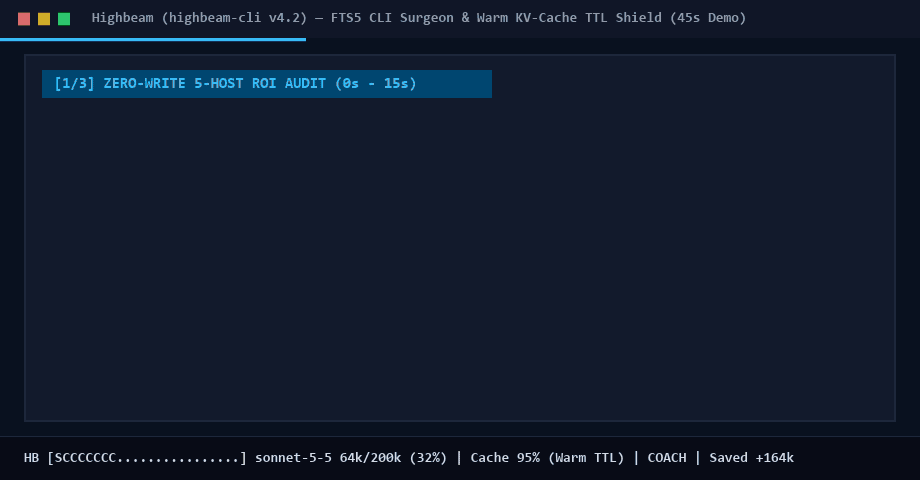
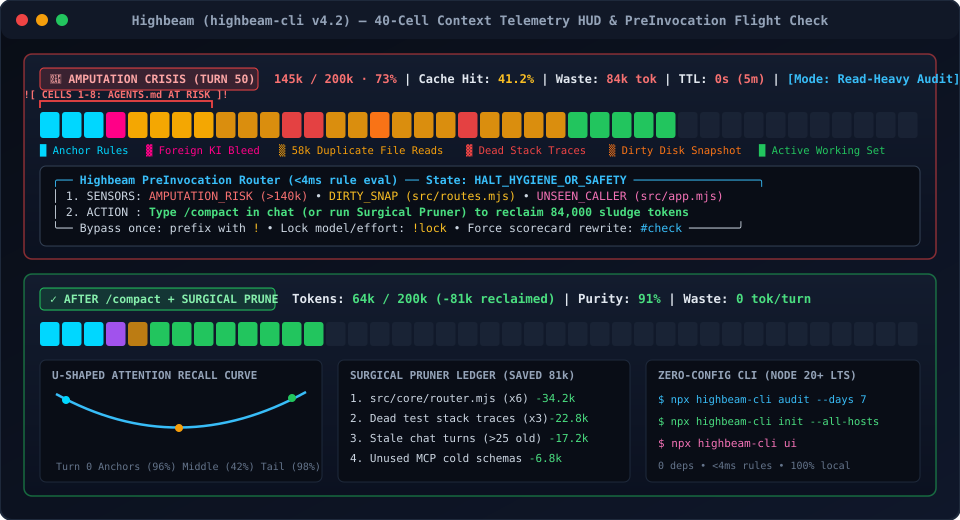
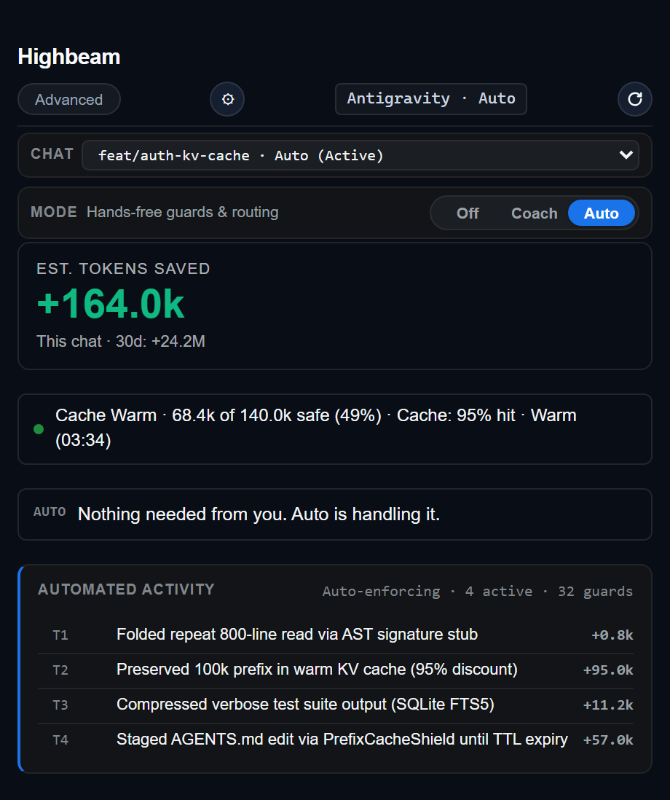

<div align="center">

# Highbeam (`highbeam-cli` v4.2) — Stop Wasting Context & Breaking Prompt Caches in Claude Code and Google Antigravity

**A zero-dependency, 100% local CLI, HUD, and IDE sidebar that watches your agent's context window, trims noisy tool logs before they compound, and calculates whether switching models or effort will bust a warm prompt cache** *(each hook runs as a short spawned Node process: `~60–80ms` Linux, `~200–275ms` Windows; in-process rule engine `<1ms` — see [Verification & Benchmarks](#verification--benchmarks))*

[](https://github.com/Gizzant/context-horizon/actions/workflows/ci.yml)
[](#systems-architecture--zero-trust-security)
[](#deterministic-preinvocation-router--6-local-sensors)
[-339933.svg)](#try-in-10-seconds-zero-hooks--zero-writes)
[](LICENSE)
[](#-installation--quick-start)

[**Live Interactive Demo**](https://gizzant.github.io/context-horizon/demo/) • [**User Guide**](https://gizzant.github.io/context-horizon/) • [**10-Second 5-Host Audit**](#try-in-10-seconds-zero-hooks--zero-writes) • [**Quick Start**](#-installation--quick-start) • [**Cookbook**](docs/COOKBOOK.md) • [**Benchmarks**](docs/ANTIGRAVITY_AND_COMPRESSION_BENCHMARK.md) • [**Enterprise MDM**](docs/ENTERPRISE_MDM.md)

<br/>



<details>
<summary><strong>View Static 40-Cell Architecture &amp; PreInvocation Scorecard Diagram (SVG)</strong></summary>
<br/>

</details>

</div>

---

## ⚡ Try in 10 Seconds (Zero Hooks / Zero Writes)

Before installing any hooks or modifying config files, scan your last 7 days of local **Google Antigravity**, **Claude Code**, **OpenAI Codex CLI**, **Gemini CLI**, and **Cursor** sessions strictly read-only to measure preventable token waste, cold-cache spikes, and oversized tool dumps:

```bash
npx highbeam-cli audit --days 7
```

```text
[Highbeam Session ROI Audit] Window: 7d | Platform: all | Sessions: 12
  Sludge Tax Preventable : 1,420,850 tok
  Cold-Cache Spikes (>5m): 14 | 3x Thrash Loops: 4
  Un-Sliced Large Reads  : 11 | Oversized Tool Dumps: 38
```

> **Why cache physics beats raw log trimming alone:** In our [45-run / 540-turn settled Anthropic wire benchmark](docs/EMPIRICAL_BENCHMARKS.md) (`540/540` wire parity), downgrading `Opus 4.6 -> Sonnet 4.6` mid-chat on a warm `~58k` prefix collapsed Turn-6 cache hits to `0.0%` and made the session **more expensive** (`$0.8611` vs. `$0.7789` staying on Opus). Highbeam computes break-even horizon math (`C_max`) live so you know when to **Hold** vs. **Switch**.

---

## 🚀 Installation & Quick Start

> Global install `npm i -g highbeam-cli` exposes `highbeam` directly (`ctxtop` remains supported as a backward-compatible alias).

| **Google Antigravity** *(1-Line Install)* | **Claude Code** *(1-Line Install)* | **Cursor / Windsurf / Codex / Gemini CLI** |
| :--- | :--- | :--- |
| `npx highbeam-cli init --antigravity` | `npx highbeam-cli init --claude --global` | `npx highbeam-cli init --cursor --windsurf --codex --gemini-cli` |
| *Workspace-only*: `npx highbeam-cli init --workspace`<br/>*Health check*: `npx highbeam-cli doctor` | *StatusLine HUD*: `npx highbeam-cli statusline --demo`<br/>*In-chat pane*: `/horizon` · `/cost-radar` · `/handoff` | *Universal `.mcp.json`*: `npx highbeam-cli init --all-hosts`<br/>*FTS5 search*: `npx highbeam-cli search "<keyword>"` |

### Your First 5 Minutes After Installing

#### 1. Google Antigravity Workflow
1. **Install hooks & sidecar**: Run `npx highbeam-cli init --antigravity` in your project root (or globally).
2. **Open the Highbeam Sidepane**: Launch the local telemetry WebView (`npx highbeam-cli ui` or via the Antigravity sidepane) to view real-time context health:
   - **Simple View (Default)**: 4 glanceable zones—**Zone A** (Safe Headroom & Warm KV Cache TTL), **Zone B** (`DO / AVOID / HOLD` Model & Effort switch guidance), **Zone C** (Live automated interventions), and **Zone D** (Estimated tokens saved + 1-click `/compact`).
   - **Advanced View (1-Click Toggle)**: Expands the **40-Cell Chrono-Positional Recall Grid** (`Primacy 0–30%`, `Mid-Trough 30–70%`, `Recency 70–100%`), top token consumer file table, `Off / Coach / Auto` mode switcher, and the full `DET-01..32` guard log.
3. **Code normally**: Highbeam runs in **`COACH` mode** by default—automatically compressing verbose CLI test dumps via SQLite FTS5 and folding repeat file reads without interrupting your prompts.

#### 2. Claude Code Workflow
1. **Install plugin & hooks**: Run `npx highbeam-cli init --claude` (current project) or `npx highbeam-cli init --claude --global` (all projects) to wire `.claude-plugin/plugin.json`, `hooks/hooks.json`, and the live terminal `statusLine`.
2. **Watch the Live Terminal `statusLine`**: At the bottom of your terminal, Highbeam renders an auto-adapting (`80 / 110 / 144` col) telemetry bar:
   ```text
   HB [SCCCCCCC................] sonnet-5-5 64k/200k (32%) · Cache 88% (4m12s) · COACH · Saved +164k
   ```
3. **Open the In-Chat Docked HUD**: Type `/horizon` in chat (or run `npx highbeam-cli panel` for the standalone HTML workbench) to inspect cache gravity, active guards, and reclaimable tokens.

#### 3. VS Code / Cursor / Antigravity (`.vsix` Extension)
Package or install the thin zero-dependency IDE sidebar & status bar extension from [`extensions/vscode-highbeam/`](extensions/vscode-highbeam/README.md):
```bash
npm run build:vsix
code --install-extension extensions/vscode-highbeam/highbeam-4.3.0.vsix
```

---

## 🧭 Built-In Slash Skills & In-Chat Commands (Both Hosts)

All 6 slash skills are registered identically in both **Google Antigravity** (`plugin.json`) and **Claude Code** (`.claude-plugin/plugin.json`):

| Slash Command / Skill | When to Use It | What It Outputs |
| :--- | :--- | :--- |
| **`/horizon`** | Anytime during a coding session | Renders the live 40-cell Context Health HUD, KV-Cache TTL countdown, active `DO / AVOID / HOLD` guidance, and reclaimable clutter breakdown. |
| **`/precheck`** | Before sending a complex refactor prompt or switching models | Audits prompt specificity (6-dimension rubric), checks horizon-aware KV-cache break-even (`C_max` & warm-request payback), and recommends the optimal Model & Effort tier. |
| **`/handoff`** | Before running `/compact` or `/clear` at `>=75%` context fill | Distills active plan checkboxes, modified files, and unresolved `stderr` into a compressed `<1,000`-token checkpoint (`task.md` / `.handoff.md`). |
| **`/cost-radar`** | When reviewing session token burn or cache busts | Generates an interactive HTML/SVG timeline of prefix-cache retention, `DET-30` thinking drift loops, and subagent worktree topology. |
| **`/inspect`** | When diagnosing slow tools or subagent fan-out | Visualizes session trajectory call-tree spans, per-tool latencies, and token attribution as a standalone artifact. |
| **`/evolve`** | After correcting agent mistakes across a session | Audits `AGENTS.md` / `CLAUDE.md` Turn-0 prefix budget (`<=20k` tok) and synthesizes validated session instincts via 1-click diff approval. |

**Quick In-Chat Prompt Prefixes:**
- `! <prompt>` — Bypass `PreInvocation` checks for a single turn.
- `!lock <prompt>` — Freeze current reasoning effort tier and prefix state for the remainder of the session.
- `#check <prompt>` — Force an explicit pre-flight scorecard and concrete prompt rewrite suggestion.

---

## 🛡️ Example 4-Step Session Receipt: `+12.0k` Tokens Stripped + `+152.0k` Warm Cache Protected

Most CLI trackers passively count tokens *after* your quota is already burned. Highbeam intercepts redundant reads, compresses noisy test dumps via local SQLite FTS5, and shields warm KV prefixes **before** they burn your context window and rate-limit quota:

<div align="center">
  
</div>

| Step in Coding Loop | Developer / Agent Action | Highbeam Active Intervention (Zone C) | Impact & Unit |
| :--- | :--- | :--- | :---: |
| **1. Warm KV Cache + Repeat Read** | Agent re-reads an unmodified 800-line source file on a `100k` warm cache | **GUARD-4** intercepts the duplicate read (`AST signature stub`) and preserves the `95%` warm KV cache discount | **`+95.0k` tok** *(cache hit kept)*<br/>**`+800` tok** *(stripped from context)* |
| **2. Failing Test Suite Dump** | `npm test` dumps `120+` lines of verbose stdout (`~11.4k` tokens) | **SQLite FTS5 BM25 Compressor** indexes raw stdout locally and injects only the 160-token failing assertion digest | **`+11.2k` tok** *(stripped from context)* |
| **3. Mid-Session Rule Edit** | Agent updates `AGENTS.md` / `CLAUDE.md` while `60k` prefix is warm (`2m 55s` TTL left) | **PrefixCacheShield** queues the rule delta until TTL expiry or `/compact`, preventing a cold prefix rebuild | **`+57.0k` tok** *(rebuild avoided)* |
| **Tokens Stripped From Context** | **Fresh uncached input removed (`100%` weight)** | **AST stub (`+0.8k`) + FTS5 digest (`+11.2k`)** | **`+12.0k` tok removed** |
| **Warm Cache & Rebuilds Protected** | **Discounted cache reads & cold rebuilds avoided** | **Warm KV hit (`+95.0k`) + PrefixCacheShield (`+57.0k`)** | **`+152.0k` tok protected** |

> Highbeam tracks physical tokens removed (`physicalTokensAvoided`) separately from cache-read/rebuild-avoided tokens (`billingEquivalentCacheTokens`) in its local ledger (`+164.0k` combined HUD counter; cached reads bill at `5%–10%` of fresh input rates).

> **Reconciled Weekly Expectation:** Across normal coding weeks without deliberate cache-busting, our bottom-up benchmark model estimates **`~2.5M–6M` redundant tokens stripped per week** (`~6%–11%` lower raw API input volume for metered org teams), translating into **`30%–50%` longer 5-hour subscription sprints** by cutting `O(N²)` tool-log compounding and cold prefix rebuilds.

---

## 💡 Why Saved Tokens Multiply (`O(N²)` Turn Compounding, Quota Life & Model IQ)

In agentic coding, every turn re-sends the entire prior conversation history. A single `15,000`-token raw test dump on Turn 5 is not billed once—it is re-sent on Turns 6 through 25, burning **`300,000` cumulative tokens** (`15,000 × 20`).

1. **For Fixed-Subscription Users (`Claude Pro / Max`, `Antigravity OAuth Seats`) — Stop 2:00 PM Quota Lockouts & Context Rot**:
   - Compressing noisy tool outputs and duplicate file reads on early turns prevents `O(N²)` history compounding, **stretching 5-hour sprint quotas by `30%–50%`**.
   - Staying below the **70% Safe Horizon** prevents **Context Rot** (middle-window attention decay where the model starts overlooking `AGENTS.md`/`CLAUDE.md` rules or hallucinating imports).
2. **For Metered API & Enterprise FinOps Teams (`Bedrock / Vertex / Anthropic API`)**:
   - Preventing accidental warm-cache busts plus automatic FTS5 log compression reduces raw API input volume by **`~6%–11%`** across multi-seat engineering orgs and adds per-PR token & budget guardrails (`pr-cost`, `team-rollup`, `ci-gate`, `receipt --pdf`).
3. **Daily Cockpit Decisions No Human Can Calculate in Their Head (Zone B)**:
   - *"If I downshift from Opus to Sonnet right now, will I save quota or pay a 10x cold-prefill penalty?"* — Highbeam computes the horizon-aware KV-cache break-even limit (`C_max`) and post-switch warm-request payback in real time and displays a 1-line verdict: **`Model: Hold (03:34) — switching busts warm cache`**.

---

## ⚙️ What Runs Automatically (100% Free `COACH` Default)

Highbeam defaults to **`COACH` mode**—trimming tokens silently in the background while never blocking your chat prompt unless a 3-strike identical failure loop or destructive git command occurs:

| Automated Feature | How It Works Under the Hood | Developer Experience |
| :--- | :--- | :--- |
| **1. SQLite FTS5 CLI & Test Output Compression** (`PostToolUse`) | Strips ANSI/progress noise, indexes full stdout in local SQLite FTS5 (`porter unicode61`), and injects only the compact failing assertion digest | **Automatic** — typically saves `50%–90%` of test/build log tokens while keeping failing assertions and error lines (full output stays searchable locally) |
| **2. Post-Edit Delta Diffs & 3rd-Read AST Stubs** (`GUARD-4` in `PreToolUse`) | When the agent re-reads a file after editing 5 lines (or reads the same unclipped file `>=3` times), returns a unified line diff or function-signature AST stub | **100% automatic** — cuts repeat-read token burn by `80%+` without interrupting the agent |
| **3. `PrefixCacheShield` Warm Rule & Effort Deferral** (`DET-09`) | Intercepts mid-session edits to `AGENTS.md` / `CLAUDE.md` while a KV cache is warm, and checks `MODEL_EFFORT_CACHE_CAPABILITIES` on effort changes (defers on `4.6`, silent on cache-preserving `5.5` models, warns on untested models) | **Model-aware cache protection** — prevents silent cold prefix rebuilds without false-positiving on `5.5` effort |
| **4. Live Model & Effort Switch Verdict** (`Zone B`) | Evaluates remaining KV cache TTL (`5m`/`1h`) and horizon break-even (`C_max` & warm-request payback) across `MODEL / HOLD / SWITCH / LOCK` states | **Instant visual guidance** — tells you when to hold vs. switch models or lower thinking effort |
| **5. Held Downshift & Boundary Lifecycle** (`SessionStart:compact` / `Stop`) | Surfaces held `pending_downshift` after compaction via a zero-token `SessionStart:compact` `systemMessage` reminder (`/model <target>`), with optional boundary prompts disabled by default | **Post-compact downshift handoff** — reminds `/model <target>` cleanly right after compaction |
| **6. Git Hook-Bypass & Destructive Shell Guard** (`DET-18` / `DET-19`) | Blocks `git commit --no-verify`, `-n`, `core.hooksPath` tampering, and unconfirmed `git reset --hard` | **Zero-config repo safety** — keeps frustrated agents from bypassing your pre-commit linters |
| **7. `PreModelSwitch` Warm KV-Cache Guard** (`DET-08`) | Computes break-even (`C*`, `C_max`), cold-write penalties, and warm-request paybacks directly from `anthropicModelCatalog.json` using rolling session turns (`R`, `g`), returning explicit `unknownModel: true` without fallback price guesses | **Protects mid-session switches** — prevents wasting quota and warm cache on short-horizon downgrades while allowing clean early switches |

---

## 📊 Empirical Wire Highlights (Claude Code `2.1.325`)

Highbeam's cache-economics engine is backed by **45 pre-registered randomized runs (`540` live wire-reconciled turns)** and **6 live 30-turn compaction studies** against first-party Anthropic via OpenRouter:

- **Downgrading Mid-Chat Can Cost More Than Staying on Opus:** At `~58k` context, switching `Opus 4.6 -> Sonnet 4.6` at Turn 6 produced a `0.0%` cache hit (`+$0.1783` spike) and increased 12-turn session cost (`$0.8611` vs `$0.7789` Opus control).
- **Changing `--effort` Busted `4.6` Caches (`+$0.0853`), Fixed in `5.5`:** Wire diffs caught `output_config.effort` invalidating `4.6` prompt caches while `claude-sonnet-5-5` preserved warm cache hits (`n = 3`).
- **Stock `/compact` Scored `0/6` Violations Up to `28.10x` Compression:** Because default compaction preserved constraints cleanly without custom templates, Highbeam emits zero `PreCompact` bloat.
- **MCP / Tool-List Swaps on `--resume` Wipe Cache; `CLAUDE.md` Edits Do Not:** Highbeam hashes `.mcp.json` / `.claude/settings*.json` across resumes and warns before uncached rebuilds.
- AUTO_PILOT blocks a model switch only after the session has enough observed turns. Before that it warns, because blocks based on default estimates were wrong on 39 of 42 benchmark switches.

👉 See full methodology, per-arm datasets, SDK `stream-json` `set_model` patterns, and explicit unverified boundaries in [**`docs/EMPIRICAL_BENCHMARKS.md`**](docs/EMPIRICAL_BENCHMARKS.md).

---

## 💵 FinOps: Expense Receipt

For systems engineers, re-sending a 40,000-token test log 15 times is the AI equivalent of a memory leak—it wastes datacenter GPU prefill cycles, increases time-to-first-token (TTFT) latency, and degrades reasoning quality.

For **Engineering Managers and FinOps teams**, Highbeam's local expense receipt (`npx highbeam-cli receipt --pdf`) reports **estimated USD saved** from your own local ledger, with a SHA-256 digest of the report so it can be checked later. It is computed on your machine and sends nothing to the cloud. Figures are estimates based on published list prices and the token counts Highbeam records; they are not an invoice or a guarantee of savings.

---

## Why Highbeam (`highbeam-cli`) Exists (vs. Cloud LLM Observability)

Cloud trace platforms (Langfuse, Helicone, Arize) require proxying API keys over the network and only observe HTTP request/response payloads. They have **zero visibility into the local filesystem, git working tree, IDE process table, or local SQLite/JSONL session stores**.

Highbeam (`highbeam-cli`) is a zero-dependency local systems profiler built on Node.js built-ins (`node:sqlite`, `node:fs`, `node:http`). It correlates local session transcripts and SQLite databases with live disk state to catch concrete failure modes that cloud proxies cannot see:

| Failure Mode | Root Cause in Agentic Sessions | How Highbeam Detects & Remediates It Locally |
| :--- | :--- | :--- |
| **12.5x–80x Prompt Cache Tax & Overage TTL Cliffs** | Falling from a 1-hour prompt cache tier to a 5-minute overage/fallback tier, or mutating system/MCP blocks mid-session while holding `>50k` warm tokens, triggers an uncached prefix rebuild. | Tracks Dual-TTL windows (`1h` vs `5m` main + `5m` subagent), pinpoints the exact turn/component/byte offset of prefix mutations (`computePrefixMutationDiff`), and enforces a Cold-Session Cost Gate. |
| **Compaction Lobotomy & Post-Compact Re-Read Tax** | Autocompact at 80%–95% context wipes file line numbers, active `task.md` checklists, and unresolved `stderr`, forcing the agent to re-read the same unmodified files immediately after compaction. | Deterministically distills `.handoff.md` before compaction (`>=80%` saturation), tracks post-compaction re-reads of unmodified files, and synthesizes `<1,000`-token `[▶ RESUME HERE]` packs via SQLite FTS5 BM25 episodic memory. |
| **30GB–100GB Local IDE Storage Bloat (`state.vscdb`)** | Orphaned Cursor `bubbleId:*`, `checkpointId:*`, `messageRequestContext:*`, and unreferenced `agentKv:blob:*` rows accumulate in SQLite `cursorDiskKV` until disk space or `VACUUM` locks fail. | Audits and reclaims orphaned rows via streaming read-only SQLite export (`--gc-cursor` / `--storage-gc`) without requiring a 2x-disk-space in-place `VACUUM` lock, and recovers orphaned Antigravity `brain/` artifacts (`--recover-brain`). |
| **Stale File Overwrites (`DIRTY_SNAP`)** | Developer edits or runs `git pull` on a file the agent read 10 turns ago; the agent overwrites disk changes with its stale in-context snapshot. | Compares `fs.statSync(path).mtimeMs` on disk against the last `read_file` / `view_file` step timestamp in the JSONL transcript (`+1000ms` tolerance) and injects a pre-turn re-read guard. |
| **Unseen Call-Site Breakage (`UNSEEN_CALLERS`)** | Agent modifies an exported function signature without reading downstream callers in the repo. | Runs a bounded `<8ms` regex import scan (`import ... from`, `require()`, Python `from ... import`) across workspace files (up to 250 files) and flags callers absent from the active working set. |
| **Superseded Full-File Reads & Tool Sludge (`--prune-tools`)** | Agent reads the same 800-line file 6 times, runs unreferenced exploratory `grep` searches, or retains resolved test `stderr` traces, diluting middle-window recall. | Pairs `tool_use` and `tool_result` across Antigravity, Claude Code, and Cursor while pinning Turn 0 and the newest 6 turns; truncates stale tool outputs offline with an atomic `.pre_surgeon` backup. |
| **Turn-0 MCP Schema Bloat (`SCHEMA_TAX`)** | Eagerly loaded MCP servers inject 15k–40k tokens of JSON tool schemas on Turn 0 even when never invoked. | Computes per-server Token ROI (`calls / schemaTokens`, `IDLE_BLOAT_TAX`) and dynamic `deferred_tools_delta` expansion, flagging 0-call eager servers to switch to `"loading": "lazy"`. |

---

## Multi-Harness v4.0 Wedge Capabilities

1. **Cross-Harness SQLite & Protobuf Trajectory Stitcher (`src/core/trajectory_stitcher.mjs`)**:
   - **Google Antigravity (`[App]`, `[IDE]`, `[CLI]`)**: Zero-dependency protobuf wire-walker (`decodeProtobufWire`) inspects `conversations/<uuid>.db` (`steps` table binary `step_payload` and `metadata` blobs) in strict read-only mode to extract `file:///` workspace URIs and stitch with `transcript_full.jsonl` and `annotations/<uuid>.pbtxt`.
   - **Claude Code**: Reconstructs the `uuid -> parentUuid` DAG up to the active `leafUuid`, isolating `/rewind` branches, `file-history-snapshot` restore points, and Turn-1 `cache_creation_input_tokens`.
   - **Cursor**: Correlates `composerData:<id>`, `bubbleId:<id>:<bubble>`, `messageRequestContext`, and `agentKv:blob:*` (`requestId`) with `store.db` and timestamp-less `agent-transcripts/*.jsonl`.
2. **Subagent Worktree & File Collision Detector (`src/core/subagents.mjs`)**:
   - Builds a parent-to-child subagent DAG, tracks independent 5-minute child cache TTLs, and flags `SUBAGENT_FILE_COLLISION` when `>= 2` concurrent subagent branches edit the same canonical file path.
3. **SQLite FTS5 Episodic Memory & Git Commit Token Ledger (`src/core/episodic_memory.mjs`, `src/core/git_ledger.mjs`)**:
   - Indexes historical session decisions, modified files, and resolved bug signatures into a local SQLite FTS5 (`porter unicode61`) store (`~/.ctxtop/episodic_memory.sqlite`) for `<1,000`-token BM25 retrieval.
   - Correlates `.git/logs/HEAD` commit timestamps against session windows to attribute input/output tokens, cache hit %, and USD cost per git commit.
4. **Zero-PII Sanitizer & Forensic Snapshot Exporter (`src/core/sanitizer.mjs`)**:
   - Scrubs API keys (`sk-ant-*`, `sk-proj-*`, `AIza*`), GitHub PATs (`ghp_*`, `github_pat_*`), AWS keys, Bearer tokens, `.env` values, and OS home paths (`<USER_HOME>`) before exporting shareable forensic JSON snapshots.

---

## Quick Start

### 1. Inspect Live Sessions, Prune Tool Sludge, or Run Storage GC
```bash
# Audit the last 5 local sessions for duplicate file reads, dead errors & MCP schema tax
node src/cli/postmortem.mjs --last 5

# Run environment & transcript health diagnostics (hooks, SQLite/JSONL confidence, 3-way mirror SHA-256)
node src/cli/doctor.mjs

# Run offline Prefix-Safe Tool-Output Surgeon on the active session transcript (with atomic backup)
node src/cli/doctor.mjs --prune-tools --dry-run

# Recover orphaned Antigravity brain/ directories or compact Cursor state.vscdb without VACUUM locks
node src/cli/doctor.mjs --recover-brain --gc-cursor --vscdb path/to/state.vscdb --dry-run

# Print the 40-cell ANSI status bar for the active session
node src/cli/horizon_hud.mjs --live
```

### 2. Launch the Local Telemetry WebView (`127.0.0.1`)
```bash
# Start the loopback sidecar daemon and open the Tufte WebView
node sidecars/horizon-daemon/server.mjs
```

### 3. Install Lifecycle Hooks & CLI `statusLine`
```bash
# Global install (~/.gemini/config/plugins/agy-horizon-flightcheck)
node src/cli/init.mjs init

# Workspace-local install (.agents/plugins/agy-horizon-flightcheck)
node src/cli/init.mjs init --workspace
```

> [!TIP]
> Looking for copy-paste recipes for Cursor 50GB storage reclamation, offline tool pruning, Antigravity brain recovery, or programmatic Node.js API snippets? See the [**`highbeam-cli` Cookbook & Recipes**](docs/COOKBOOK.md).

---

## Systems Architecture & Zero-Trust Security

Highbeam is engineered for strict operational safety alongside live IDE/CLI database writers:

1. **Zero Outbound Network Connections**:
   - **0 runtime `npm` dependencies** (`package.json` has no `dependencies` block).
   - **No telemetry beacons or remote API calls by design.** Parsing, classification, and routing run locally on your machine.
   - The local WebView daemon (`sidecars/horizon-daemon/server.mjs`) binds strictly to `127.0.0.1` (loopback only) and rejects cross-origin `Origin` or non-local `Host` headers (`HTTP 403`) to prevent DNS rebinding and drive-by localhost CSRF.
2. **Read-Only Database & Transcript Introspection (`SQLITE_OPEN_READONLY`)**:
   - Every connection to Antigravity or Cursor SQLite databases (`conversations/<uuid>.db`, `conversation_summaries.db`, `state.vscdb`, `store.db`) is opened via Node's native `node:sqlite` `DatabaseSync` with `Object.freeze({ readOnly: true })` (`SQLITE_OPEN_READONLY`). Highbeam can never contend for write locks with an active IDE or CLI.
   - Live JSONL transcripts (`transcript_full.jsonl` / `transcript.jsonl`) are read via `fs.openSync(filePath, 'r')` using byte-offset slicing (`O(Δbytes)` per turn), falling back to full re-parse only when a step-index regression (Undo/Rewind) is detected.
3. **Ring 1 Security, Concurrency & Context Hygiene Boundaries**:
   - **`DET-19` Git Hook-Bypass Guard**: Intercepts `git` execution via `.agents/shims/` wrappers, strips `.agents/shims` from `PATH` to eliminate recursion, blocks verification evasion (`--no-verify`, standalone `-n`, `-amn`, `--no-gpg-sign`, `core.hooksPath`), and allows bypass strictly via a 60-second single-use cryptographic human nonce.
   - **Zero-Token Subagent IPI Sanitizer**: Deterministically strips Unicode Tag characters, zero-width spaces, bidi overrides, HTML comments, and delimiter breakouts in `<1ms`, framing external research digests safely at prompt tails under `<untrusted_subagent_data>`.
   - **Pre-Threshold ANSI Normalization (`DET-14b`)**: Strips ANSI escape sequences and collapses carriage returns (`\r`) before the 4,096-char threshold and SQLite FTS5 archival, featuring specialized noise profiles for `cargo test` and `npm install` with Critical Error-Line Recovery.
   - **Concurrent Scope Lockfile (`DET-20`)**: Manages `.agents/locks/active_scopes.json` with atomic writes, auto-evicting dead PIDs and expired leases (>300s), while alerting on multi-agent file collisions with 1-click `git worktree add` commands.
4. **Locked v4.0 Edward Tufte UI Laws**:
   - **Law 1 (Raw Physical Units Only)**: Displays `Tokens + %`, `Cache Hit %`, `Waste Tokens`, and `1h/5m TTL Countdown` side-by-side—never arbitrary `0–100` gamified scores.
   - **Law 2 (40-Cell Hero + Top 3–5 Riskiest Cells)**: Surfaces the top 3–5 highest-risk context cells directly below the 40-cell flamegraph with exact file paths, attention recall %, and 1-click `[Re-Anchor / Prune]` actions.
   - **Law 3 (Zero-Click Passive Workload Tag)**: Passively classifies sessions into `[Mode: Read-Heavy Audit]`, `[Mode: Multi-File Refactor]`, or `[Mode: Subagent Swarm]` from tool-call ratios.
   - **Law 4 (Silent-When-Nominal Watchdog)**: Host RAM and orphan process counters remain completely hidden unless an anomaly (`orphanCount > 0` or `ZOMBIE_LEAK`) occurs.

---

## 🔧 Configuration, Flight Modes & MCP Server (`@ctxtop/mcp`)

### 1. Customizing `.attention-horizon.json` (Flight Modes & Detector Overrides)
Highbeam works with zero configuration out of the box (`COACH` mode). To customize behavior per-repository or globally (`~/.attention-horizon.json`), use the CLI or create `.attention-horizon.json` in your workspace root:

```bash
# Set a detector to warn-only, block, or off via CLI
npx highbeam-cli config DET-08 warn
npx highbeam-cli config DET-19 block
```

```json
{
  "flightMode": "COACH",
  "turnZeroTokenBudget": 20000,
  "detectors": {
    "DET-06": "block",
    "DET-07": "block",
    "DET-08": "warn",
    "DET-09": "block",
    "DET-19": "block",
    "DET-20": "warn"
  }
}
```
- **`"COACH"` *(Default)***: Compresses CLI output (`DET-07`), folds repeat file reads (`GUARD-4`), and stages warm rule edits (`DET-09`) automatically while advising on model/cache switches without blocking normal flow.
- **`"AUTO_PILOT"`**: Enforces strict pre-turn & stop-gate verification locks (e.g., requiring tests to run after source edits before session completion).
- **`"SILENT"` / `"OFF"`**: Passive telemetry collection only.

### 2. Using Highbeam as an MCP Server (`npx highbeam-cli mcp`)
Any MCP-compatible client (**Google Antigravity**, **Claude Code**, **OpenAI Codex CLI**, **Gemini CLI**, **Cursor**, **Windsurf**, or **Claude Desktop**) can auto-configure Highbeam via `npx highbeam-cli init --cursor --windsurf --codex --gemini-cli` or run standard JSON-RPC stdio directly:

```json
{
  "mcpServers": {
    "highbeam": {
      "command": "npx",
      "args": ["-y", "highbeam-cli", "mcp"]
    }
  }
}
```
Exposes **7 standalone zero-network MCP tools** (`<5ms` response): `horizon_status`, `cache_gravity_check`, `scope_lock_claim`, `export_receipt_pdf`, `horizon_compress_cli`, `horizon_search_logs`, and `horizon_audit_sessions`.

For centralized organization deployment (Jamf / Intune / GPO), `CHECKSUMS.sha256` verification, and BYO-Grafana OpenTelemetry telemetry, see [**Enterprise & MDM Deployment Guide**](docs/ENTERPRISE_MDM.md).

---

## 📦 Editions: Free (`MIT` Core + `COACH`) vs. Pro & Team

| Feature / Capability | Free Core (`MIT`, `$0`) | [Highbeam Pro](https://buy.polar.sh/polar_cl_GYIDWrPsxnwsx58Ur6fIqMq3o1lrfK0o4hOFM4HOgpr) (`$149/yr` · `$199` Cap-200 LTD) | [Team Starter](https://buy.polar.sh/polar_cl_BDTd1Gru7L7BCE3jXBsqNpYmrATNtpgTfzAkQ2Emmt5) (`$299/yr` 5-Seat Intro · `$39/seat/mo` >5) |
| :--- | :---: | :---: | :---: |
| Simple & Advanced 40-Cell HUD + `5m/1h` Live TTL Timer | ✅ | ✅ | ✅ |
| Multi-Family FTS5 Compression (`test`, `lint`, `git`, `docker`/`kubectl`) & `highbeam search` | ✅ | ✅ | ✅ |
| Automated Repeat-Read Delta Diffs & AST Stubs (`GUARD-4`) | ✅ | ✅ | ✅ |
| `COACH` Non-Blocking Advisories & 32 Auditable Guards across 5 Hosts | ✅ | ✅ | ✅ |
| `AUTO_PILOT` Hands-Free Enforcement & Horizon `C_max` Holds | Preview | ✅ | ✅ |
| 30-Day Chronic Offender Memory & Workspace Savings Ledger | — | ✅ | ✅ |
| Signed Corporate PDF 1.4 FinOps + GreenOps Receipt (`highbeam receipt --pdf`) | — | ✅ | ✅ |
| Cross-Machine Zero-Knowledge Encrypted Sync (`highbeam sync`) | — | ✅ | ✅ |
| Git Branch & PR Token/USD Cost Attribution (`highbeam pr-cost`) | — | ✅ | ✅ |
| Shared `.agents/rules/` Governance, MDM Policy & OTel / Grafana Pack | — | — | ✅ |
| Zero-Knowledge Org FinOps Rollup & PII Firewall (`highbeam team-rollup`) | — | — | ✅ |
| CI / PR Token-Budget Gate for GitHub Actions & GitLab CI (`highbeam ci-gate`) | — | — | ✅ |

**How Free, the trial and Pro differ:** Free shows what `AUTO_PILOT` would have done and what it would have saved, but changes nothing. The 14-day trial (`npx highbeam-cli license trial`) unlocks everything; Auto stays off until you turn it on with `npx highbeam-cli mode auto`. When the trial ends, Auto pauses and Highbeam goes back to showing what it would have saved until you activate Pro. `npx highbeam-cli mode` shows which mode is running.

**Commercial SKU Summary (Offline Ed25519 `CTXP1` Activation via `npx highbeam-cli license activate <key>`):**
- **Free Core (`MIT`, `$0` forever)**: `COACH` non-blocking mode, 5-host read-only `audit`, FTS5 compression + `search`, `GUARD-4`, Simple/Advanced HUD, and 7-tool `@ctxtop/mcp`.
- **[Pro Annual (`$149/yr`, `~$12.42/mo`)](https://buy.polar.sh/polar_cl_GYIDWrPsxnwsx58Ur6fIqMq3o1lrfK0o4hOFM4HOgpr)**: 1 developer seat, 14-day zero-network local trial (`npx highbeam-cli license trial`), `AUTO_PILOT` holds, encrypted sync (`highbeam sync`), PR cost attribution (`highbeam pr-cost`), and expensable PDF receipts (`npx highbeam-cli receipt --pdf`). *(Offline verifier also accepts legacy `$15/mo` monthly keys.)*
- **[Pro Founder Lifetime (`$199` one-time, capped at `200` seats)](https://buy.polar.sh/polar_cl_qVD4MYra8gIe9uDvkRtJUzv6Ou4PTES4Jp3nj1nAOff)**: Lifetime solo Pro entitlement (`expiresAt: null`).
- **[Team Starter (`$299/yr` for 5 seats — `$59.80/seat/yr` intro pack)](https://buy.polar.sh/polar_cl_BDTd1Gru7L7BCE3jXBsqNpYmrATNtpgTfzAkQ2Emmt5)**: Multi-seat MDM rollout, shared `.agents/rules/` primacy governance, zero-knowledge org rollups (`highbeam team-rollup`), CI token-budget gates (`highbeam ci-gate`), and BYO-Grafana OpenTelemetry pack (`npx highbeam-cli team-pack`).
- **Team / Enterprise FinOps (`$39/seat/mo` for `>5` seats & volume invoicing)**: Contact `sales@highbeamdev.com`.

---

## Deterministic `PreInvocation` Router & 6 Local Sensors

When registered in `hooks.json`, `src/hooks/pre_invocation.mjs` evaluates incoming prompts across 8 deterministic router states (**each hook call is a spawned Node process: `~60–80ms` median on Linux, `~200–275ms` measured on Windows (Claude Code 2.1.325, Node 25)**, wall time including Node process startup. The rule engine itself takes under 1ms of that (cold fallback with no warm daemon: roughly `100–450ms`, machine dependent)):

1. `ALLOW_SILENT`: Immediate pass-through (`{}`) on `!` bypass prefix or healthy turns.
2. `ALLOW_ACTIVE_SET`: Silent pass-through when referenced files are already warm in the last 5 turns.
3. `ALLOW_PLAN_OR_SUBAGENT`: Silent pass-through during `/plan` mode or subagent delegation.
4. `INJECT_CONTEXT_GUARD`: Appends a `systemMessage` warning when target files were modified externally on disk (`DIRTY_SNAP`), have unseen callers (`UNSEEN_CALLERS`), or touch deprecated paths (`LEGACY_POISON`).
5. `STEER_SUBAGENT`: Advises `invoke_subagent` when a broad exploratory prompt would pollute a warm `>30k`-token parent context window.
6. `HALT_HYGIENE_OR_SAFETY`: Halts execution (or warns in `advisory` mode) on context ceiling breach, 3-strike identical command error loops, or severe duplicate-read dilution.
7. `HALT_EFFORT_OR_QUOTA`: Warns when 5-hour/7-day quota falls below the configured floor (`10%`) or when `>600`-line single-shot file rewrites risk output stream truncation.
8. `HALT_REWRITE_SCORECARD`: Triggered via `#check` or vague cold-start prompts (`Turn <= 2`), outputting a 4-line prompt rewrite scorecard.

---

## CLI Commands & Forensic Postmortem

| Command | Description |
| :--- | :--- |
| `npx highbeam-cli audit [--platform all\|antigravity\|claude\|codex\|gemini\|cursor] [--days 7] [--json]` | Zero-write, hookless 5-host audit of Sludge Tax, cold-cache spikes, and oversized tool dumps. |
| `npx highbeam-cli init [--cursor \| --windsurf \| --codex \| --gemini-cli \| --all-hosts]` | Installs Google Antigravity, Claude Code, and 1-command MCP configurations across editors & CLIs. |
| `npx highbeam-cli search [<turn-id>] "<keyword>" [--json]` | Searches local SQLite FTS5 offloaded CLI dumps and artifacts via BM25 matching. |
| `npx highbeam-cli init --claude [--global]` | Installs only the Claude Code `.claude-plugin` manifest, command hooks, and terminal `statusLine` (current project, or all projects with `--global`). |
| `npx highbeam-cli ui [--demo]` | Launches the local HTTP/SSE telemetry daemon (`127.0.0.1`) and interactive WebView (`/` Simple, `/advanced` Advanced). |
| `npx highbeam-cli mcp` | Starts the standalone zero-network 7-tool JSON-RPC stdio MCP server (`@ctxtop/mcp`). |
| `npx highbeam-cli doctor [--diagnostic]` | Validates hook registration, FTS5 offload readiness, warm-IPC path, model ceilings, 3-way SHA-256 parity, and SQLite health. |
| `npx highbeam-cli postmortem [--last N] [--json]` | Scans the last `N` local sessions, classifies root causes (`CONTEXT_ROT_DECAY`, `VERIFICATION_CHURN`, `SPEC_AMBIGUITY`, `CLEAN`), lists top duplicate-read files, and audits Turn-0 MCP schema overhead. |
| `npx highbeam-cli receipt [--markdown \| --pdf]` | Exports a SHA-256 estimated FinOps + GreenOps token/USD savings receipt for the active workspace. |
| `npx highbeam-cli mode [coach \| auto \| silent \| off] [--project]` | Shows or sets the active flight mode (`auto` requires Pro or the 14-day local trial). |
| `npx highbeam-cli sync <export \| import \| inspect> [--out \| --in <file>] [--passphrase]` | *(Pro)* Exports or merges zero-knowledge `scrypt` + `AES-256-GCM` encrypted memory and 30-day savings vaults across machines. |
| `npx highbeam-cli pr-cost [--base main] [--head HEAD] [--markdown \| --json]` | *(Pro)* Correlates branch commits with local ledgers to attribute PR tokens, cache hit %, USD spend/saved, and USD per 100 LOC. |
| `npx highbeam-cli team-rollup [--export-snapshot \| --in <dir>] [--format json \| md \| csv]` | *(Team)* Emits salted-pseudonymous snapshots behind a recursive PII/path/secret firewall and aggregates org FinOps rollups offline. |
| `npx highbeam-cli ci-gate [--base main] [--max-cost-usd N] [--mode enforce \| advisory]` | *(Team)* Enforces PR token, cost, cache-hit, and Ring-0 safety budgets in GitHub Actions or GitLab CI. |
| `npx highbeam-cli verify [--json]` | Verifies cryptographic SHA-256 integrity of all tracked release files against `CHECKSUMS.sha256`. |
| `npx highbeam-cli --roast` | Prints a terminal forensic summary of recent sessions with top duplicate-read file offenders and copy-pasteable remediations. |
| `npx highbeam-cli --demo-animate` | Plays the 5-stage terminal crisis simulation across synthetic fixtures. |

---

## Verification & Benchmarks

Run the full zero-dependency test and verification suites (**1,300+ tests** — see [**Empirical Benchmarks**](docs/EMPIRICAL_BENCHMARKS.md) & [**Compression & Antigravity Parity Report**](docs/ANTIGRAVITY_AND_COMPRESSION_BENCHMARK.md)):

```bash
# Full Coach, UI, & 360° Capability-Proof suite
npm run test:coach

# Claude Code hooks, statusLine, and 5-category ledger suite (~230 tests)
npm run test:claude

# Unit & Multi-Harness Wedge suite (~85 tests)
npm run test:unit

# Architectural verification suite (Gates 0-6 & Phases 1-7: SQLite read-only locks, JSDOM UI, MCP audit)
npm run test:gates && npm run test:phases

# Reproducible 10-family CLI compression + 12-session Antigravity & 5-host parity benchmark
npm run bench:parity

# Latency benchmark: prints p50/p95 per path (in-process rule engine: 200 iterations; spawned hook: 6 samples, wall time incl. Node startup). Re-run on your machine; numbers vary by OS and load.
node scripts/bench_hooks.mjs
```

---

## License

- **Core runtime (`MIT`):** MIT © [Gizzant](https://github.com/Gizzant) — see [LICENSE](LICENSE).
- **Commercial Pro & Team modules (`packages/pro/**`, `src/core/pro_license.mjs`):** [Commercial Source-Available License](packages/pro/LICENSE-COMMERCIAL.md).
