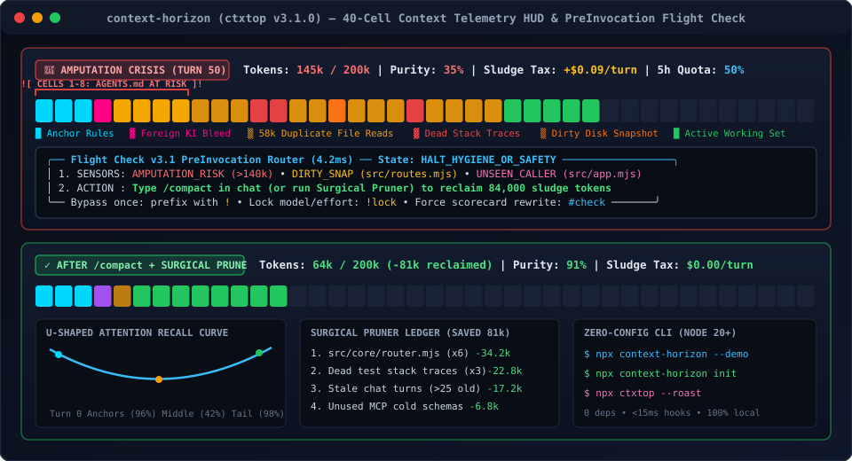

<div align="center">

# `ctxtop` — Context Horizon (v3.3.0)

**Local Context Window Profiler, KV-Cache TTL Monitor & `<15ms` PreInvocation Router for Google Antigravity, Claude Code & Cursor**

[](#systems-architecture--zero-trust-security)
[](#deterministic-preinvocation-router--6-local-sensors)
[](#quick-start)
[](LICENSE)
[](https://github.com/Gizzant/cc-attention-horizon)

[**Live Interactive Demo**](https://gizzant.github.io/context-horizon/) • [**Download Releases**](https://github.com/Gizzant/context-horizon/releases) • [**Quick Start**](#quick-start) • [**Cookbook & Recipes**](docs/COOKBOOK.md) • [**Claude Code Port**](https://github.com/Gizzant/cc-attention-horizon)

<br/>



</div>

---

## ⚡ 1-Command Installation & Download Options

### Option A: Zero-Config CLI / Plugin Install (Recommended)
```bash
# Auto-install Antigravity plugin, lifecycle hooks, and CLI statusLine
npx github:Gizzant/context-horizon init

# Or run live HUD directly without installing
npx github:Gizzant/context-horizon
```

### Option B: Direct GitHub Release Download
Download the latest pre-packaged archives from [**GitHub Releases**](https://github.com/Gizzant/context-horizon/releases):
- `agy-horizon-flightcheck-v3.3.0.zip` — Ready to unzip into `~/.gemini/config/plugins/agy-horizon-flightcheck` (includes self-resolving hooks)
- `agy-horizon-flightcheck-v3.3.0.tar.gz` — POSIX tarball
- `context-horizon-3.3.0.tgz` — Offline npm tarball
- `SHA256SUMS.txt` — Verified cryptographic checksums

### Looking for Claude Code?
Check out [`cc-attention-horizon`](https://github.com/Gizzant/cc-attention-horizon) for Claude Code's native Mod SDK & Tier-2 hook cost governor.

---

## Why `ctxtop` Exists (vs. Cloud LLM Observability)

Cloud trace platforms (Langfuse, Helicone, Arize) require proxying API keys over the network and only observe HTTP request/response payloads. They have **zero visibility into the local filesystem, git working tree, IDE process table, or local SQLite/JSONL session stores**.

`ctxtop` is a zero-dependency local systems profiler built on Node.js built-ins (`node:sqlite`, `node:fs`, `node:http`). It correlates local session transcripts and SQLite databases with live disk state to catch concrete failure modes that cloud proxies cannot see:

| Failure Mode | Root Cause in Agentic Sessions | How `ctxtop` Detects & Remediates It Locally |
| :--- | :--- | :--- |
| **12.5x–80x Prompt Cache Tax & Overage TTL Cliffs** | Falling from a 1-hour prompt cache tier to a 5-minute overage/fallback tier, or mutating system/MCP blocks mid-session while holding `>50k` warm tokens, triggers an uncached prefix rebuild. | Tracks Dual-TTL windows (`1h` vs `5m` main + `5m` subagent), pinpoints the exact turn/component/byte offset of prefix mutations (`computePrefixMutationDiff`), and enforces a Cold-Session Cost Gate. |
| **Compaction Lobotomy & Post-Compact Re-Read Tax** | Autocompact at 80%–95% context wipes file line numbers, active `task.md` checklists, and unresolved `stderr`, forcing the agent to re-read the same unmodified files immediately after compaction. | Deterministically distills `.handoff.md` before compaction (`>=80%` saturation), tracks post-compaction re-reads of unmodified files, and synthesizes `<1,000`-token `[▶ RESUME HERE]` packs via SQLite FTS5 BM25 episodic memory. |
| **30GB–100GB Local IDE Storage Bloat (`state.vscdb`)** | Orphaned Cursor `bubbleId:*`, `checkpointId:*`, `messageRequestContext:*`, and unreferenced `agentKv:blob:*` rows accumulate in SQLite `cursorDiskKV` until disk space or `VACUUM` locks fail. | Audits and reclaims orphaned rows via streaming read-only SQLite export (`--gc-cursor` / `--storage-gc`) without requiring a 2x-disk-space in-place `VACUUM` lock, and recovers orphaned Antigravity `brain/` artifacts (`--recover-brain`). |
| **Stale File Overwrites (`DIRTY_SNAP`)** | Developer edits or runs `git pull` on a file the agent read 10 turns ago; the agent overwrites disk changes with its stale in-context snapshot. | Compares `fs.statSync(path).mtimeMs` on disk against the last `read_file` / `view_file` step timestamp in the JSONL transcript (`+1000ms` tolerance) and injects a pre-turn re-read guard. |
| **Unseen Call-Site Breakage (`UNSEEN_CALLERS`)** | Agent modifies an exported function signature without reading downstream callers in the repo. | Runs a bounded `<8ms` regex import scan (`import ... from`, `require()`, Python `from ... import`) across workspace files (up to 250 files) and flags callers absent from the active working set. |
| **Superseded Full-File Reads & Tool Sludge (`--prune-tools`)** | Agent reads the same 800-line file 6 times, runs unreferenced exploratory `grep` searches, or retains resolved test `stderr` traces, diluting middle-window recall. | Pairs `tool_use` and `tool_result` across Antigravity, Claude Code, and Cursor while pinning Turn 0 and the newest 6 turns; truncates stale tool outputs offline with an atomic `.pre_surgeon` backup. |
| **Turn-0 MCP Schema Bloat (`SCHEMA_TAX`)** | Eagerly loaded MCP servers inject 15k–40k tokens of JSON tool schemas on Turn 0 even when never invoked. | Computes per-server Token ROI (`calls / schemaTokens`, `IDLE_BLOAT_TAX`) and dynamic `deferred_tools_delta` expansion, flagging 0-call eager servers to switch to `"loading": "lazy"`. |

---

## Multi-Harness v2.0 Wedge Capabilities

1. **Cross-Harness SQLite & Protobuf Trajectory Stitcher (`src/core/trajectory_stitcher.mjs`)**:
   - **Google Antigravity (`[App]`, `[IDE]`, `[CLI]`)**: Zero-dependency protobuf wire-walker (`decodeProtobufWire`) inspects `conversations/<uuid>.db` (`steps` table binary `step_payload` and `metadata` blobs) in strict read-only mode to extract `file:///` workspace URIs and stitch with `transcript_full.jsonl` and `annotations/<uuid>.pbtxt`.
   - **Claude Code**: Reconstructs the `uuid -> parentUuid` DAG up to the active `leafUuid`, isolating `/rewind` branches, `file-history-snapshot` restore points, and Turn-1 `cache_creation_input_tokens`.
   - **Cursor**: Correlates `composerData:<id>`, `bubbleId:<id>:<bubble>`, `messageRequestContext`, and `agentKv:blob:*` (`requestId`) with `store.db` and timestamp-less `agent-transcripts/*.jsonl`.
2. **Subagent Worktree & File Collision Detector (`src/core/subagents.mjs`)**:
   - Builds a parent-to-child subagent DAG, tracks independent 5-minute child cache TTLs, and flags `SUBAGENT_FILE_COLLISION` when `>= 2` concurrent subagent branches edit the same canonical file path.
3. **SQLite FTS5 Episodic Memory & Git Commit Token Ledger (`src/core/episodic_memory.mjs`, `src/core/git_ledger.mjs`)**:
   - Indexes historical session decisions, modified files, and resolved bug signatures into a local SQLite FTS5 (`porter unicode61`) store (`~/.ctxtop/episodic_memory.sqlite`) for `<1,000`-token BM25 retrieval.
   - Correlates `.git/logs/HEAD` commit timestamps against session windows to attribute input/output tokens, cache hit %, and USD cost per git commit.
4. **Zero-PII Sanitizer & Forensic Snapshot Exporter (`src/core/sanitizer.mjs`)**:
   - Scrubs API keys (`sk-ant-*`, `sk-proj-*`, `AIza*`), GitHub PATs (`ghp_*`, `github_pat_*`), AWS keys, Bearer tokens, `.env` values, and OS home paths (`<USER_HOME>`) before exporting shareable forensic JSON snapshots.

---

## Quick Start

### 1. Inspect Live Sessions, Prune Tool Sludge, or Run Storage GC
```bash
# Audit the last 5 local sessions for duplicate file reads, dead errors & MCP schema tax
node src/cli/postmortem.mjs --last 5

# Run environment & transcript health diagnostics (hooks, SQLite/JSONL confidence, 3-way mirror SHA-256)
node src/cli/doctor.mjs

# Run offline Prefix-Safe Tool-Output Surgeon on the active session transcript (with atomic backup)
node src/cli/doctor.mjs --prune-tools --dry-run

# Recover orphaned Antigravity brain/ directories or compact Cursor state.vscdb without VACUUM locks
node src/cli/doctor.mjs --recover-brain --gc-cursor --vscdb path/to/state.vscdb --dry-run

# Print the 40-cell ANSI status bar for the active session
node src/cli/horizon_hud.mjs --live
```

### 2. Launch the Local Telemetry WebView (`127.0.0.1`)
```bash
# Start the loopback sidecar daemon and open the Tufte WebView
node sidecars/horizon-daemon/server.mjs
```

### 3. Install Lifecycle Hooks & CLI `statusLine`
```bash
# Global install (~/.gemini/config/plugins/agy-horizon-flightcheck)
node src/cli/init.mjs init

# Workspace-local install (.agents/plugins/agy-horizon-flightcheck)
node src/cli/init.mjs init --workspace
```

> [!TIP]
> Looking for copy-paste recipes for Cursor 50GB storage reclamation, offline tool pruning, Antigravity brain recovery, or programmatic Node.js API snippets? See the [**`ctxtop` Cookbook & Recipes**](docs/COOKBOOK.md).

---

## Systems Architecture & Zero-Trust Security

`ctxtop` is engineered for strict operational safety alongside live IDE/CLI database writers:

1. **Zero Outbound Network Connections**:
   - **0 runtime `npm` dependencies** (`package.json` has no `dependencies` block).
   - **0 external HTTP/HTTPS requests, telemetry beacons, or remote API calls**. All parsing, classification, and routing run 100% in-memory on the local machine.
   - The local WebView daemon (`sidecars/horizon-daemon/server.mjs`) binds strictly to `127.0.0.1` (loopback only) and rejects cross-origin `Origin` or non-local `Host` headers (`HTTP 403`) to prevent DNS rebinding and drive-by localhost CSRF.
2. **Read-Only Database & Transcript Introspection (`SQLITE_OPEN_READONLY`)**:
   - Every connection to Antigravity or Cursor SQLite databases (`conversations/<uuid>.db`, `conversation_summaries.db`, `state.vscdb`, `store.db`) is opened via Node's native `node:sqlite` `DatabaseSync` with `Object.freeze({ readOnly: true })` (`SQLITE_OPEN_READONLY`). `ctxtop` can never contend for write locks with an active IDE or CLI.
   - Live JSONL transcripts (`transcript_full.jsonl` / `transcript.jsonl`) are read via `fs.openSync(filePath, 'r')` using byte-offset slicing (`O(Δbytes)` per turn), falling back to full re-parse only when a step-index regression (Undo/Rewind) is detected.
3. **Ring 1 Security, Concurrency & Context Hygiene Boundaries**:
   - **`DET-19` Git Hook-Bypass Guard**: Intercepts `git` execution via `.agents/shims/` wrappers, strips `.agents/shims` from `PATH` to eliminate recursion, blocks verification evasion (`--no-verify`, standalone `-n`, `-amn`, `--no-gpg-sign`, `core.hooksPath`), and allows bypass strictly via a 60-second single-use cryptographic human nonce.
   - **Zero-Token Subagent IPI Sanitizer**: Deterministically strips Unicode Tag characters, zero-width spaces, bidi overrides, HTML comments, and delimiter breakouts in `<1ms`, framing external research digests safely at prompt tails under `<untrusted_subagent_data>`.
   - **Pre-Threshold ANSI Normalization (`DET-14b`)**: Strips ANSI escape sequences and collapses carriage returns (`\r`) before the 4,096-char threshold and SQLite FTS5 archival, featuring specialized noise profiles for `cargo test` and `npm install` with Critical Error-Line Recovery.
   - **Concurrent Scope Lockfile (`DET-20`)**: Manages `.agents/locks/active_scopes.json` with atomic writes, auto-evicting dead PIDs and expired leases (>300s), while alerting on multi-agent file collisions with 1-click `git worktree add` commands.
4. **Locked v2.0 Edward Tufte UI Laws**:
   - **Law 1 (Raw Physical Units Only)**: Displays `Tokens + %`, `Cache Hit %`, `Waste Tokens`, and `1h/5m TTL Countdown` side-by-side—never arbitrary `0–100` gamified scores.
   - **Law 2 (40-Cell Hero + Top 3–5 Riskiest Cells)**: Surfaces the top 3–5 highest-risk context cells directly below the 40-cell flamegraph with exact file paths, attention recall %, and 1-click `[Re-Anchor / Prune]` actions.
   - **Law 3 (Zero-Click Passive Workload Tag)**: Passively classifies sessions into `[Mode: Read-Heavy Audit]`, `[Mode: Multi-File Refactor]`, or `[Mode: Subagent Swarm]` from tool-call ratios.
   - **Law 4 (Silent-When-Nominal Watchdog)**: Host RAM and orphan process counters remain completely hidden unless an anomaly (`orphanCount > 0` or `ZOMBIE_LEAK`) occurs.

---

## Deterministic `PreInvocation` Router & 6 Local Sensors

When registered in `hooks.json`, `src/hooks/pre_invocation.mjs` evaluates incoming prompts in **`< 15ms`** across 8 deterministic router states:

1. `ALLOW_SILENT`: Immediate pass-through (`{}`) on `!` bypass prefix or healthy turns.
2. `ALLOW_ACTIVE_SET`: Silent pass-through when referenced files are already warm in the last 5 turns.
3. `ALLOW_PLAN_OR_SUBAGENT`: Silent pass-through during `/plan` mode or subagent delegation.
4. `INJECT_CONTEXT_GUARD`: Appends a `systemMessage` warning when target files were modified externally on disk (`DIRTY_SNAP`), have unseen callers (`UNSEEN_CALLERS`), or touch deprecated paths (`LEGACY_POISON`).
5. `STEER_SUBAGENT`: Advises `invoke_subagent` when a broad exploratory prompt would pollute a warm `>30k`-token parent context window.
6. `HALT_HYGIENE_OR_SAFETY`: Halts execution (or warns in `advisory` mode) on context ceiling breach, 3-strike identical command error loops, or severe duplicate-read dilution.
7. `HALT_EFFORT_OR_QUOTA`: Warns when 5-hour/7-day quota falls below the configured floor (`10%`) or when `>600`-line single-shot file rewrites risk output stream truncation.
8. `HALT_REWRITE_SCORECARD`: Triggered via `#check` or vague cold-start prompts (`Turn <= 2`), outputting a 4-line prompt rewrite scorecard.

### In-Chat Control Flags
- `! <prompt>`: Bypass `PreInvocation` checks for a single turn.
- `!lock <prompt>`: Lock current reasoning effort tier for the remainder of the session.
- `#check <prompt>`: Force an explicit pre-flight scorecard and concrete prompt rewrite.

---

## CLI Commands & Forensic Postmortem

| Command | Description |
| :--- | :--- |
| `npx ctxtop postmortem [--last N] [--json]` | Scans the last `N` real local sessions, classifies root causes (`CONTEXT_ROT_DECAY`, `VERIFICATION_CHURN`, `SPEC_AMBIGUITY`, `CLEAN`), lists top duplicate-read files with step indices, audits Turn-0 MCP schema overhead, and writes `session_analysis_report.md` + `conversation_diagnostics.jsonl`. |
| `npx ctxtop --roast` | Prints a terminal forensic summary of recent sessions with top duplicate-read file offenders and copy-pasteable remediations. |
| `npx ctxtop doctor [--prune-tools] [--gc-cursor] [--recover-brain]` | Validates lifecycle hook registration, config overlays, dynamic model ceilings, sidecar storage, 3-way WebView SHA-256 parity, live JSONL parser confidence, offline tool-output surgery, and SQLite storage GC. |
| `npx ctxtop --serve` | Launches the local HTTP/SSE telemetry daemon (`127.0.0.1`) and interactive WebView. |
| `npx ctxtop --demo-animate` | Plays the 5-stage terminal crisis simulation across synthetic fixtures. |

---

## Verification & Benchmarks

Run the full zero-dependency test and verification suite:

```bash
# Unit & Wedge tests (62 tests across 24 suites: router, sensors, Waves 1-3 wedge, concurrency, schema drift)
node --test

# Architectural verification suite (Phases 1-7: SQLite read-only locks, JSDOM UI invariants, MCP audit, pruner)
npm run test:phases

# End-to-end context memory & live loopback daemon integration suite
npm run test:e2e

# Latency benchmark (<15ms PreInvocation p99, <45ms CLI statusLine p99)
npm run bench
```

---

## License

MIT © [Gizzant](https://github.com/Gizzant)
