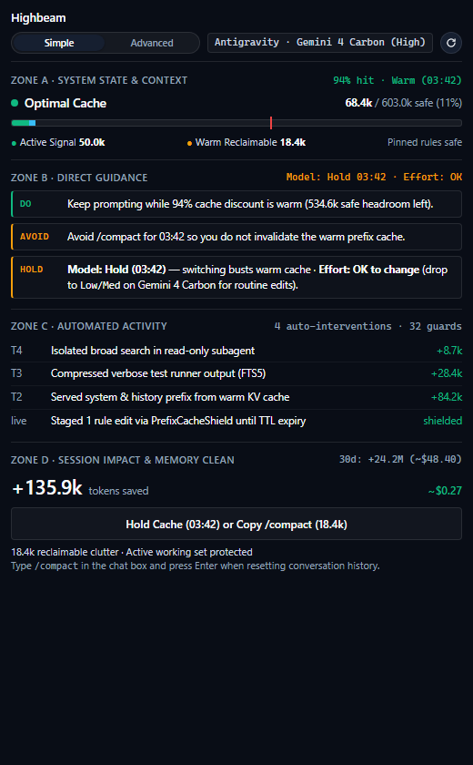

<div align="center">

# Highbeam (ctxtop v4.0) — Active Context Surgeon, KV-Cache Shield & Token FinOps for Claude Code & Google Antigravity

**Local Context Window Profiler, KV-Cache TTL Monitor & Deterministic PreInvocation / PreToolUse Surgeon (`~0.18ms` Tier-1 In-Process / `~25–90ms` Tier-2 CLI Hook) for Claude Code & Google Antigravity**

[](#systems-architecture--zero-trust-security)
[](#deterministic-preinvocation-router--6-local-sensors)
[](#quick-start)
[](LICENSE)
[](#-installation--quick-start)

[**Live Interactive Demo**](https://gizzant.github.io/attention-horizon-antigravity/) • [**Quick Start**](#-installation--quick-start) • [**Cookbook & Recipes**](docs/COOKBOOK.md) • [**Systems Architecture**](#systems-architecture--zero-trust-security)

<br/>


</div>

---

## ⚡ Installation & Quick Start

| **Google Antigravity** *(1-Line Install)* | **Claude Code** *(1-Line Install)* |
| :--- | :--- |
| ```bash
npx ctxtop init
``` | ```bash
npx ctxtop install --claude
``` |
| *Workspace-only*: `npx ctxtop init --workspace`<br/>*Health check*: `npx ctxtop doctor` | *StatusLine HUD*: `npx ah-statusline --demo`<br/>*In-chat pane*: `/horizon` · `/cost-radar` · `/handoff` |

### Your First 5 Minutes After Installing

#### 1. Google Antigravity Workflow
1. **Install hooks & sidecar**: Run `npx ctxtop init` in your project root (or globally).
2. **Open the Highbeam Sidepane**: Launch the local telemetry WebView (`npx ctxtop --serve` or via the Antigravity sidepane) to view real-time context health:
   - **Simple View (Default)**: 4 glanceable zones—**Zone A** (Safe Headroom & Warm KV Cache TTL), **Zone B** (`DO / AVOID / HOLD` Model & Effort switch guidance), **Zone C** (Live automated interventions), and **Zone D** (Verified tokens/USD saved + 1-click `/compact`).
   - **Advanced View (1-Click Toggle)**: Expands the **40-Cell Chrono-Positional Recall Grid** (`Primacy 0–30%`, `Mid-Trough 30–70%`, `Recency 70–100%`), top token consumer file table, `Off / Coach / Auto-Pilot` mode switcher, and the full `DET-01..32` guard log.
3. **Code normally**: Highbeam runs in **`COACH` mode** by default—automatically compressing verbose CLI test dumps via SQLite FTS5 and folding repeat file reads without interrupting your prompts.

#### 2. Claude Code Workflow
1. **Install plugin & hooks**: Run `npx ctxtop install --claude` to wire `.claude-plugin/plugin.json`, `hooks/hooks.json`, and the live terminal `statusLine`.
2. **Watch the Live Terminal `statusLine`**: At the bottom of your terminal, Highbeam renders an auto-adapting (`80 / 110 / 144` col) telemetry bar:
   ```text
   AH [SCCCCCCC................] sonnet-5-5 64k/200k (32%) · Cache 88% (4m12s) · COACH · Saved $1.84
   ```
3. **Open the In-Chat Docked HUD**: Type `/horizon` in chat (or run `npx ah-claude panel` for the standalone HTML workbench) to inspect cache gravity, active guards, and reclaimable tokens.

---

## 🧭 Built-In Slash Skills & In-Chat Commands (Both Hosts)

All 6 slash skills are registered identically in both **Google Antigravity** (`plugin.json`) and **Claude Code** (`.claude-plugin/plugin.json`):

| Slash Command / Skill | When to Use It | What It Outputs |
| :--- | :--- | :--- |
| **`/horizon`** | Anytime during a coding session | Renders the live 40-cell Context Health HUD, KV-Cache TTL countdown, active `DO / AVOID / HOLD` guidance, and reclaimable clutter breakdown. |
| **`/precheck`** | Before sending a complex refactor prompt or switching models | Audits prompt specificity (6-dimension rubric), checks algebraic KV-cache gravity (`C*`), and recommends the optimal Model & Effort tier. |
| **`/handoff`** | Before running `/compact` or `/clear` at `>=75%` context fill | Distills active plan checkboxes, modified files, and unresolved `stderr` into a compressed `<1,000`-token checkpoint (`task.md` / `.handoff.md`). |
| **`/cost-radar`** | When reviewing session token burn or cache busts | Generates an interactive HTML/SVG timeline of prefix-cache retention, `DET-30` thinking drift loops, and subagent worktree topology. |
| **`/inspect`** | When diagnosing slow tools or subagent fan-out | Visualizes session trajectory call-tree spans, per-tool latencies, and token attribution as a standalone artifact. |
| **`/evolve`** | After correcting agent mistakes across a session | Audits `AGENTS.md` / `CLAUDE.md` Turn-0 prefix budget (`<=20k` tok) and synthesizes validated session instincts via 1-click diff approval. |

**Quick In-Chat Prompt Prefixes:**
- `! <prompt>` — Bypass `PreInvocation` checks for a single turn.
- `!lock <prompt>` — Freeze current reasoning effort tier and prefix state for the remainder of the session.
- `#check <prompt>` — Force an explicit pre-flight scorecard and concrete prompt rewrite suggestion.

---

## 🛡️ Verified Token Receipt: `+164.0k` Tokens Saved in One 4-Step Coding Loop

Most CLI trackers passively count tokens *after* your quota is already burned. Highbeam intercepts redundant reads, compresses noisy test dumps via local SQLite FTS5, and shields warm KV prefixes **before** they hit your billing meter:

<div align="center">
  
</div>

| Step in Coding Loop | Developer / Agent Action | Highbeam Active Intervention (Zone C) | Verified Savings |
| :--- | :--- | :--- | :---: |
| **1. Warm KV Cache + Repeat Read** | Agent re-reads an unmodified 800-line source file on a `100k` warm cache | **GUARD-4** intercepts the duplicate read (`AST signature stub`) and preserves the `95%` warm KV cache discount | **`+95.0k` tok** *(KV cache)*<br/>**`+800` tok** *(deduped read)* |
| **2. Failing Test Suite Dump** | `npm test` dumps `120+` lines of verbose stdout (`~11.4k` tokens) | **SQLite FTS5 BM25 Compressor** indexes raw stdout locally and injects only the 160-token failing assertion digest | **`+11.2k` tok** |
| **3. Mid-Session Rule Edit** | Agent updates `AGENTS.md` / `CLAUDE.md` while `60k` prefix is warm (`2m 55s` TTL left) | **PrefixCacheShield** queues the rule delta until TTL expiry or `/compact`, preventing a cold prefix rebuild | **`+57.0k` tok** |
| **Total Verified Session Receipt** | **4-Step Feature / Bugfix Loop** | **Zero context dilution · 100% critical error retention** | **`+164.0k` tok (`~$0.33`)** |

---

## 💡 Why Saved Tokens Multiply (`O(N²)` Turn Compounding, Quota Life & Model IQ)

In agentic coding, every turn re-sends the entire prior conversation history. A single `15,000`-token raw test dump on Turn 5 is not billed once—it is re-sent on Turns 6 through 25, burning **`300,000` cumulative tokens** (`15,000 × 20`).

1. **For Fixed-Subscription Users (`Claude Pro / Max`, `Antigravity OAuth Seats`) — Stop 2:00 PM Quota Lockouts & Context Rot**:
   - Compressing noisy tool outputs and duplicate file reads on early turns prevents `O(N²)` history compounding, **stretching 5-hour sprint quotas by `30%–50%`**.
   - Even more importantly, keeping your session below the **70% Safe Horizon** prevents **Context Rot** (middle-window attention decay where the model starts forgetting `AGENTS.md`/`CLAUDE.md` rules, hallucinating imports, and breaking working code).
2. **For Metered API & Enterprise Teams — Self-Expensing FinOps ROI**:
   - Preventing just two accidental warm-cache busts per day (switching models mid-TTL or editing rule files on a `100k` warm prefix) plus FTS5 log compression saves **`$3–$12/day` (`$60–$240/month`) per active seat**.
3. **Daily Cockpit Decisions No Human Can Calculate in Their Head (Zone B)**:
   - *"If I downshift from Opus/Argon to Sonnet/Flash right now, will I save quota or pay a 10x cold-prefill penalty?"* — Highbeam computes the algebraic cross-model break-even threshold (`C*`) in real time and displays a 1-line verdict: **`Model: Hold (03:34) — switching busts warm cache · Effort: OK to change`**.

---

## ⚙️ What Runs Automatically (Zero-Friction `COACH` Default)

Highbeam defaults to **`COACH` mode**—performing lossless token surgery silently in the background while never blocking your chat prompt unless a true 3-strike identical failure loop or destructive git command occurs:

| Automated Feature | How It Works Under the Hood | Developer Experience |
| :--- | :--- | :--- |
| **1. SQLite FTS5 CLI & Test Output Compression** (`PostToolUse`) | Strips ANSI/progress noise, indexes full stdout in local SQLite FTS5 (`porter unicode61`), and injects only the compact failing assertion digest | **100% automatic** — saves `50%–90%` of test/build log tokens with zero lost stack traces |
| **2. Post-Edit Delta Diffs & 3rd-Read AST Stubs** (`GUARD-4` in `PreToolUse`) | When the agent re-reads a file after editing 5 lines (or reads the same unclipped file `>=3` times), returns a unified line diff or function-signature AST stub | **100% automatic** — cuts repeat-read token burn by `80%+` without interrupting the agent |
| **3. `PrefixCacheShield` Warm Rule Deferral** (`DET-09`) | Intercepts mid-session edits to `AGENTS.md` / `CLAUDE.md` while a `>=15k` KV cache is warm (`TTL > 0s`) and queues the delta until Turn 0, `/compact`, or manual `[Apply]` | **Automatic protection** — prevents silent `50k–150k` cold prefix rebuilds |
| **4. Live Model & Effort Switch Verdict** (`Zone B`) | Evaluates remaining KV cache TTL (`5m`/`1h`) and algebraic break-even `C*` across `MODEL / HOLD / SWITCH / LOCK` states | **Instant visual guidance** — tells you when to hold vs. switch models or lower thinking effort |
| **5. Pre-Compact State Baton** (`task.md` / `HANDOFF.md`) | Distills active plan checkboxes, modified file paths, and unresolved errors before `/compact` (`>=80%` saturation) | **Eliminates post-compact amnesia** — stops the agent from re-reading the same 10 files after compacting |
| **6. Git Hook-Bypass & Destructive Shell Guard** (`DET-08` / `DET-19`) | Blocks `git commit --no-verify`, `-n`, `core.hooksPath` tampering, and unconfirmed `git reset --hard` | **Zero-config repo safety** — keeps frustrated agents from bypassing your pre-commit linters |

---

## 🌱 Zero-Waste AI Engineering: FinOps + GreenOps (Scope 3 Compute Efficiency)

For systems engineers, re-sending a 40,000-token test log 15 times is the AI equivalent of a memory leak—it wastes datacenter GPU prefill cycles, increases time-to-first-token (TTFT) latency, and degrades reasoning quality.

For **Engineering Managers and Enterprise FinOps / Sustainability teams**, every `1,000,000` redundant frontier LLM tokens prevented avoids approximately **`~0.65 kWh` (`650 Wh`) of datacenter GPU prefill energy** (`~247g CO₂e` and associated cooling water). Highbeam's local **Corporate PDF 1.4 Expense Receipt** (`npx ctxtop receipt --pdf`) automatically reports both **Verified USD Saved (FinOps)** and **Estimated GPU Compute Energy Avoided (GreenOps / Scope 3)** with a cryptographic SHA-256 audit digest—giving teams a dual cost-and-sustainability justification with zero cloud telemetry.

---

## Why Highbeam (`ctxtop`) Exists (vs. Cloud LLM Observability)

Cloud trace platforms (Langfuse, Helicone, Arize) require proxying API keys over the network and only observe HTTP request/response payloads. They have **zero visibility into the local filesystem, git working tree, IDE process table, or local SQLite/JSONL session stores**.

`ctxtop` is a zero-dependency local systems profiler built on Node.js built-ins (`node:sqlite`, `node:fs`, `node:http`). It correlates local session transcripts and SQLite databases with live disk state to catch concrete failure modes that cloud proxies cannot see:

| Failure Mode | Root Cause in Agentic Sessions | How `ctxtop` Detects & Remediates It Locally |
| :--- | :--- | :--- |
| **12.5x–80x Prompt Cache Tax & Overage TTL Cliffs** | Falling from a 1-hour prompt cache tier to a 5-minute overage/fallback tier, or mutating system/MCP blocks mid-session while holding `>50k` warm tokens, triggers an uncached prefix rebuild. | Tracks Dual-TTL windows (`1h` vs `5m` main + `5m` subagent), pinpoints the exact turn/component/byte offset of prefix mutations (`computePrefixMutationDiff`), and enforces a Cold-Session Cost Gate. |
| **Compaction Lobotomy & Post-Compact Re-Read Tax** | Autocompact at 80%–95% context wipes file line numbers, active `task.md` checklists, and unresolved `stderr`, forcing the agent to re-read the same unmodified files immediately after compaction. | Deterministically distills `.handoff.md` before compaction (`>=80%` saturation), tracks post-compaction re-reads of unmodified files, and synthesizes `<1,000`-token `[▶ RESUME HERE]` packs via SQLite FTS5 BM25 episodic memory. |
| **30GB–100GB Local IDE Storage Bloat (`state.vscdb`)** | Orphaned Cursor `bubbleId:*`, `checkpointId:*`, `messageRequestContext:*`, and unreferenced `agentKv:blob:*` rows accumulate in SQLite `cursorDiskKV` until disk space or `VACUUM` locks fail. | Audits and reclaims orphaned rows via streaming read-only SQLite export (`--gc-cursor` / `--storage-gc`) without requiring a 2x-disk-space in-place `VACUUM` lock, and recovers orphaned Antigravity `brain/` artifacts (`--recover-brain`). |
| **Stale File Overwrites (`DIRTY_SNAP`)** | Developer edits or runs `git pull` on a file the agent read 10 turns ago; the agent overwrites disk changes with its stale in-context snapshot. | Compares `fs.statSync(path).mtimeMs` on disk against the last `read_file` / `view_file` step timestamp in the JSONL transcript (`+1000ms` tolerance) and injects a pre-turn re-read guard. |
| **Unseen Call-Site Breakage (`UNSEEN_CALLERS`)** | Agent modifies an exported function signature without reading downstream callers in the repo. | Runs a bounded `<8ms` regex import scan (`import ... from`, `require()`, Python `from ... import`) across workspace files (up to 250 files) and flags callers absent from the active working set. |
| **Superseded Full-File Reads & Tool Sludge (`--prune-tools`)** | Agent reads the same 800-line file 6 times, runs unreferenced exploratory `grep` searches, or retains resolved test `stderr` traces, diluting middle-window recall. | Pairs `tool_use` and `tool_result` across Antigravity, Claude Code, and Cursor while pinning Turn 0 and the newest 6 turns; truncates stale tool outputs offline with an atomic `.pre_surgeon` backup. |
| **Turn-0 MCP Schema Bloat (`SCHEMA_TAX`)** | Eagerly loaded MCP servers inject 15k–40k tokens of JSON tool schemas on Turn 0 even when never invoked. | Computes per-server Token ROI (`calls / schemaTokens`, `IDLE_BLOAT_TAX`) and dynamic `deferred_tools_delta` expansion, flagging 0-call eager servers to switch to `"loading": "lazy"`. |

---

## Multi-Harness v4.0 Wedge Capabilities

1. **Cross-Harness SQLite & Protobuf Trajectory Stitcher (`src/core/trajectory_stitcher.mjs`)**:
   - **Google Antigravity (`[App]`, `[IDE]`, `[CLI]`)**: Zero-dependency protobuf wire-walker (`decodeProtobufWire`) inspects `conversations/<uuid>.db` (`steps` table binary `step_payload` and `metadata` blobs) in strict read-only mode to extract `file:///` workspace URIs and stitch with `transcript_full.jsonl` and `annotations/<uuid>.pbtxt`.
   - **Claude Code**: Reconstructs the `uuid -> parentUuid` DAG up to the active `leafUuid`, isolating `/rewind` branches, `file-history-snapshot` restore points, and Turn-1 `cache_creation_input_tokens`.
   - **Cursor**: Correlates `composerData:<id>`, `bubbleId:<id>:<bubble>`, `messageRequestContext`, and `agentKv:blob:*` (`requestId`) with `store.db` and timestamp-less `agent-transcripts/*.jsonl`.
2. **Subagent Worktree & File Collision Detector (`src/core/subagents.mjs`)**:
   - Builds a parent-to-child subagent DAG, tracks independent 5-minute child cache TTLs, and flags `SUBAGENT_FILE_COLLISION` when `>= 2` concurrent subagent branches edit the same canonical file path.
3. **SQLite FTS5 Episodic Memory & Git Commit Token Ledger (`src/core/episodic_memory.mjs`, `src/core/git_ledger.mjs`)**:
   - Indexes historical session decisions, modified files, and resolved bug signatures into a local SQLite FTS5 (`porter unicode61`) store (`~/.ctxtop/episodic_memory.sqlite`) for `<1,000`-token BM25 retrieval.
   - Correlates `.git/logs/HEAD` commit timestamps against session windows to attribute input/output tokens, cache hit %, and USD cost per git commit.
4. **Zero-PII Sanitizer & Forensic Snapshot Exporter (`src/core/sanitizer.mjs`)**:
   - Scrubs API keys (`sk-ant-*`, `sk-proj-*`, `AIza*`), GitHub PATs (`ghp_*`, `github_pat_*`), AWS keys, Bearer tokens, `.env` values, and OS home paths (`<USER_HOME>`) before exporting shareable forensic JSON snapshots.

---

## Quick Start

### 1. Inspect Live Sessions, Prune Tool Sludge, or Run Storage GC
```bash
# Audit the last 5 local sessions for duplicate file reads, dead errors & MCP schema tax
node src/cli/postmortem.mjs --last 5

# Run environment & transcript health diagnostics (hooks, SQLite/JSONL confidence, 3-way mirror SHA-256)
node src/cli/doctor.mjs

# Run offline Prefix-Safe Tool-Output Surgeon on the active session transcript (with atomic backup)
node src/cli/doctor.mjs --prune-tools --dry-run

# Recover orphaned Antigravity brain/ directories or compact Cursor state.vscdb without VACUUM locks
node src/cli/doctor.mjs --recover-brain --gc-cursor --vscdb path/to/state.vscdb --dry-run

# Print the 40-cell ANSI status bar for the active session
node src/cli/horizon_hud.mjs --live
```

### 2. Launch the Local Telemetry WebView (`127.0.0.1`)
```bash
# Start the loopback sidecar daemon and open the Tufte WebView
node sidecars/horizon-daemon/server.mjs
```

### 3. Install Lifecycle Hooks & CLI `statusLine`
```bash
# Global install (~/.gemini/config/plugins/agy-horizon-flightcheck)
node src/cli/init.mjs init

# Workspace-local install (.agents/plugins/agy-horizon-flightcheck)
node src/cli/init.mjs init --workspace
```

> [!TIP]
> Looking for copy-paste recipes for Cursor 50GB storage reclamation, offline tool pruning, Antigravity brain recovery, or programmatic Node.js API snippets? See the [**`ctxtop` Cookbook & Recipes**](docs/COOKBOOK.md).

---

## Systems Architecture & Zero-Trust Security

`ctxtop` is engineered for strict operational safety alongside live IDE/CLI database writers:

1. **Zero Outbound Network Connections**:
   - **0 runtime `npm` dependencies** (`package.json` has no `dependencies` block).
   - **0 external HTTP/HTTPS requests, telemetry beacons, or remote API calls**. All parsing, classification, and routing run 100% in-memory on the local machine.
   - The local WebView daemon (`sidecars/horizon-daemon/server.mjs`) binds strictly to `127.0.0.1` (loopback only) and rejects cross-origin `Origin` or non-local `Host` headers (`HTTP 403`) to prevent DNS rebinding and drive-by localhost CSRF.
2. **Read-Only Database & Transcript Introspection (`SQLITE_OPEN_READONLY`)**:
   - Every connection to Antigravity or Cursor SQLite databases (`conversations/<uuid>.db`, `conversation_summaries.db`, `state.vscdb`, `store.db`) is opened via Node's native `node:sqlite` `DatabaseSync` with `Object.freeze({ readOnly: true })` (`SQLITE_OPEN_READONLY`). `ctxtop` can never contend for write locks with an active IDE or CLI.
   - Live JSONL transcripts (`transcript_full.jsonl` / `transcript.jsonl`) are read via `fs.openSync(filePath, 'r')` using byte-offset slicing (`O(Δbytes)` per turn), falling back to full re-parse only when a step-index regression (Undo/Rewind) is detected.
3. **Ring 1 Security, Concurrency & Context Hygiene Boundaries**:
   - **`DET-19` Git Hook-Bypass Guard**: Intercepts `git` execution via `.agents/shims/` wrappers, strips `.agents/shims` from `PATH` to eliminate recursion, blocks verification evasion (`--no-verify`, standalone `-n`, `-amn`, `--no-gpg-sign`, `core.hooksPath`), and allows bypass strictly via a 60-second single-use cryptographic human nonce.
   - **Zero-Token Subagent IPI Sanitizer**: Deterministically strips Unicode Tag characters, zero-width spaces, bidi overrides, HTML comments, and delimiter breakouts in `<1ms`, framing external research digests safely at prompt tails under `<untrusted_subagent_data>`.
   - **Pre-Threshold ANSI Normalization (`DET-14b`)**: Strips ANSI escape sequences and collapses carriage returns (`\r`) before the 4,096-char threshold and SQLite FTS5 archival, featuring specialized noise profiles for `cargo test` and `npm install` with Critical Error-Line Recovery.
   - **Concurrent Scope Lockfile (`DET-20`)**: Manages `.agents/locks/active_scopes.json` with atomic writes, auto-evicting dead PIDs and expired leases (>300s), while alerting on multi-agent file collisions with 1-click `git worktree add` commands.
4. **Locked v4.0 Edward Tufte UI Laws**:
   - **Law 1 (Raw Physical Units Only)**: Displays `Tokens + %`, `Cache Hit %`, `Waste Tokens`, and `1h/5m TTL Countdown` side-by-side—never arbitrary `0–100` gamified scores.
   - **Law 2 (40-Cell Hero + Top 3–5 Riskiest Cells)**: Surfaces the top 3–5 highest-risk context cells directly below the 40-cell flamegraph with exact file paths, attention recall %, and 1-click `[Re-Anchor / Prune]` actions.
   - **Law 3 (Zero-Click Passive Workload Tag)**: Passively classifies sessions into `[Mode: Read-Heavy Audit]`, `[Mode: Multi-File Refactor]`, or `[Mode: Subagent Swarm]` from tool-call ratios.
   - **Law 4 (Silent-When-Nominal Watchdog)**: Host RAM and orphan process counters remain completely hidden unless an anomaly (`orphanCount > 0` or `ZOMBIE_LEAK`) occurs.

---

## 🔧 Configuration, Flight Modes & MCP Server (`@ctxtop/mcp`)

### 1. Customizing `.attention-horizon.json` (Flight Modes & Detector Overrides)
Highbeam works with zero configuration out of the box (`COACH` mode). To customize behavior per-repository or globally (`~/.attention-horizon.json`), use the CLI or create `.attention-horizon.json` in your workspace root:

```bash
# Set a detector to warn-only, block, or off via CLI
npx ctxtop config DET-08 warn
npx ctxtop config DET-19 block
```

```json
{
  "flightMode": "COACH",
  "turnZeroTokenBudget": 20000,
  "detectors": {
    "DET-06": "block",
    "DET-07": "block",
    "DET-08": "warn",
    "DET-09": "block",
    "DET-19": "block",
    "DET-20": "warn"
  }
}
```
- **`"COACH"` *(Default)***: Compresses CLI output (`DET-07`), folds repeat file reads (`GUARD-4`), and stages warm rule edits (`DET-09`) automatically while advising on model/cache switches without blocking normal flow.
- **`"AUTO_PILOT"`**: Enforces strict pre-turn & stop-gate verification locks (e.g., requiring tests to run after source edits before session completion).
- **`"SILENT"` / `"OFF"`**: Passive telemetry collection only.

### 2. Using Highbeam as an MCP Server (`ctxtop-mcp`)
Any MCP-compatible client (**Google Antigravity**, **Claude Code**, **Cursor**, **Windsurf**, or **Claude Desktop**) can query Highbeam's telemetry and KV-cache advisor via standard JSON-RPC stdio:

```json
{
  "mcpServers": {
    "highbeam": {
      "command": "npx",
      "args": ["-y", "ctxtop-mcp"]
    }
  }
}
```
Exposes 4 read-only MCP tools (`<5ms` response): `get_context_telemetry`, `check_cache_gravity`, `get_savings_receipt`, and `inspect_detectors`.

---

## Deterministic `PreInvocation` Router & 6 Local Sensors

When registered in `hooks.json`, `src/hooks/pre_invocation.mjs` evaluates incoming prompts across 8 deterministic router states (**Tier-1 In-Process Router Evaluation: `~0.18ms p95`** inside a warm V8 isolate; **Tier-2 Spawned CLI Hook End-to-End Wall Time: `~25–45ms` POSIX / `~40–90ms` Windows PowerShell** including Node process startup):

1. `ALLOW_SILENT`: Immediate pass-through (`{}`) on `!` bypass prefix or healthy turns.
2. `ALLOW_ACTIVE_SET`: Silent pass-through when referenced files are already warm in the last 5 turns.
3. `ALLOW_PLAN_OR_SUBAGENT`: Silent pass-through during `/plan` mode or subagent delegation.
4. `INJECT_CONTEXT_GUARD`: Appends a `systemMessage` warning when target files were modified externally on disk (`DIRTY_SNAP`), have unseen callers (`UNSEEN_CALLERS`), or touch deprecated paths (`LEGACY_POISON`).
5. `STEER_SUBAGENT`: Advises `invoke_subagent` when a broad exploratory prompt would pollute a warm `>30k`-token parent context window.
6. `HALT_HYGIENE_OR_SAFETY`: Halts execution (or warns in `advisory` mode) on context ceiling breach, 3-strike identical command error loops, or severe duplicate-read dilution.
7. `HALT_EFFORT_OR_QUOTA`: Warns when 5-hour/7-day quota falls below the configured floor (`10%`) or when `>600`-line single-shot file rewrites risk output stream truncation.
8. `HALT_REWRITE_SCORECARD`: Triggered via `#check` or vague cold-start prompts (`Turn <= 2`), outputting a 4-line prompt rewrite scorecard.

---

## CLI Commands & Forensic Postmortem

| Command | Description |
| :--- | :--- |
| `npx ctxtop init [--workspace]` | Installs Google Antigravity plugin manifests, lifecycle hooks, and sidecar configuration. |
| `npx ctxtop install --claude` | Installs Claude Code `.claude-plugin` manifest, Tier-1/Tier-2 hooks, and terminal `statusLine`. |
| `npx ctxtop doctor [--diagnostic]` | Validates hook registration, config overlays, dynamic model ceilings, 3-way WebView SHA-256 parity, and SQLite/JSONL health. |
| `npx ctxtop postmortem [--last N] [--json]` | Scans the last `N` local sessions, classifies root causes (`CONTEXT_ROT_DECAY`, `VERIFICATION_CHURN`, `SPEC_AMBIGUITY`, `CLEAN`), lists top duplicate-read files, and audits Turn-0 MCP schema overhead. |
| `npx ctxtop receipt [--markdown \| --pdf]` | Exports a SHA-256 verified FinOps + GreenOps token/USD savings receipt for the active workspace. |
| `npx ctxtop verify [--json]` | Verifies cryptographic SHA-256 integrity of all 149 release files against `CHECKSUMS.sha256`. |
| `npx ctxtop --roast` | Prints a terminal forensic summary of recent sessions with top duplicate-read file offenders and copy-pasteable remediations. |
| `npx ctxtop --serve` | Launches the local HTTP/SSE telemetry daemon (`127.0.0.1`) and interactive WebView (`/` Simple, `/advanced` Advanced). |
| `npx ctxtop --demo-animate` | Plays the 5-stage terminal crisis simulation across synthetic fixtures. |

---

## Verification & Benchmarks

Run the full zero-dependency test and verification suite (**1,050+ tests across 215+ suites**):

```bash
# Full Coach, UI, & 360° Capability-Proof suite (911+ tests across 183+ suites)
npm run test:coach

# Claude Code dual-tier Mod, CLI hooks, statusLine, and 5-category ledger suite (168 tests)
npm run test:claude

# Unit & Multi-Harness Wedge suite (89 tests across 31 suites)
npm run test:unit

# Architectural verification suite (Gates 0-6 & Phases 1-7: SQLite read-only locks, JSDOM UI, MCP audit)
npm run test:gates && npm run test:phases

# End-to-end context memory & live loopback daemon integration suite (7 layers)
npm run test:e2e

# Latency benchmark (200 iterations/path: Tier-1 ~3.0ms avg / <15ms SLA, Tier-2 CLI Hook, <45ms HUD)
npm run bench
```

---

## License

MIT © [Gizzant](https://github.com/Gizzant)
