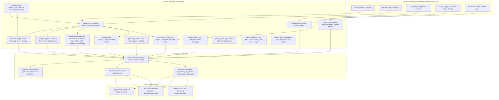

# Highbeam: 360° Technical & Architectural Evaluation Guide

> **Component:** `attention-horizon-antigravity` (`ctxtop` / `agy-horizon-flightcheck`)  
> **Target Platform:** Google Antigravity IDE, CLI, and Standalone Browser Telemetry  
> **Status:** Production v3.1.0 (Zero-Dependency Node.js 20+ ESM)  
> **Specification Version:** 1.1.0 (Dynamic Effort-Tier & Transition-Aware)  

---

## 1. Executive Summary & Problem Space

Modern LLM-assisted software engineering relies on long-context models (e.g., 200k tokens in Gemini 1.5/2.0/3.8/4 Argon and Claude Opus/Sonnet). However, as conversations progress, developers inevitably encounter four severe context degradation hazards:

1. **Prefix Amputation:** When total token usage exceeds safe thresholds (e.g., ~140k tokens on Standard/Auto tiers, ~115k on High/Max reasoning tiers, or ~95k on Fast/Flash tiers), earlier conversational turns, foundational system rules, and workspace requirements risk being truncated or pushed outside the high-attention retrieval horizon.
2. **Dynamic Reasoning Headroom Compression & Early Dilution:** A static safe limit ignores real-world model mechanics:
   * **High / Max Effort (`HIGH`):** Deep reasoning models reserve a large hidden thinking-token budget (`~25k` tokens) that compresses effective input headroom down to `115k`.
   * **Fast / Flash / Low Effort (`FAST`):** Lightweight and low-effort tiers suffer from middle-window Attention Dilution much earlier (`~95k` tokens) than frontier reasoning tiers.
3. **Context Dilution & High-Effort "Sludge Tax":** Re-reading the same full source files repeatedly, leaving dead stack traces in history, or emitting massive un-truncated terminal outputs dilutes the model's attention. Switching to `High` reasoning effort while carrying `>= 30k` of reclaimable bloat forces the reasoning model to burn expensive thinking tokens and latency re-evaluating dead context on every turn.
4. **Accidental Context Blinding:** When tools offer blunt exclusion mechanisms (such as adding files to `.antigravityignore`), novice users frequently exclude the very source files they are editing (e.g., `sidepane.html`), permanently blinding the AI to the active workspace.

**Context Memory (Chrono-Attention Horizon)** is an agent-native, non-invasive telemetry and memory management system built specifically for Antigravity. It monitors token health in real time, dynamically adapts safe thresholds when a developer switches models or reasoning effort mid-session, classifies the active 200k-token window into 40 discrete chronological cells (5,000 tokens each), marks effort transitions on the timeline, attributes context growth, and provides human-friendly, one-click compaction and handoff workflows.

---

## 2. System Architecture



### 2.1 Core Architectural Principles
* **Zero Overhead on Agent Thinking:** The agent never polls or processes telemetry in its own context window. The engine passively reads local JSONL log streams emitted by the Antigravity host harness.
* **Dynamic Effort-Tier Adaptation:** Safe limits, progress bar markers, headroom calculations, and sludge warnings automatically recalibrate whenever `<USER_SETTINGS_CHANGE>` or turn metadata indicates a model or reasoning effort switch mid-session.
* **Tenth-of-a-Kilotoken Mathematical Parity:** The UI enforces strict mathematical equality across all visible badges: individual rows are rounded to `0.1k`, and the total badges, cards, and button counts are derived from the exact sum of those rounded values.
* **Deterministic Discretization:** The 200k context window is mapped onto 40 discrete 5,000-token cells, giving developers a tactile, chronological block view of their session from oldest instruction to newest tool call—including exact `⇄` markers where model/effort switches occurred.

---

## 3. Effort-Tier Profiles & Context Classification Engine

### 3.1 Dynamic Effort-Tier Profiles & Model Ceilings (`constants.mjs`)
`constants.mjs` defines `MODEL_CEILINGS`, `EFFORT_PROFILES`, `resolveModelCeiling()`, and `scaleEffortProfileForCeiling()` to dynamically resolve Antigravity's native `256,000`-token window (`6,400` tokens/cell across 40 cells) or `1,000,000`-token windows (`25,000` tokens/cell):

| Profile Key | UI Label | Short Badge | 200k Legacy Safe Limit | 256k Native Safe Limit | Thinking Reserve | Limit Reason (`limitReason` Tooltip) |
| :--- | :--- | :---: | :---: | :---: | :---: | :--- |
| **`HIGH`** | `High Effort` | `High` | `115,000` (57.5%) | **`147,000`** (57.4%) | `32,000` | `"32k reserved for deep reasoning"` |
| **`STANDARD`** | `Standard / Auto` | `Auto` | `140,000` (70.0%) | **`180,000`** (70.3%) | `0` | `"180k recall ceiling"` |
| **`FAST`** | `Fast / Low Effort` | `Fast` | `95,000` (47.5%) | **`120,000`** (46.9%) | `0` | `"Earlier middle-window dilution on fast tiers"` |

### 3.2 Mid-Session Effort Transition Tracking & Stream Partitioning (`parser.mjs` & `classifier.mjs`)
* **Usage & Cache Metadata Extraction:** `parseRawJsonl` extracts `cache_read_input_tokens`, `cache_creation_input_tokens`, and `thinking_tokens` directly from usage blocks.
* **Multi-Agent Stream Partitioning:** Child subagents invoked via `invoke_subagent` are partitioned (`agentId: 'child:<id>'`) so concurrent subagent turns never interleave into or corrupt parent turn numbering.
* **Undo/Rewind vs. Compaction:** `history.mjs` distinguishes step-count regressions caused by IDE Undo/Rewind (`rewound: true, compacted: false`) from true compactions (`compacted: true` with `<CONTEXT_SUMMARY>` / `CHECKPOINT`), preventing false `-78.0k` banners on Undo.
* **Per-Turn Extraction (`extractTurnEffortMetadata`):** Scans JSONL entries for `<USER_SETTINGS_CHANGE>` tags (e.g., ``The user changed setting `Model Selection` from Gemini 4 Argon (High) to Gemini 3.8 Flash (Medium)``) as well as structured turn properties.
* **Transition History (`extractEffortTimeline`):**
  * Records a structured transition event whenever the resolved effort tier changes between Turn `N-1` and Turn `N`:
    `{ turnIndex, stepNumber, blockIndex, fromTier, toTier, fromLabel, toLabel, timestamp }`.
  * **Mid-Session `fromSpec` Baseline Resolution:** `extractEffortTimeline()` inspects `meta.fromSpec` on any turn index (`idx >= 0`) to establish the true prior tier when no earlier tag was emitted, and computes an initial `blockIndex` (`0..39`) from cumulative step tokens.
* **Semantic Reference Pinning:** In `classifier.mjs`, foundational files and schema/type declarations older than 25 steps are preserved in `ACTIVE_WORKING_SET` (`semanticallyPinned: true`) as long as they are un-superseded and actively referenced in the recent 8-turn window.

### 3.3 Six Token Categories (`classifier.mjs`)
Every token in the conversation transcript is classified into one of six distinct categories:

| Category | Color / Code | Priority | Description & Examples |
| :--- | :--- | :---: | :--- |
| **`ANCHOR`** | Cyan (`#00d7ff`) | 1 | Foundational project instructions: `AGENTS.md`, workspace rules, injected skill definitions, base tool schemas. |
| **`ACTIVE_WORKING_SET`**| Green (`#10b981`) | 5 | Current task state: turns within the last 25 steps, active code diffs, recent tool inputs/outputs. |
| **`STALE_DUPLICATE`** | Amber (`#f59e0b`) | 3 | Wasteful context: full-file re-reads where an earlier snapshot already exists, older turns beyond 25 steps. |
| **`DEAD_ERROR`** | Red (`#ef4444`) | 4 | Resolved stack traces, failed commands, and tool syntax errors that no longer contribute to the active plan. |
| **`FOREIGN_BLEED`** | Magenta (`#ff0087`)| 2 | Cross-workspace memory bleed or irrelevant Knowledge Items injected from other projects. |
| **`FREE_HEADROOM`** | Slate (`#334155`) | 6 | Available unallocated tokens remaining before reaching the active safe limit (`95k`/`115k`/`140k`) or window limit (`200k`). |

---

## 4. UI Capabilities & Feature Breakdown

### 4.1 Telemetry Overview Bar, Dynamic Safe Limit Line & Metric Cards
* **Segmented Bar:** Visually divides active tokens into Active Signal (green), Reclaimable Clutter (amber), and Resolved Errors (red) against Free Headroom (slate/dark).
* **Dynamic Safe Limit Line (`#limitLine` & `#limitTag`):** Positions the red dashed threshold marker dynamically at `(activeEffortProfile.safeLimit / maxTokens) * 100%` (`57.5%` for `115k`, `70%` for `140k`, `47.5%` for `95k`) with the label `{safeLimitInK}k safe limit ({activeEffortProfile.label})`.
* **Dynamic Safe Headroom Card (`#valFree` & `#subFree`):**
  * Computes headroom against `activeEffortProfile.safeLimit` (`15.0k left` vs `+10.0k over`).
  * Appends an interactive info tooltip (`ⓘ`) to `#subFree` (`Until {safeLimitInK}k safe limit ⓘ`) explaining `activeEffortProfile.limitReason`.
  * Green (`#10b981`) when `> 15k` tokens of safe headroom remain; Amber (`#f59e0b`) when `0.1k` to `15k` remain; Red (`#ef4444`) when operating above the active safe limit.
* **Chat Selector & Footer Routing Badge (`#sessionSelect` & `#footerMeta`):**
  * When a session changes effort tiers mid-chat (e.g., started in `Auto` or `Low` and switched to `High` on Turn #120), displays `[125k • Auto → High]` in both the top conversation selector and footer metadata line.

### 4.2 High-Effort "Sludge Tax" Warning Banner (`#highEffortSludgeBanner`)
* When `activeEffortProfile.tier === 'HIGH'` AND `reclaimableTokens >= 30000`, injects a prominent one-line callout banner directly inside the `/compact` recommendation box (`#guidedStepBox`):
  > `⚡ High Effort active with 35k of stale noise — compact now to prevent slow reasoning turns and thinking-token burn.`

### 4.3 Turn-to-Turn Delta Attribution
* Tracks session growth velocity on every turn using a 50-turn ring buffer (`history.mjs`).
* Highlights single-turn spikes and names the exact cause:
  > `▲ +4.5k since last turn · largest: read_file sidepane.html (~0.7k)`
* Automatically recognizes compaction events:
  > `▼ −78.0k since last turn (compacted)`

### 4.4 Actionable Brain Diagnostics (Cleared by `/compact`)
* **Earlier Chat History:** Displays tokens consumed by older turns (`> 25` steps old) that are ready to be summarized.
* **Fixed Error Logs:** Identifies dead compiler/test stack traces that have been superseded by successful runs.
* **Repeated File Reads:**
  * Groups re-read files with occurrence counts (`1 re-read`, `4 re-reads`).
  * **Active Source Protection (`isIgnorablePath`):** Excludes editable source files (`*.html`, `*.js`, `*.ts`, `*.py`) from the ignore action. Only scratch scripts, logs, lockfiles, and build artifacts show the `Ignore file` button.
  * **Behavioral Nudge Prompts:**
    * `Prevent re-reads: 📋 Tell agent: Read line ranges`
    * `Prevent re-reads: 📋 Tell agent: Use subagent`

### 4.5 Plain-Text `/compact` Instruction & Prompt Action Buttons
* **Slash Command Guidance (`/compact`):** Because `/compact` is a native slash command with IDE autocomplete, the panel renders a clean text instruction (`Type /compact in the chat box and press Enter · reclaims ~X.Xk · keeps rules, plan & code intact`) rather than a redundant copy/paste button.
* **Cache-Aware Advisory States:** `LEAN_NO_COMPACT` (< 50k tokens and < 25k reclaimable: advisory hidden, neutral slate `/compact` box, note `Session is lean (20.4k / 8%) · No compaction needed until >50k`), `DEFER_WARM`, and `COMPACT_NOW`. If the drift warning is visible, `COMPACT_NOW` reads `Cache is cold — click "Save task.md" first, then run /compact.` so the two banners never conflict.
* **Prompt Action Buttons (`📋 Tell agent` / `Save task.md`):** Clicking any behavioral prompt button:
  1. Submits directly into the active chat via `window.sidecar.agent.sendMessage` when running inside the IDE host, or writes the prompt to the system clipboard as a fallback.
  2. Dispatches a postMessage (`antigravity.focusChatInput`) to the host IDE on clipboard fallback so the cursor immediately focuses on the chat input box.
  3. Flashes the button with a 2,000ms visual confirmation (`✓ Sent to agent` or `✓ Copied! Press Ctrl+V in chat`).

### 4.6 Clean Chat Handoff & `task.md` Checkpointing
* Evaluates whether `task.md` has been saved and how many turns it is behind.
* Protects against context loss by warning users before they abandon a session:
  * `● task.md synced` (Green)
  * `● task.md stale • 5 turns behind` (Amber)
  * `● task.md stale • not saved yet` (Red)
  * `task.md missing` is shown instead of `stale (N behind)` when no `task.md` was ever written and none exists on disk. Writes to a `task.md` outside the session brain folder are detected from the tool-call path.
* **Pre-Compaction Drift Warning:** shown only when the session itself edited workspace files, `git status --porcelain` is dirty, `task.md` is missing or stale, and compaction is relevant (>= 50k tokens, >= 25k reclaimable, or past the safe horizon). Read-only or planning sessions are never blamed for pre-existing dirty files.

### 4.7 40-Block Chronological Timeline with Effort Shift Markers (`⇄`)
* An expandable drawer (`â–¶ View session timeline`) rendering 40 individual 5k-token blocks (or 6.4k-token blocks under 256k ceilings).
* Any block containing an entry in `effortTransitions` renders a top-border accent (`.effort-shift`) and a corner badge (`⇄`).
* Hovering over a transition cell displays the exact transition detail: `Turn #120: Switched effort STANDARD → HIGH`.

### 4.8 Dual-Pool Quota & Cache Telemetry Strip (`#quotaStrip`)
* **Simple View Presentation:** Refocused purely as a dedicated `⚡ Prompt Cache` dashboard with a visual 5-minute countdown bar (`#cacheTimerBarFill`), dynamic TTL readout (`3m 40s left` / `Expired`), clear discount status (`95% discount active` vs `No active discount`), and a plain-English "What to do now" operational guidance banner (`#cacheOperationalGuide`). Unrelated 5h/7d quota meters are hidden in Simple View via `[data-view-mode="simple"] .quota-strip .quota-pills { display: none !important; }` to eliminate noise.
* **Advanced View Presentation:** Renders full 5-Hour rolling Sprint usage vs. 7-Day rolling Weekly Marathon usage (`5h Sprint: 24% · 7d Weekly: 68% · Cache Hit: 92%`).
* Warns when Weekly pool depletion rate outpaces Sprint burn (`⚠️ 7d Lockout Risk`), avoiding the common 5-day lockout trap.
* Forecasts single-turn burn before switching to High effort (`Next High turn: ~2.35% of 5h`).
* **Provenance:** quota values are a **local estimate** from transcript token counts unless the host supplies numeric fractions on stdin. Estimates render muted as `5h ~42% est. · 7d ~100% est.` (tooltip: "Local estimate from transcript token counts; Antigravity does not expose quota to this panel.") and never raise the lockout pill, the overage alert, or a RED risk band. Host-sourced values (`source: 'host'`) keep the exact rendering and alerts. When the overage alert banner is visible, the duplicate `7d Lockout Risk` pill is hidden.
* **Prefix Bust copy:** a bust is amber, not red. When the cause is known (model switch), it reads `Last turn: cache miss (model switch → Claude Opus 5.5)`; otherwise the legacy `Prefix Bust (system_message / config drift)` label is kept. Because a missing turn writes a fresh prefix, `nextTurnLikelyWarm` (not the strict warm badge predicate) drives the compaction advisory, the "Cache is cold" copy and the history-bar color.
* **Model detection:** `stdin.model` → `gen_metadata.model` → last `USER_INPUT` "Model Selection" change → fallback; labels are normalized (`Claude Opus 5.5 (Medium)` → `claude-opus-5.5`). Anything not supplied by the host is shown as `(model inferred)`.

### 4.9 Prefix-Safe Surgical Context Pruner & AST Folder (`#btnCondenseAst`)
* One-click action calling `POST /api/prune` on the sidecar daemon.
* Checks 5-minute prefix cache TTL (`isCacheCold`) before pruning to avoid accidental cache-invalidation cost penalties.
* Folds duplicate full-file reads into compact AST signature stubs (preserving functions, types, exports, line numbers) and collapses resolved stack traces into 1-line tombstones, with automated `.pre_prune.<ts>.bak` backups.

### 4.10 Host Process & Zombie Subagent/MCP Watchdog (`#hostWatchdogBar`)
* Compact footer indicator (`Host RAM: 1.4 GB · Orphans: 0`).
* Detects orphaned `language_server` instances (`multicall schedule` leaks) and detached MCP processes.
* Provides a **Clean up N orphans…** button that shows a `confirm()` listing each orphan as `name (PID)` and then posts only those explicit PIDs to `POST /api/host/reap`, terminating detached orphan processes without restarting the IDE.

### 4.10a Session-Scoped Git Drift (`#artifactDriftBanner`)
* Uses `git status --porcelain=v1 -z -uall` (via `execFileSync`, no shell, cached for ~4s), parsed before trimming, with renames resolved to the new path and paths resolved against `git rev-parse --show-toplevel`.
* Only files this session wrote/edited count: `⚠️ 7 files edited in this session are uncommitted (59 repo-wide) while task.md is missing.`
* The banner contains an inline **Save task.md** button that reuses the `#btnCheckpoint` handler.

### 4.10b Daemon Same-Origin Restrictions
* No `Access-Control-Allow-Origin` header. Requests with a non-loopback `Host` (DNS rebinding) or a foreign `Origin` (cross-site POST) get `403`.
* Tracked HTML ships `window.__PRECOMPUTED_SESSIONS__ = {}`; the e2e suite asserts no local paths or session UUIDs are embedded.

### 4.11 Multi-Agent Context Tree Inspector (`#subagentPills`)
* Scans `invoke_subagent` calls across `inherit`, `branch`, and `share` modes.
* Computes isolated exploration tokens vs. parent handoff tokens (e.g. `48.2k isolated -> 1.2k handoff (40x)`).

### 4.12 5-Bucket Zero-Turn Customization Profiler (`#bucketBars`)
* Tracks Turn-0 customization overhead across 5 native Antigravity budgets (`Rules`, `Skills`, `MCP`, `Subagents`, `Workflows` vs. `20,000` tokens).
* Flags eager injection warnings when Turn-0 customization bloat exceeds 15% of the context ceiling.

### 4.13 Show-HN Layers 1–4: Composite Session Risk, Dual-Watermark Model & Baton Pass (`/handoff`)
* **Composite Session Risk (`GREEN` / `AMBER` / `RED`):** Evaluates token headroom (`179k` safe horizon), KV cache TTL (`300s`), `task.md` staleness, and 7d quota lockout risk, plus a **Prefix-Lock Protection Warning** when a warm cache holds `> 50k` tokens (`TTL > 0s`).
* **Multi-Store Session Discovery (`[App]`, `[IDE]`, `[CLI]`):** Scans `~/.gemini/antigravity`, `~/.gemini/antigravity-ide`, and `~/.gemini/antigravity-cli` with dual-target `Open ↗` (Click to focus chat, `Alt+Click` to open OS brain folder).
* **Dual-Watermark & Dynamic Ceiling Model (`50k` / `179k` / `256k`):** Renders `50k Cascade Sync Armed`, `179k Highbeam (70%)`, and `256k Hard Assembly Limit` (`cortex/utils.GetCheckpointConfig`), coloring older history in **Muted Slate/Teal (`Cached History — 95% Discounted`)** while warm and transitioning to **Amber (`Reclaimable Cold Bloat`)** only when cold or over `179k`.
* **Parameterized `/compact` & Baton Pass (`/handoff`):** Synthesizes context-preserving `/compact` prompts, displays a Cache-Aware Compaction Advisory, audits Brain artifacts (`task.md`, `implementation_plan.md`, `walkthrough.md`) + `git status --porcelain` drift, and generates `docs/HANDOFF_<timestamp>.md` with one click (`POST /api/handoff/generate`).

### 4.14 Show-HN Layer 5: Smart File Re-Read Classifier, MCP Prefix Audit & Lifecycle Hooks (`layer5_hygiene.mjs`)
* **Smart File Re-Read Classifier (`evaluateSmartFileReReads`):** Exempts post-compaction (`step_type == 23`), post-edit (`write_file`, `edit_file`, `replace_file_content`, `write_to_file`), and post-build/test (`run_command`) file re-reads from false-positive `STALE_DUP` waste.
* **MCP Prefix Bloat Audit (`auditMcpPrefixBloat`):** Parses `~/.gemini/config/mcp_config.json` and `.agents/mcp_config.json` to flag `eager`-loaded MCP servers with zero session tool calls (`#mcpAuditCard`).
* **Fail-Open CLI Command Dampening Hook & Primacy/Recency Rule Promotion:** Registers a 1-click `PreToolUse` command-condensing wrapper in `.agents/hooks.json` (`POST /api/hooks/dampen`) and promotes in-chat corrections into the Primacy (top 30%) or Recency (bottom 30%) zone of `AGENTS.md` / `.agents/CONTEXT.md` while enforcing Antigravity's 200-line `MEMORY.md` truncation threshold (`POST /api/rules/promote`).

### 4.15 Show-HN Layer 6 & Phase 7: U-Shaped Attention Heatmap, Session Fracture Overlay & Zero-Trust SQLite Locks
* **Parabolic U-Shaped Attention Curve ($\gamma = 0.6$):** Shades the 30%–70% **Low-Attention Trough** (`.mini-cell.low-attention-trough`) and flags `ACTIVE_WORKING_SET` or `ANCHOR` buffers stranded in Cells 7–15 (`#strandedSignalBanner`).
* **Session Fracture Overlay (`⚡`) & Interactive Turn Inspection:** Renders `.fracture-marker` (`⚡`) between cells where a compaction (`step_type == 23`) or mid-run prefix bust (`cache_read_tokens == 0`, $\Delta t < 300\text{s}$) occurred, and opens `#cellTurnFilterPanel` on cell click to inspect exact turns and tool calls.
* **Zero-Trust Read-Only Profile (`SQLITE_OPEN_READONLY`):** Opens all SQLite databases (`conversations/*.db`, `conversation_summaries.db`) strictly with `{ readOnly: true }` (`SQLITE_OPEN_READONLY`) and all JSONL logs with `'r'`, with zero outbound network sockets and zero runtime npm dependencies.

### 4.16 Simple View 5-Box Ergonomic Hierarchy & Cache-Aware Gating
The Simple View dashboard (`[data-view-mode="simple"]`) streamlines developer focus by organizing telemetry into an ergonomic 5-box vertical hierarchy, while removing host process watchdog noise (`.host-watchdog-bar` scoped to `.advanced-only`):
1. **Box 1 (Top): Context Memory Capacity (`.storage-card`):** Provides the master 200k/256k watermark progress bar, 3 metric breakdown cards (Signal, Reclaimable Clutter, Safe Headroom), and a compact 1-line folded Primary Bloat Driver (`#storagePrimaryBloatLine`).
2. **Box 2: ⚡ Prompt Cache (`#quotaStrip`):** Dedicated prompt cache monitor featuring a visual 5-minute countdown bar (`#cacheTimerBarFill`), dynamic TTL readout, 95% discount indicator, and plain-English "What to do now" operational guidance banner (`#cacheOperationalGuide`). Unrelated 5h/7d quota meters are hidden in Simple View.
3. **Box 3: Recommended Actions (`#simpleActionableBox`):** Context hygiene cards with single-action execution (`📋 Copy Prompt`), gated by prompt cache warmth via `#cacheGatedHoldBanner` so users avoid discarding 95% cache discounts prematurely.
4. **Box 4: Active Coaching & Effort Governor (`#coachingBox`):** 3-Way Coach Mode switcher (`OFF` \| `COACH` \| `AUTO_PILOT`), real-time effort recommendations, and circuit breaker status.
5. **Box 5: Recursive Self-Improvement (`#rsiBox`):** Continuous learning metrics tracking averted amnesia, token savings ledger, and rule promotions.

### 4.17 Top Unbuilt Gaps: Checkpointing, Contradiction Audits & Reflector Isolation
* **`DET-10` Progressive Checkpointer (`progressive_checkpointer.mjs`):** Takes zero-token out-of-band disk snapshots at the 50,000-token soft watermark and 20%, 35%, 50%, 65%, and 80% fill bands into `.agents/cache/checkpoints/` without mutating prompt prefixes. Detects post-compaction Negative Constraint Evaporation (`NEVER`, `MUST`, `DO NOT`) and truncated `[/]` in-progress steps, providing a 1-click recovery prompt.
* **Contradiction Auditor (`contradiction_auditor.mjs`):** Analyzes rule polarity (`POSITIVE`, `NEGATIVE`, `INSTEAD_OF`) to catch opposing directives before rule promotion, while protecting test suites (`test/*`, `tests/*`) from unauthorized agent edits.
* **`DET-16` Reflector Queue & Repo-Hash Isolation (`reflector_queue.mjs`):** Stages user corrections in `.agents/cache/learnings-queue.json` tagged with a 12-char SHA-256 repo hash (`project_hash`) to stop cross-repo Knowledge Bleed. Enforces a Global Promotion Pipeline (`confidence >= 0.80` across $\ge 2$ repos) and routes domain clusters into `.agents/skills/<domain>/SKILL.md` strictly when the KV cache is cold.
* **48-Hour TTL Fenced Coach Blocks & 200-Line Hygiene (`DET-13` / `turn_zero_gate.mjs`):** Injects trend-based advice into rule files inside fenced markers with expiration timestamps, auto-pruning after 48 hours when the cache is cold, and warns when rule files exceed 200 lines.
* **Mega-Prompt Decomposer Coach (`DET-12` / `prompt_decomposer_coach.mjs`):** Detects multi-objective scope sprawl ($\ge 3$ mutation verbs across $\ge 4$ modules or $> 120$ words) in non-blocking advisory mode, recommending `/plan` or `/grill-me`.

### 4.18 Ring 1 Security, Concurrency & Context Hygiene Upgrades
* **`DET-19` Git Hook-Bypass Guard Shim (`agy_git_guard.mjs`):** Intercepts `git` commands via `.agents/shims/` wrappers, filters `.agents/shims` from `PATH` to eliminate recursion, blocks verification evasion (`--no-verify`, standalone `-n`, `-amn`, `--no-gpg-sign`, `core.hooksPath`), and allows bypass strictly via a 60-second single-use cryptographic human nonce.
* **Zero-Token Subagent IPI Sanitizer (`subagent_ipi_sanitizer.mjs`):** Deterministically strips Unicode Tag characters, zero-width spaces, bidi overrides, HTML comments, and delimiter breakouts in `<1ms`, framing external research digests safely at prompt tails under `<untrusted_subagent_data>`.
* **Pre-Threshold ANSI Normalization (`DET-14b` / `agy_cli_compressor.mjs`):** Strips ANSI escape sequences and collapses carriage returns (`\r`) before the 4,096-char threshold and SQLite FTS5 archival, featuring specialized noise profiles for `cargo test` and `npm install` with Critical Error-Line Recovery.
* **Concurrent Scope Lockfile (`DET-20` / `scope_lock_registry.mjs`):** Manages `.agents/locks/active_scopes.json` with atomic writes, auto-evicting dead PIDs and expired leases (>300s), while alerting on multi-agent file collisions with 1-click `git worktree add` commands.
* **Cross-Tool Portable Handoff Packet (`handoff_hydrator.mjs`):** Generates standardized `docs/HANDOFF_<timestamp>.md` bundles with four self-contained sections: Resume Contract & Active Step, Verified Unchanged File Schemas, Active File Diffs & Owned Scope Paths, and Negative Constraints & Ruled-Out Approaches.

---

## 5. Walkthrough of Practical Usage Scenarios

### Scenario 1: Mid-Session Upgrade to High Effort Triggers Dynamic Limit & Sludge Warning


### Scenario 2: Stopping Redundant Full-File Reads
* **Situation:** During an iterative CSS edit, the agent reads `sidepane.html` (2,000+ lines) on 6 consecutive turns.
* **Telemetry Alert:** `Repeated File Reads (1 file) · 18.2k reclaimable`.
* **Safe Action:**
  * The row displays `.../ui/sidepane.html: 6 re-reads · 18.2k tok`.
  * Because `sidepane.html` is an active source file, the dangerous `Ignore file` button is omitted.
  * The developer clicks `📋 Tell agent: Read line ranges`.
  * Dev pastes into chat: *"To keep context memory lean, please use StartLine/EndLine when reading large files instead of reading full files repeatedly."*
  * The agent adjusts behavior immediately, using surgical line ranges on subsequent turns.

### Scenario 3: Isolating a Massive Command Blowout
* **Situation:** The agent executes `npm test --verbose` which prints a 16,000-token trace.
* **Telemetry Alert:** Section **Biggest Single Turn** flags `Large Output at Turn #34 (16.0k in 1 step)`.
* **Action:** Developer expands `▶ View turn details`, verifies the runaway command, and clicks `📋 Tell agent: Truncate Command Output` to enforce piping through `head` or `Select-Object -First 50`.

### Scenario 4: Pre-Compaction Handoff Audit (`/handoff`)
* **Situation:** Context crosses 120k tokens with 40k of stale reads. Developer prepares to run `/compact`.
* **Telemetry Action:** Developer invokes `/handoff`.
* **Audit Execution:** `handoff_audit.mjs` checks `task.md` for Next Action Clarity, Incomplete Coverage, Blocker Accuracy, Decision Rationale, and Freshness.
* **Output:** `Result: CLEAN ✅` confirms the checkpoint is durable before compacting history.

### Scenario 5: Cross-Session Forensic Postmortem (`ctxtop postmortem`)
* **Situation:** Team reviews developer productivity across 15 historical sessions.
* **Command:** `npx ctxtop postmortem --last 15`.
* **Output:** Generates `session_analysis_report.md` with KPI ratings (Purity, Proof Quality, Plan Churn, Loops) and `conversation_diagnostics.jsonl` dataset with root causes (`CONTEXT_ROT_DECAY`, `VERIFICATION_CHURN`, `SPEC_AMBIGUITY`, `CLEAN`).

---

## 6. Verification, Test Coverage & Integrity

The component is verified via an automated test harness executed against production build outputs:

| Test Suite | Purpose | Key Assertions |
| :--- | :--- | :--- |
| `test_baseline.cjs` | Static overhead calculation | Rules full bytes, skill frontmatters, lazy MCP schemas, unattributed remainder. |
| `test_colors.cjs` | UI accessibility & theme tokens | Dark-mode contrast ratios, opaque danger/warning card backgrounds, text legibility. |
| `test_delta.cjs` | Dynamic turn velocity | Turn-to-turn token deltas, blowup source attribution, compaction drops. |
| `test_offenders.cjs` | Cross-session chronic analysis | `offenders.jsonl` deduplication, 20-session pruning, ignorable vs source file checks. |
| `test_regressions.cjs` | Polish & rounding parity | Sum of rounded rows equals total badge to 0.1k; footer alignment; button states. |
| `test_settings.cjs` | Settings & Effort-Tier unit tests | `EFFORT_PROFILES` & `resolveEffortProfile` (`115k`/`140k`/`95k`), JSONL mid-session transition parsing (`idx >= 0` `fromSpec` & `blockIndex`), custom limits (20k–1M). |
| `test_spikes.cjs` | Spike categorization semantics | `Biggest Single Turn` headers, turn age (>25 steps) classification, dynamic badge pills. |
| `test_router_and_sensors.mjs` | Router, sensor & crash-immunity suite | Path canonicalization, atomic sidecars, 6 sensors, 8 router states, advisory mode, halt cooldown. |
| `test_schema_drift.mjs` | Schema drift & telemetry confidence | Golden transcript HIGH confidence, corrupt JSONL LOW confidence, router fail-open resilience. |
| `test_concurrency.mjs` | Sidecar concurrency & race defenses | Atomic section merge without lost updates or race conditions under concurrent load. |
| `test_postmortem_features.mjs` | Postmortem workflows & forensics | 6-dim sufficiency rubric, plan churn, proof quality, rot detection, error fingerprinting, handoff gate. |
| `verify_phase_1.mjs` .. `verify_phase_5.mjs` | Show-HN Layers 1–5 Verification | Composite Session Risk, Live Pool/Credit Telemetry, Dual-Watermark Ceilings, Baton Pass `/handoff`, Smart File Re-Reads, MCP Bloat Audit, Dampening Hook & Primacy/Recency Rule Promotion. |
| `verify_phase_6.mjs` & `verify_phase_6_roadmap.mjs` | Show-HN Layer 6 & Wave 1-4 Roadmap | Parabolic U-shaped attention curve ($\gamma = 0.6$), 30%–70% Low-Attention Trough, Stranded Signal Warning, `⚡` Session Fracture Markers, interactive cell turn filter, and 256K/1M scaling. |
| `verify_phase_7.mjs` | Zero-Trust Security & Open-Source Manifest | Zero runtime npm dependencies, zero outbound sockets, `127.0.0.1` loopback binding, and live `SQLITE_OPEN_READONLY` (`{ readOnly: true }`) write-rejection proof. |
| `verify_e2e_context_memory.mjs` | Full 6-Layer End-to-End Validation | Legacy JSDOM regressions, Wave 1-4 + Layer 1-6 DOM checks, surgical AST pruner, live HTTP/SSE daemon endpoints, real active conversation audit, and 3-way SHA-256 mirror parity. |

### 3-Way Mirror Parity Verification
Core modules and panel HTML are maintained in byte-for-byte synchronization across the canonical plugin directory, the workspace repository, and the Flightcheck plugin mirror via `node scripts/sync_mirrors.mjs`:
1. **UI Panel HTML (3 Copies — 100% Identical):**
   * Canonical Plugin UI: `~/.gemini/config/plugins/agy-horizon/src/ui/sidepane.html`
   * Workspace Canonical UI: [`src/webview/horizon_panel.html`](../src/webview/horizon_panel.html)
   * Flightcheck Mirror UI: `~/.gemini/config/plugins/agy-horizon-flightcheck/src/webview/horizon_panel.html`
   * *Verified SHA-256 Hash:* `520531f158cfe068bc5dc07bd06f5e9f8f82f73bbd0042229d575c5233951ac4`
2. **Core Engine (`src/core/` across `agy-horizon`, `attention-horizon-antigravity`, and `agy-horizon-flightcheck` — 100% Identical):**
   * `constants.mjs`, `parser.mjs`, `classifier.mjs`, `layer5_hygiene.mjs`, `quota.mjs`, `pruner.mjs`, `host_watchdog.mjs`, `subagents.mjs`, `baseline.mjs`, `history.mjs`, `offenders.mjs`, `settings.mjs`, `paths.mjs`, `prompt_rubric.mjs`, `session_forensics.mjs`, `handoff_audit.mjs`, `blindspot_sensors.mjs`, `horizon_classifier.mjs`, `log_resolver.mjs`, `path_canonicalizer.mjs`, `sidecar_store.mjs`.

---

## 7. Operational Cheat Sheet

```
+-----------------------------------------------------------------------------------------+
|                                CONTEXT MEMORY PANEL GUIDE                               |
+-----------------------------------------------------------------------------------------+
| Metric / Component          | What it Means                  | Recommended Action       |
+-----------------------------+--------------------------------+--------------------------+
| Active Signal (Green)       | Essential code, rules, & plan  | Keep high (> 70%)        |
| Reclaimable Clutter (Amber) | Old turns, re-reads, dead logs | Run /compact to clear    |
| Safe Headroom (Green/Amber) | Room before tier safe limit    | Check effort tier & rate |
| --------------------------- | ------------------------------ | ------------------------ |
| ⚡ Prompt Cache             | 5m TTL timer & 95% discount    | Hold compaction if warm  |
| Recommended Actions         | Gated by cache warmth          | 📋 Copy Prompt to agent  |
| Active Coach Mode           | OFF / COACH / AUTO_PILOT       | Set level of autonomy    |
| Recursive Self-Improvement  | Saved quota & rule promotions  | Track cumulative gains   |
| --------------------------- | ------------------------------ | ------------------------ |
| Effort Tiers (95k/115k/140k)| Fast (95k), High (115k), Auto  | Hover ⓘ for limit reason |
| [125k • Auto → High] Badge  | Mid-session effort switch      | Watch for tighter limit  |
| ⚡ High Effort Sludge Alert  | High effort + >=30k stale noise| Run /compact immediately |
| ⇄ Timeline Cell Marker      | 5k block where effort switched | Hover cell for Turn #    |
| --------------------------- | ------------------------------ | ------------------------ |
| Earlier Chat History        | Completed turns > 25 steps old | Safe to summarize        |
| Repeated File Reads         | Files read multiple times      | Tell agent: Line ranges  |
| Fixed Error Logs            | Obsolete stack traces/failures | Clear via /compact       |
| Biggest Single Turn         | Massive single-step injections | Tell agent: Truncate     |
| --------------------------- | ------------------------------ | ------------------------ |
| ● task.md stale             | Checkpoint out of date         | Click "Save task.md"     |
| View session timeline       | 40-block chronological view    | Hover to inspect slices  |
+-----------------------------------------------------------------------------------------+
```
