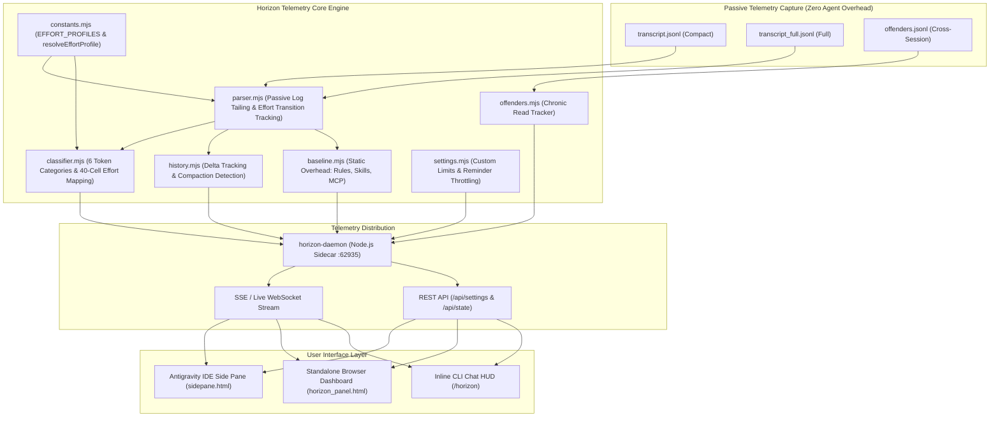
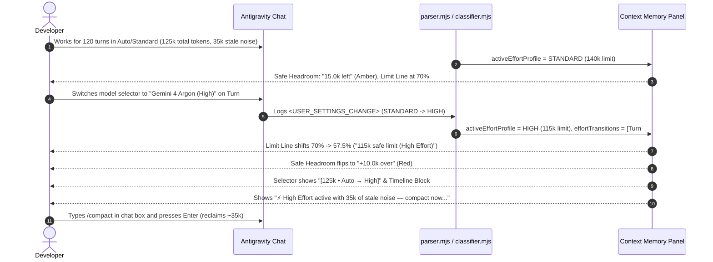

# Context Memory (Chrono-Attention Horizon): 360° Technical & Architectural Evaluation Guide

> **Component:** `context-horizon` (`ctxtop` / `agy-horizon-flightcheck`)  
> **Target Platform:** Google Antigravity IDE, CLI, and Standalone Browser Telemetry  
> **Status:** Production v3.1.0 (Zero-Dependency Node.js 20+ ESM)  
> **Specification Version:** 1.1.0 (Dynamic Effort-Tier & Transition-Aware)  

---

## 1. Executive Summary & Problem Space

Modern LLM-assisted software engineering relies on long-context models (e.g., 200k tokens in Gemini 1.5/2.0/3.8/4 Argon and Claude Opus/Sonnet). However, as conversations progress, developers inevitably encounter four severe context degradation hazards:

1. **Prefix Amputation:** When total token usage exceeds safe thresholds (e.g., ~140k tokens on Standard/Auto tiers, ~115k on High/Max reasoning tiers, or ~95k on Fast/Flash tiers), earlier conversational turns, foundational system rules, and workspace requirements risk being truncated or pushed outside the high-attention retrieval horizon.
2. **Dynamic Reasoning Headroom Compression & Early Dilution:** A static safe limit ignores real-world model mechanics:
   * **High / Max Effort (`HIGH`):** Deep reasoning models reserve a large hidden thinking-token budget (`~25k` tokens) that compresses effective input headroom down to `115k`.
   * **Fast / Flash / Low Effort (`FAST`):** Lightweight and low-effort tiers suffer from middle-window Attention Dilution much earlier (`~95k` tokens) than frontier reasoning tiers.
3. **Context Dilution & High-Effort "Sludge Tax":** Re-reading the same full source files repeatedly, leaving dead stack traces in history, or emitting massive un-truncated terminal outputs dilutes the model's attention. Switching to `High` reasoning effort while carrying `>= 30k` of reclaimable bloat forces the reasoning model to burn expensive thinking tokens and latency re-evaluating dead context on every turn.
4. **Accidental Context Blinding:** When tools offer blunt exclusion mechanisms (such as adding files to `.antigravityignore`), novice users frequently exclude the very source files they are editing (e.g., `sidepane.html`), permanently blinding the AI to the active workspace.

**Context Memory (Chrono-Attention Horizon)** is an agent-native, non-invasive telemetry and memory management system built specifically for Antigravity. It monitors token health in real time, dynamically adapts safe thresholds when a developer switches models or reasoning effort mid-session, classifies the active 200k-token window into 40 discrete chronological cells (5,000 tokens each), marks effort transitions on the timeline, attributes context growth, and provides human-friendly, one-click compaction and handoff workflows.

---

## 2. System Architecture



### 2.1 Core Architectural Principles
* **Zero Overhead on Agent Thinking:** The agent never polls or processes telemetry in its own context window. The engine passively reads local JSONL log streams emitted by the Antigravity host harness.
* **Dynamic Effort-Tier Adaptation:** Safe limits, progress bar markers, headroom calculations, and sludge warnings automatically recalibrate whenever `<USER_SETTINGS_CHANGE>` or turn metadata indicates a model or reasoning effort switch mid-session.
* **Tenth-of-a-Kilotoken Mathematical Parity:** The UI enforces strict mathematical equality across all visible badges: individual rows are rounded to `0.1k`, and the total badges, cards, and button counts are derived from the exact sum of those rounded values.
* **Deterministic Discretization:** The 200k context window is mapped onto 40 discrete 5,000-token cells, giving developers a tactile, chronological block view of their session from oldest instruction to newest tool call—including exact `⇄` markers where model/effort switches occurred.

---

## 3. Effort-Tier Profiles & Context Classification Engine

### 3.1 Dynamic Effort-Tier Profiles (`constants.mjs`)
`constants.mjs` defines `EFFORT_PROFILES` and exports `resolveEffortProfile(turnMetadata)` to map any model or reasoning effort setting (`Low`, `Medium`, `High`/`Max`/`Thinking`, `Fast`/`Flash`/`Lite`, or `Auto`) to its effective context ceiling:

| Profile Key | UI Label | Short Badge | Safe Limit | Bar Position (`% of 200k`) | Thinking Reserve | Limit Reason (`limitReason` Tooltip) |
| :--- | :--- | :---: | :---: | :---: | :---: | :--- |
| **`HIGH`** | `High Effort` | `High` | **`115,000`** | `57.5%` | `25,000` | `"25k reserved for deep reasoning"` |
| **`STANDARD`** | `Standard / Auto` | `Auto` | **`140,000`** | `70.0%` | `0` | `"140k recall ceiling"` |
| **`FAST`** | `Fast / Low Effort` | `Fast` | **`95,000`** | `47.5%` | `0` | `"Earlier middle-window dilution on fast tiers"` |

### 3.2 Mid-Session Effort Transition Tracking (`parser.mjs` & `classifier.mjs`)
* **Per-Turn Extraction (`extractTurnEffortMetadata`):** Scans JSONL entries for `<USER_SETTINGS_CHANGE>` tags (e.g., ``The user changed setting `Model Selection` from Gemini 4 Argon (High) to Gemini 3.8 Flash (Medium)``) as well as structured turn properties (`effort`, `reasoning_effort`, `effortTier`, `model`, `turnMetadata`).
* **Transition History (`extractEffortTimeline`):**
  * Records a structured transition event whenever the resolved effort tier changes between Turn `N-1` and Turn `N`:
    `{ turnIndex, stepNumber, blockIndex, fromTier, toTier, fromLabel, toLabel, timestamp }`.
  * **Mid-Session `fromSpec` Baseline Resolution:** Because Antigravity only injects `<USER_SETTINGS_CHANGE>` on the turn a developer modifies the model/effort dropdown (e.g., Turn `#120`), `extractEffortTimeline()` inspects `meta.fromSpec` on any turn index (`idx >= 0`) to establish the true prior tier when no earlier tag was emitted, and computes an initial `blockIndex` (`0..39`) from cumulative step tokens.
* **State Payload Enrichment:** `classifyHorizon()` evaluates `extractEffortTimeline(rawSteps)` across the full transcript (preserving transitions across checkpoints), refines each transition's `blockIndex` (`0..39`) against the 40-cell `turnRange` array, and attaches `activeEffortProfile` and `effortTransitions` (`effortHistory`) to the `:62935` sidecar state payload.

### 3.3 Six Token Categories (`classifier.mjs`)
Every token in the conversation transcript is classified into one of six distinct categories:

| Category | Color / Code | Priority | Description & Examples |
| :--- | :--- | :---: | :--- |
| **`ANCHOR`** | Cyan (`#00d7ff`) | 1 | Foundational project instructions: `AGENTS.md`, workspace rules, injected skill definitions, base tool schemas. |
| **`ACTIVE_WORKING_SET`**| Green (`#10b981`) | 5 | Current task state: turns within the last 25 steps, active code diffs, recent tool inputs/outputs. |
| **`STALE_DUPLICATE`** | Amber (`#f59e0b`) | 3 | Wasteful context: full-file re-reads where an earlier snapshot already exists, older turns beyond 25 steps. |
| **`DEAD_ERROR`** | Red (`#ef4444`) | 4 | Resolved stack traces, failed commands, and tool syntax errors that no longer contribute to the active plan. |
| **`FOREIGN_BLEED`** | Magenta (`#ff0087`)| 2 | Cross-workspace memory bleed or irrelevant Knowledge Items injected from other projects. |
| **`FREE_HEADROOM`** | Slate (`#334155`) | 6 | Available unallocated tokens remaining before reaching the active safe limit (`95k`/`115k`/`140k`) or window limit (`200k`). |

---

## 4. UI Capabilities & Feature Breakdown

### 4.1 Telemetry Overview Bar, Dynamic Safe Limit Line & Metric Cards
* **Segmented Bar:** Visually divides active tokens into Active Signal (green), Reclaimable Clutter (amber), and Resolved Errors (red) against Free Headroom (slate/dark).
* **Dynamic Safe Limit Line (`#limitLine` & `#limitTag`):** Positions the red dashed threshold marker dynamically at `(activeEffortProfile.safeLimit / maxTokens) * 100%` (`57.5%` for `115k`, `70%` for `140k`, `47.5%` for `95k`) with the label `{safeLimitInK}k safe limit ({activeEffortProfile.label})`.
* **Dynamic Safe Headroom Card (`#valFree` & `#subFree`):**
  * Computes headroom against `activeEffortProfile.safeLimit` (`15.0k left` vs `+10.0k over`).
  * Appends an interactive info tooltip (`ⓘ`) to `#subFree` (`Until {safeLimitInK}k safe limit ⓘ`) explaining `activeEffortProfile.limitReason`.
  * Green (`#10b981`) when `> 15k` tokens of safe headroom remain; Amber (`#f59e0b`) when `0.1k` to `15k` remain; Red (`#ef4444`) when operating above the active safe limit.
* **Chat Selector & Footer Routing Badge (`#sessionSelect` & `#footerMeta`):**
  * When a session changes effort tiers mid-chat (e.g., started in `Auto` or `Low` and switched to `High` on Turn #120), displays `[125k • Auto → High]` in both the top conversation selector and footer metadata line.

### 4.2 High-Effort "Sludge Tax" Warning Banner (`#highEffortSludgeBanner`)
* When `activeEffortProfile.tier === 'HIGH'` AND `reclaimableTokens >= 30000`, injects a prominent one-line callout banner directly inside the `/compact` recommendation box (`#guidedStepBox`):
  > `⚡ High Effort active with 35k of stale noise — compact now to prevent slow reasoning turns and thinking-token burn.`

### 4.3 Turn-to-Turn Delta Attribution
* Tracks session growth velocity on every turn using a 50-turn ring buffer (`history.mjs`).
* Highlights single-turn spikes and names the exact cause:
  > `▲ +4.5k since last turn · largest: read_file sidepane.html (~0.7k)`
* Automatically recognizes compaction events:
  > `▼ −78.0k since last turn (compacted)`

### 4.4 Actionable Brain Diagnostics (Cleared by `/compact`)
* **Earlier Chat History:** Displays tokens consumed by older turns (`> 25` steps old) that are ready to be summarized.
* **Fixed Error Logs:** Identifies dead compiler/test stack traces that have been superseded by successful runs.
* **Repeated File Reads:**
  * Groups re-read files with occurrence counts (`1 re-read`, `4 re-reads`).
  * **Active Source Protection (`isIgnorablePath`):** Excludes editable source files (`*.html`, `*.js`, `*.ts`, `*.py`) from the ignore action. Only scratch scripts, logs, lockfiles, and build artifacts show the `Ignore file` button.
  * **Behavioral Nudge Prompts:**
    * `Prevent re-reads: 📋 Tell agent: Read line ranges`
    * `Prevent re-reads: 📋 Tell agent: Use subagent`

### 4.5 Plain-Text `/compact` Instruction & Prompt Action Buttons
* **Slash Command Guidance (`/compact`):** Because `/compact` is a native slash command with IDE autocomplete, the panel renders a clean text instruction (`Type /compact in the chat box and press Enter · reclaims ~X.Xk · keeps rules, plan & code intact`) rather than a redundant copy/paste button.
* **Prompt Action Buttons (`📋 Tell agent` / `Save task.md`):** Clicking any behavioral prompt button:
  1. Submits directly into the active chat via `window.sidecar.agent.sendMessage` when running inside the IDE host, or writes the prompt to the system clipboard as a fallback.
  2. Dispatches a postMessage (`antigravity.focusChatInput`) to the host IDE on clipboard fallback so the cursor immediately focuses on the chat input box.
  3. Flashes the button with a 2,000ms visual confirmation (`✓ Sent to agent` or `✓ Copied! Press Ctrl+V in chat`).

### 4.6 Clean Chat Handoff & `task.md` Checkpointing
* Evaluates whether `task.md` has been saved and how many turns it is behind.
* Protects against context loss by warning users before they abandon a session:
  * `● task.md synced` (Green)
  * `● task.md stale • 5 turns behind` (Amber)
  * `● task.md stale • not saved yet` (Red)

### 4.7 40-Block Chronological Timeline with Effort Shift Markers (`⇄`)
* An expandable drawer (`▶ View session timeline`) rendering 40 individual 5k-token blocks.
* Any 5k-token block containing an entry in `effortTransitions` renders a top-border accent (`.effort-shift`) and a corner badge (`⇄`).
* Hovering over a transition cell displays the exact transition detail in both the cell tooltip and inspector bar:
  > `Turn #120: Switched effort STANDARD → HIGH`

---

## 5. Walkthrough of Practical Usage Scenarios

### Scenario 1: Mid-Session Upgrade to High Effort Triggers Dynamic Limit & Sludge Warning


### Scenario 2: Stopping Redundant Full-File Reads
* **Situation:** During an iterative CSS edit, the agent reads `sidepane.html` (2,000+ lines) on 6 consecutive turns.
* **Telemetry Alert:** `Repeated File Reads (1 file) · 18.2k reclaimable`.
* **Safe Action:**
  * The row displays `.../ui/sidepane.html: 6 re-reads · 18.2k tok`.
  * Because `sidepane.html` is an active source file, the dangerous `Ignore file` button is omitted.
  * The developer clicks `📋 Tell agent: Read line ranges`.
  * Dev pastes into chat: *"To keep context memory lean, please use StartLine/EndLine when reading large files instead of reading full files repeatedly."*
  * The agent adjusts behavior immediately, using surgical line ranges on subsequent turns.

### Scenario 3: Isolating a Massive Command Blowout
* **Situation:** The agent executes `npm test --verbose` which prints a 16,000-token trace.
* **Telemetry Alert:** Section **Biggest Single Turn** flags `Large Output at Turn #34 (16.0k in 1 step)`.
* **Action:** Developer expands `▶ View turn details`, verifies the runaway command, and clicks `📋 Tell agent: Truncate Command Output` to enforce piping through `head` or `Select-Object -First 50`.

---

## 6. Verification, Test Coverage & Integrity

The component is verified via an automated 8-suite test harness executed in JSDOM environments against production build outputs:

| Test Suite | Purpose | Key Assertions |
| :--- | :--- | :--- |
| `test_baseline.cjs` | Static overhead calculation | Rules full bytes, skill frontmatters, lazy MCP schemas, unattributed remainder. |
| `test_colors.cjs` | UI accessibility & theme tokens | Dark-mode contrast ratios, opaque danger/warning card backgrounds, text legibility. |
| `test_delta.cjs` | Dynamic turn velocity | Turn-to-turn token deltas, blowup source attribution, compaction drops. |
| `test_offenders.cjs` | Cross-session chronic analysis | `offenders.jsonl` deduplication, 20-session pruning, ignorable vs source file checks. |
| `test_regressions.cjs` | Polish & rounding parity | Sum of rounded rows equals total badge to 0.1k; footer alignment; button states. |
| `test_settings.cjs` | Settings & Effort-Tier unit tests | `EFFORT_PROFILES` & `resolveEffortProfile` (`115k`/`140k`/`95k`), JSONL mid-session transition parsing (`idx >= 0` `fromSpec` & `blockIndex`), custom limits (20k–1M). |
| `test_spikes.cjs` | Spike categorization semantics | `Biggest Single Turn` headers, turn age (>25 steps) classification, dynamic badge pills. |
| `test_ui.cjs` | End-to-end DOM & Effort Shift validation | Mid-session transition `STANDARD` (`140k`) → `HIGH` (`115k`) at `125k` tokens (`15.0k left` → `+10.0k over`, `70%` → `57.5%`), high-effort sludge banner, `Auto → High` badge, timeline `⇄` marker. |

### 3-Way Mirror Parity Verification
Core modules and panel HTML are maintained in byte-for-byte synchronization across the canonical plugin directory, the workspace repository, and the Flightcheck plugin mirror:
1. **UI Panel HTML (3 Copies — 100% Identical):**
   * Canonical Plugin UI: `C:\Users\frank\.gemini\config\plugins\agy-horizon\src\ui\sidepane.html`
   * Workspace Mirror UI: `C:\Projects\ga-visualizer-v2\src\webview\horizon_panel.html`
   * Flightcheck Mirror UI: `C:\Users\frank\.gemini\config\plugins\agy-horizon-flightcheck\src\webview\horizon_panel.html`
   * *Verified SHA-256 Hash:* `A2D8B55BD9D63AF6B31363F1C1026123FC8A3DCE3050370B49B92A822430AAA4`
2. **Core Engine (`src/core/` across `agy-horizon`, `ga-visualizer-v2`, and `agy-horizon-flightcheck` — 100% Identical):**
   * `constants.mjs`: `17796D14D4B3248ADA8303F08AE3EBA481D200A60FC2CFA1ED6A8162D88C83DB`
   * `parser.mjs`: `482827DB961F40FBC83F38396AF42E36AD769EDEFA87C6F828079D50C900D2D3`
   * `classifier.mjs`: `49BEA6B91927390F5A324A6388FD8184B147914C50BF1F5EE13FC8BF7ECEEB24`

---

## 7. Operational Cheat Sheet

```
+-----------------------------------------------------------------------------------------+
|                                CONTEXT MEMORY PANEL GUIDE                               |
+-----------------------------------------------------------------------------------------+
| Metric / Component          | What it Means                  | Recommended Action       |
+-----------------------------+--------------------------------+--------------------------+
| Active Signal (Green)       | Essential code, rules, & plan  | Keep high (> 70%)        |
| Reclaimable Clutter (Amber) | Old turns, re-reads, dead logs | Run /compact to clear    |
| Safe Headroom (Green/Amber) | Room before tier safe limit    | Check effort tier & rate |
| --------------------------- | ------------------------------ | ------------------------ |
| Effort Tiers (95k/115k/140k)| Fast (95k), High (115k), Auto  | Hover ⓘ for limit reason |
| [125k • Auto → High] Badge  | Mid-session effort switch      | Watch for tighter limit  |
| ⚡ High Effort Sludge Alert | High effort + >=30k stale noise| Run /compact immediately |
| ⇄ Timeline Cell Marker      | 5k block where effort switched | Hover cell for Turn #    |
| --------------------------- | ------------------------------ | ------------------------ |
| Earlier Chat History        | Completed turns > 25 steps old | Safe to summarize        |
| Repeated File Reads         | Files read multiple times      | Tell agent: Line ranges  |
| Fixed Error Logs            | Obsolete stack traces/failures | Clear via /compact       |
| Biggest Single Turn         | Massive single-step injections | Tell agent: Truncate     |
| --------------------------- | ------------------------------ | ------------------------ |
| ● task.md stale             | Checkpoint out of date         | Click "Save task.md"     |
| View session timeline       | 40-block chronological view    | Hover to inspect slices  |
+-----------------------------------------------------------------------------------------+
```
