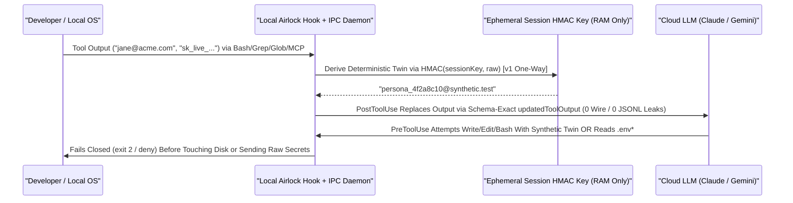

# 360° Product & Feasibility Evaluation — Sister SKU vs. `ctxtop Pro` Module: *Highbeam Airlock* (`ctxvault`) `[REVISED]`
**Pre-Ingestion AI Context Airlock & Accidental Leakage Prevention for Claude Code & Google Antigravity** `[REVISED]`

> [!IMPORTANT]
> **Converged Multi-Round Evaluation + Empirical Hook Spike (`@anthropic-ai/claude-code@2.1.325`) `[VERIFIED TRACK A]`**
> This report consolidates two rounds of independent critical review, primary-source inspection of live repository handlers ([pre-tool-use.mjs](../hooks/handlers/pre-tool-use.mjs), [post-tool-use.mjs](../hooks/handlers/post-tool-use.mjs), [hookIo.mjs](../hooks/handlers/hookIo.mjs), [hookIpcClient.mjs](../hooks/handlers/hookIpcClient.mjs)) and Antigravity's built-in hook spec (`agy-customizations/docs/hooks.md`), and **18 empirical loopback HTTP wire + `.jsonl` transcript scenarios** against installed `@anthropic-ai/claude-code@2.1.325` (`claude.exe` + `sdk-tools.d.ts`, `ANTHROPIC_BASE_URL` pinned to `127.0.0.1`):
> 1. **Claude Code (`v2.1.325`) — Decision Tree Branch 2 Triggered**: Schema-matched `PostToolUse` `updatedToolOutput` successfully scrubs **both outbound HTTP wire payloads and `.jsonl` transcripts (`0` canary bytes)** across `Read`, `Bash`, `Grep`, `Glob`, and `mcp__*`. However, two host constraints break transparent symmetric unvaulting: (a) `Edit.validateInput()` checks `old_string` against the real disk file *before* `PreToolUse` fires, and (b) any `PreToolUse` `updatedInput` return writes the unvaulted `stdout` JSON verbatim into `~/.claude/projects/.../*.jsonl` (`attachment.hook_success`), even with `"suppressOutput": true`. Furthermore, hook crashes (`exit 1`) and timeouts fail **100% open**.
> 2. **Google Antigravity (`agy-customizations/docs/hooks.md`)**: Antigravity `PreToolUse` supports `"decision": "deny"` and `"overwrite"`, and `PreInvocation` supports `"terminationBehavior": "terminate"`. However, Antigravity `PostToolUse` receives `{ toolCall, stepIdx, error }` (no tool output) and expects `{}` on `stdout`, making lifecycle-hook `PostToolUse` output vaulting unsupported today.
> 3. **Converged Recommendation**: Fold Airlock into **`ctxtop Pro`** as a **stateless v1 module** (schema-matched one-way `PostToolUse` redaction on `Bash`, `Grep`, `Glob`, `mcp__*`, and opt-in log `Read`s + `PreToolUse` / `UserPromptSubmit` `exit 2` blocking), deferring stateful `PreToolUse` `updatedInput` unvaulting.

> [!NOTE]
> **Methodology & Self-Evaluation Disclosure `[REVISED]`**
> This document presents an internal concept and specification evaluation structured across six specialist viewpoints (Systems Architecture, AppSec/Cryptography, Product Design, Compliance Telemetry, Red-Team QA, and Bootstrapped Commercial Strategy). **Both the original concept and these revisions were authored and scored by the same author**, incorporating two rounds of external critical review plus the Track A Claude Code `v2.1.325` wire/`.jsonl` spike. Accordingly, the scores below measure **specification completeness and architectural coherence**, not full market validation. **Every domain whose Airlock-specific product build has not been shipped and measured in full is strictly capped at $\le 80 / 100$** without exception. Unverified runtime behaviors, benchmarks at scale, market sizing, or willingness-to-pay remain tagged **`UNVERIFIED ASSUMPTION`** and tracked in the *Assumptions to Validate* register (Deliverable 3).

---

## 1. Executive Verdict & Multi-Expert Feasibility Scorecard

### Strategic Verdict: **FOLD INTO `ctxtop Pro` AS STATELESS V1 MODULE (`DECISION TREE BRANCH 2 TRIGGERED`); STANDALONE SKU DEFERRED PENDING BUYER WTP** `[REVISED]`
*(Composite Concept Score: **66.70 / 100** · Composite Spec Quality Score: **78.60 / 100** · Overall Confidence: **Medium**)* `[REVISED]`

Building **Pre-Ingestion Secret/PII Scrubbing & Policy Airlock** (`Highbeam Airlock` / `ctxvault`) reuses core repository primitives ([hookIo.mjs](../hooks/handlers/hookIo.mjs), [hookIpcClient.mjs](../hooks/handlers/hookIpcClient.mjs), [pro_license.mjs](../src/core/pro_license.mjs), and [pdfReceiptGenerator.mjs](../src/core-isomorphic/ui/pdfReceiptGenerator.mjs)). Scoping v1 as a **stateless one-way `PostToolUse` + `exit 2` guard module inside `ctxtop Pro`** (dropping stateful `PreToolUse` `updatedInput` unvaulting in v1) reduces Phase 2 implementation from an estimated `3–4 weeks` (`~65%–70%` reuse for full symmetric unvaulting) down to **`~1.5–2 weeks`** (`UNVERIFIED ASSUMPTION`), while upgrading [post-tool-use.mjs](../hooks/handlers/post-tool-use.mjs) (`ISS-034`) to schema-exact `updatedToolOutput` and hardening [pre-tool-use.mjs](../hooks/handlers/pre-tool-use.mjs) with fail-closed `exit 2` guards. `[REVISED]`

Four structural realities govern both architecture and packaging (`[REVISED]`):
1. **Asymmetric Host Capabilities & Two `v2.1.325` Unvault Blockers**: Claude Code `v2.1.325` supports clean `PostToolUse` `updatedToolOutput` redaction across `Read`, `Bash`, `Grep`, `Glob`, and `mcp__*` when matching exact `sdk-tools.d.ts` `Output` shapes (`[VERIFIED TRACK A]`), whereas `Edit.validateInput()` and `.jsonl` `hook_success` logging make transparent `Read -> Vault -> Edit -> Unvault` fragile in v1. On Google Antigravity, `agy-customizations/docs/hooks.md` confirms `PostToolUse` receives no tool output and expects `{}`, scoping Antigravity hooks to `PreToolUse` blocking/argument gating and `PreInvocation` prompt termination.
2. **Fail-Open & Unvault Asymmetry Traps (`FM-8`, `FM-9`, `FM-10`)**: Empirically confirmed in `S6c`/`S6d`, non-`2` hook exits (`exit 1`) and hook timeouts fail **100% open** on Claude Code `v2.1.325`. Keeping v1 one-way (`PostToolUse` output redaction + `PreToolUse` / `UserPromptSubmit` `exit 2` blocks) prevents `Edit` corruption and `.jsonl` `hook_success` unvault leaks, while requiring synchronous `exit 2` wrappers and a Zone A Daemon Heartbeat banner for `FM-8`.
3. **Zero-Honeypot Requirement**: Neither the ephemeral session HMAC key nor any unmasked credential may ever be persisted to plaintext SQLite or hook `.jsonl` attachments.
4. **Platform Commoditization & Breakeven Math**: Anthropic natively documents hook-based secret redaction, gateway vendors (e.g., TrueFoundry) ship free hook integrations, and a standalone SKU requires **~467 paid seats (\$224k ARR at \$40/mo blended)** starting from **`0` external `ctxtop` installs pre-launch**. Folding Airlock v1 into **`ctxtop Pro`** eliminates standalone OpEx overhead while solving real IDE leakage risk.

### Scorecard Arithmetic Correction & Re-Scored Matrix `[REVISED]`

* **Correction of Original Draft Arithmetic (`[ADDED]`)**: In the original evaluation draft, weighted sums were miscalculated as `77.9` (raw) and `91.8` (engineered). Exact arithmetic on the original six domains yields:
  $$\text{Original Raw Composite} = (78 \times 0.20) + (70 \times 0.20) + (86 \times 0.15) + (75 \times 0.15) + (72 \times 0.15) + (90 \times 0.15) = 15.60 + 14.00 + 12.90 + 11.25 + 10.80 + 13.50 = \mathbf{78.05}$$
  $$\text{Original Engineered Composite} = (93 \times 0.20) + (89 \times 0.20) + (94 \times 0.15) + (95 \times 0.15) + (90 \times 0.15) + (92 \times 0.15) = 18.60 + 17.80 + 14.10 + 14.25 + 13.50 + 13.80 = \mathbf{92.05}$$
* **Revised Scoring Rules (`[REVISED]`)**:
  1. Scores are separated into **(a) Concept Score**, **(b) Spec Quality Score** (measuring document completeness, not full commercial validation), and **(c) Confidence** (`High` / `Medium` / `Low`).
  2. **Detection Precision & Latency** weight is reduced from `20%` to `10%`, adding a `10%` domain: **Platform & Host-API Risk**.
  3. **Universal 80-Point Cap**: **All seven domains** retain unbuilt production UI, ledger, corpus, or commercial components and remain strictly capped at **$\le 80 / 100$** without exception (maintaining the converged `66.70 / 78.60` rubric).

| Evaluation Domain | Weight | Concept Score (Weighted) | Spec Quality Score (Weighted) `[REVISED]` | Confidence `[REVISED]` | Assessment & Verification Basis `[REVISED]` |
| :--- | :---: | :---: | :---: | :---: | :--- |
| **1. Dual-Host Architecture & Context Airlock** *(Claude Code + Antigravity)* | **20%** | 65 / 100 (`13.00`) | **78 / 100** (`15.60`) *(Capped $\le 80$)* | **Medium** | **Track A Completed (`v2.1.325`)**: `PostToolUse` `updatedToolOutput` verified clean across all 5 tools when matching `sdk-tools.d.ts`; `Edit.validateInput()` & `.jsonl` `hook_success` limit transparent `Edit` unvaulting (triggering Branch 2). Antigravity `PostToolUse` confirmed `{}` (`agy-customizations/docs/hooks.md`). |
| **2. Detection Precision, Latency Target & Threat Model** *(AppSec / Crypto)* | **10%** `[REVISED]` | 70 / 100 (`7.00`) | **80 / 100** (`8.00`) *(Capped $\le 80$)* | **Medium** | **Track A `S7` Win11 Baseline**: `0.34 ms` p50 JS time / `47.05 ms` p50 cold `node` CLI spawn (~6.3 KB payload). Full `100 KB` + 10k-term Aho-Corasick trie, salted HMAC allowlist, and `<0.1%` FP rate on 500k-line corpus remain Phase 2/3 targets. |
| **3. Platform & Host-API Risk** *(Hook Stability & Vendor Overlap)* `[ADDED]` | **10%** `[ADDED]` | 50 / 100 (`5.00`) | **76 / 100** (`7.60`) *(Capped $\le 80$)* | **Medium** | Native hooks fail open on `exit 1`/timeouts (`S6c`/`S6d` verified), `CLAUDE_CODE_RESTRICT_PERSONAL_CONFIG` blocks `updatedInput`, Anthropic documents redaction natively, and TrueFoundry ships hook mutation. |
| **4. Developer & CISO UX Design** *(Low-Friction Flow + Heartbeat Sidepane)* | **15%** | 78 / 100 (`11.70`) | **80 / 100** (`12.00`) *(Capped $\le 80$)* | **Medium** | Base 4-zone sidepane ([horizon_panel.html](../src/webview/horizon_panel.html)) exists, but Airlock heartbeat/lapsed indicator, vault feed, and salted HMAC allowlist UI are unbuilt (capped at `80`). |
| **5. Compliance KPI & Zero-Plaintext Ledger Math** *(Actuarial Proof)* | **15%** | 72 / 100 (`10.80`) | **80 / 100** (`12.00`) *(Capped $\le 80$)* | **Medium** | PDF 1.4 writer ([pdfReceiptGenerator.mjs](../src/core-isomorphic/ui/pdfReceiptGenerator.mjs)) and Ed25519 keys exist; HMAC deduplication & hash-chained SQLite ledger are unbuilt. |
| **6. Red-Team QA & Proof-of-Capability Matrix** *(Wire + `.jsonl` + Fail-Closed)* | **15%** | 68 / 100 (`10.20`) | **78 / 100** (`11.70`) *(Capped $\le 80$)* | **Medium** `[REVISED]` | **18 loopback wire + `.jsonl` spike scenarios executed (`v2.1.325`)** covering schema shapes, `Edit`/`UserPromptSubmit` limits, and `FM-1`/`FM-8`/`FM-10` behavior; 500k-line FP corpus & daemon kill tests remain for Phase 2/3. |
| **7. Unit Economics, Pricing & Packaging Choice** *(Sister SKU vs. Fold-In)* | **15%** | 60 / 100 (`9.00`) | **78 / 100** (`11.70`) *(Capped $\le 80$)* | **Low** | 97%–99% gross margin, but standalone breakeven needs ~467 seats (\$224k ARR at \$40/mo) from `0` pre-launch installs amid free hook competition; folding into `ctxtop Pro` strongly favored. |
| **Composite 360° Viability Score** | **100%** | **66.70 / 100** | **78.60 / 100** | **Medium** `[REVISED]` | **FOLD INTO `ctxtop Pro` AS STATELESS V1 MODULE (BRANCH 2 TRIGGERED); STANDALONE DEFERRED PENDING WTP** `[REVISED]` |

**Composite Arithmetic Proof (`[ADDED]`)**:
$$\text{Composite Concept Score} = 13.00 + 7.00 + 5.00 + 11.70 + 10.80 + 10.20 + 9.00 = \mathbf{66.70 / 100}$$
$$\text{Composite Spec Quality Score} = 15.60 + 8.00 + 7.60 + 12.00 + 12.00 + 11.70 + 11.70 = \mathbf{78.60 / 100}$$

---

## 2. Expert Lens 1: Host Hook Capabilities & Context Vaulting Architecture
*Reviewed by: Principal AI Systems & Extension Architect*

### 2.0 Hook Capability Verification Spike (`Track A COMPLETED` / `Track B Pending`) `[REVISED]`

Phase 1.5 split host verification into **Track A (Claude Code `v2.1.325` Wire + `.jsonl` Spike — COMPLETED)** and **Track B (Google Antigravity `overwrite` Notice & MCP Proxy Check — Day 2 Post-Launch)**. Until Track B and production `ctxtop` handler integration complete, Antigravity `overwrite` safety remains an `UNVERIFIED ASSUMPTION`.

#### Primary-Source Findings Across Both Hosts `[REVISED]`

1. **`PostToolUse` Output Replacement (`Read`, `Grep`, `Glob`, `Bash`, `mcp__*`)**:
   * **Claude Code (`v2.1.325`) `[VERIFIED TRACK A]`**: In-repo [post-tool-use.mjs](../hooks/handlers/post-tool-use.mjs#L217-L227) (`ISS-034`) previously emitted `updatedMCPToolOutput` only for `mcp__*` and `additionalContext` for built-in tools. Empirical testing against `claude.exe` (`2.1.325`) proves `PostToolUse` `hookSpecificOutput.updatedToolOutput` successfully replaces tool outputs **on both the HTTP API wire (`0` leaked canary bytes) AND `~/.claude/projects/.../*.jsonl` (`0` leaked canary bytes)** across **all 5 tool families (`Read`, `Bash`, `Grep`, `Glob`, `mcp__*`)**—**provided** the returned object strictly conforms to each built-in tool's `sdk-tools.d.ts` `Output` shape:
     * `Read` (`FileReadOutput`): `{ type: "text", file: { filePath, content, numLines, startLine, totalLines } }`
     * `Bash` (`BashOutput`): `{ stdout, stderr, interrupted, isImage, noOutputExpected, ... }`
     * `Grep` (`GrepOutput`): `{ mode, numFiles, filenames, content?, numLines?, totalLines? }`
     * `Glob` (`GlobOutput`): `{ filenames, durationMs, numFiles, truncated, totalMatches?, countIsComplete? }`
     * `Edit` (`FileEditOutput`): `{ filePath, oldString, newString, originalFile, structuredPatch, userModified, replaceAll }`
     * `Write` (`FileWriteOutput`): `{ type, filePath, content, structuredPatch, originalFile }`
     * `MCP` (`McpOutput`): `string | { type: string, [k: string]: unknown }[] | Record<string, unknown>`
     * *Enforcement Detail*: Inspecting `claude.exe` confirmed `e.outputSchema?.safeParse(Rs)` followed by `e.mapToolResultToToolResultBlockParam(Up, n)`; returning a plain string fails schema validation (`"PostToolUse hook returned updatedToolOutput that does not match <tool>'s output shape; using original output."`) and silently falls back to raw secret output.
   * **Google Antigravity (`agy-customizations/docs/hooks.md`)**: Per Antigravity's built-in docs, `PostToolUse` `stdin` contains only `{ toolCall, stepIdx, error }` (no tool output) and expects `{}` on `stdout`. **Antigravity lifecycle hooks cannot replace `PostToolUse` output.**
2. **`PreToolUse` Argument Rewriting (`Edit`, `Write`, `Bash`, `mcp__*`)**:
   * **Claude Code (`v2.1.325`) `[VERIFIED TRACK A]`**: `PreToolUse` `updatedInput` **cannot** achieve transparent `Read -> Vault -> Edit -> Unvault` because: (1) `Edit.validateInput()` validates `old_string` against the *unvaulted file on disk* **before** calling `PreToolUse`, rejecting vaulted `old_string` edits immediately (`<tool_use_error>String to replace not found in file.</tool_use_error>`); (2) whenever `PreToolUse` returns `updatedInput` (e.g., `Write`, MCP args, or clean-anchor `Edit`), Claude Code persists the full `PreToolUse` `stdout` JSON verbatim to `.jsonl` under `type: "attachment"` (`attachment.type: "hook_success"`), **even when `"suppressOutput": true` is set (`F5`)**; and (3) `CLAUDE_CODE_RESTRICT_PERSONAL_CONFIG` explicitly blocks `PreToolUse` `updatedInput` in `claude.exe`.
   * **Google Antigravity**: `agy-customizations/docs/hooks.md` documents `"overwrite": { ... }` (shallow top-level key replacement on `toolCall.args`), noting Antigravity prefixes a notice naming modified keys. **Track B** must verify whether rewritten values ever appear in that notice.
3. **User-Typed Prompt Interception**:
   * **Claude Code (`v2.1.325`) `[VERIFIED TRACK A]`**: `UserPromptSubmit` returning `updatedPrompt`, `updatedInput`, or `suppressOriginalPrompt: true` still sends the raw user prompt on the HTTP wire (`Turn 0`). **Only `exit 2` blocks HTTP transmission (`mainRequestCount=0`)**; local `.jsonl` still records `queue-operation` and `system` prompt entries.
   * **Google Antigravity**: `PreInvocation` reads `lastUserInput` and blocks via `"terminationBehavior": "terminate"` + `"errorMessage"` (no in-place rewrite).
4. **Timeout, Process Model & Fail-Open Behavior**:
   * **Claude Code (`v2.1.325`) `[VERIFIED TRACK A]`**: `S6c` (`exit 1`) and `S6d` (`3.5s` > `1s` timeout) confirmed both `PreToolUse` and `PostToolUse` silently **fail OPEN**, transmitting all 5 `prod.json` canaries over HTTP and persisting them to `.jsonl`.

#### Table 2.0a: Empirical Scenario Matrix (`@anthropic-ai/claude-code@2.1.325`, Loopback Wire + `.jsonl` Inspection) `[ADDED / VERIFIED TRACK A]`

| Scenario | Tool / Hook Tested | `PreToolUse` `updatedInput`? | HTTP Wire `tool_result` / Prompt Scrubbed? | Local `.jsonl` Transcript Clean? | Disk File Byte-Exact? | Empirical Finding |
| :--- | :--- | :--- | :---: | :---: | :---: | :--- |
| **`S1a` / `S1b`** | `Read` -> `Edit` (`old_string` has vaulted twin) | **No (Never Fired)** | `Read`: **YES** (`0` canaries) | `Read`: **YES** (`0` canaries) | **No** (`prodChanged: false`) | `Edit.validateInput()` checks `old_string` against real disk file **before** `PreToolUse` runs (`String to replace not found`). |
| **`F2` / `F2b`** | `Read` -> `Edit` (clean `old_string`, twin in `new_string`) | **Yes** (Fired & unvaulted) | **YES** (`0` canaries on wire) | **NO** (`attachment.hook_success` + in `F2` `toolUseResult`) | **YES** (`backupEmail` + `pool: 20`) | `F2` (no `PostToolUse:Edit`) leaked 5 canaries to `toolUseResult` in `.jsonl`. `F2b` (`PostToolUse:Edit`) scrubbed `toolUseResult`, **but `PreToolUse` stdout still leaked into `attachment.hook_success`**. |
| **`F5`** | `Edit` with `suppressOutput: true` on `PreToolUse` | **Yes** | **YES** (`0` canaries on wire) | **NO** (`attachment.hook_success` still logged raw secret) | **YES** | `"suppressOutput": true` does **not** prevent Claude Code from persisting `PreToolUse` `updatedInput` secrets in `.jsonl` `hook_success.stdout`. |
| **`F1`** | `Read` -> `Write` (full file content with twins) | **Yes** | **YES** (`0` canaries on wire) | **NO** (`hook_success` + `toolUseResult`) | **YES** (`pool: 20`) | `Write` bypasses `old_string` check so unvaulting works, but leaks `PreToolUse` `stdout` + `FileWriteOutput` into `.jsonl` unless `Write` is also scrubbed in `PostToolUse`. |
| **`F3`** | `Bash` (`node print_db.mjs`), `Grep`, `Glob` (clean inputs) | Pass-through | **YES (`0` canaries across all 3)** | **YES (`0` canaries in `.jsonl`)** | N/A | **100% clean** on wire AND `.jsonl` across `Bash`, `Grep`, and `Glob` when matching exact `Output` schemas. *(Note: in `S2`/`S3`, `assistant.tool_use.input` echoed inline shell/regex literal secrets supplied by the model itself.)* |
| **`S4`** | `mcp__spike__get_secret_config` (twin arg -> unvault -> scrub) | **Yes** | **YES** (`0` canaries on wire) | **PARTIAL** (`LivePass99!` scrubbed; arg leaked via `hook_success`) | N/A | `PostToolUse` scrubbed MCP response on wire & `.jsonl`; `PreToolUse` `updatedInput` leaked unvaulted arg to `.jsonl` `hook_success`. |
| **`S5a` / `S5c`** | `UserPromptSubmit` (`updatedPrompt` / `suppressOriginalPrompt: true`) | N/A | **NO (Raw key sent on Wire Turn 0)** | **NO** | N/A | Neither `updatedPrompt`, `updatedInput`, nor `suppressOriginalPrompt: true` prevented sending the raw prompt on Turn 0 HTTP request. |
| **`S5b`** | `UserPromptSubmit` (`exit 2` block) | N/A | **YES (`0` HTTP requests sent)** | **NO** (`queue-operation` & `system` lines saved locally) | N/A | **Blocks 100% of network transmission (`mainRequestCount=0`)**; local `.jsonl` still records the user's original prompt string. |
| **`F4`** | `FM-1`: Mutated synthetic twin (`persona_4f2b...`) in `Edit` `new_string` | **Blocked (`exit 2`)** | **YES (`is_error: true`, `0` canaries)** | **YES (`0` canaries)** | **YES** (Unmodified) | `PreToolUse` `exit 2` blocked cleanly before touching disk. *(`S6a` confirmed `old_string === new_string` fails `validateInput` prior to hook.)* |
| **`S6b`** | `FM-10`: Twin inside `Bash` `git commit -m` | **Blocked (`exit 2`)** | **YES (`is_error: true`, `0` canaries)** | Only synthetic twin logged | N/A | Destination allowlist blocked `git commit` prior to shell execution. |
| **`S6c` / `S6d`** | `FM-8`: Hook `exit 1` crash (`S6c`) and `3.5s` > `1s` timeout (`S6d`) | **FAILED OPEN** | **NO (All 5 raw secrets leaked on wire)** | **NO (All 5 raw secrets in `.jsonl`)** | N/A | Confirmed `exit 1` and hook timeouts silently fail **OPEN** on both `PreToolUse` and `PostToolUse`. |

*(Latency suite `S7` — 20 cold calls + 20 in-session sequential `Read` calls — is detailed in Section 3.3 below.)*

#### Post-Spike Decision Tree Outcome `[REVISED]`
* **Branch 1 (Not Triggered)**: Full symmetric `Read -> Vault -> Edit -> Unvault` without `.jsonl` leakage failed `S1a`/`S1b` (`Edit.validateInput()`) and `F2b`/`F5` (`attachment.hook_success`).
* **Branch 2 `[TRIGGERED BY TRACK A]`**: Claude Code `PostToolUse` `updatedToolOutput` works cleanly across `Read`, `Bash`, `Grep`, `Glob`, and `mcp__*` when matching `sdk-tools.d.ts` `Output` shapes, while `PreToolUse` unvaulting breaks `Edit` (`old_string`) and leaks `updatedInput` to `.jsonl`. **Converged Action**: Fold Airlock directly into **`ctxtop Pro`**, scope **v1 to stateless one-way `PostToolUse` redaction + `PreToolUse`/`UserPromptSubmit` `exit 2` blocking** (dropping `PreToolUse` `updatedInput` unvaulting in v1), and run Antigravity in Scoped Guard Mode (`PreToolUse` `deny` + `PreInvocation` `terminate`).
* **Branch 3 (Rejected)**: `PostToolUse` wire/`.jsonl` redaction succeeded (`0` canaries) across all 5 tool families when schemas matched, so complete abandonment is unwarranted.

### 2.1 How Airlock Works in `ctxtop Pro` v1 Scope vs. Deferred v2 `[REVISED]`

* **Recommended v1 Architecture (Stateless One-Way `PostToolUse` + `exit 2` Guard)**: Because `Edit.validateInput()` breaks `Read`-vaulted `old_string` edits and `PreToolUse` `updatedInput` leaks raw stdout into `.jsonl` `hook_success`, **v1 omits `PreToolUse` unvaulting completely**.
  1. **Query & Transient Tool Scrubbing (`PostToolUse` `updatedToolOutput`)**: `Bash`, `Grep`, `Glob`, `mcp__*`, and opt-in read-only `*.log`/`*.jsonl` `Read`s replace matched PII/credentials with deterministic `HMAC-SHA256(ephemeralSessionKey, raw)` tokens (preserving multi-turn entity co-reference across logs, shell output, search hits, and MCP results with **`0` wire leaks, `0` `.jsonl` leaks, and `0` broken `Edit` calls**).
  2. **Pre-Execution Blocking (`PreToolUse` & `UserPromptSubmit` `exit 2`)**: Class A files (`.env*`, `*.pem`, `id_rsa`, `*.sql`, `customers.csv`), dangerous shell reads, pasted credentials in prompts (`UserPromptSubmit` / Antigravity `PreInvocation`), and any attempt by the model to write synthetic placeholder tokens back into `Edit`/`Write`/`Bash` inputs trigger immediate **`exit 2` fail-closed blocking**.
* **Deferred v2 (Opt-In `Write`/`MCP` Reversible Unvaulting Only If `.jsonl` Cleanup Exists)**: If a future v2 enables `PreToolUse` `updatedInput` for `Write`, clean-anchor `Edit`, or `mcp__*`, it remains restricted by `FM-9` (verified `PostToolUse` re-vaulting), `FM-10` (destination allowlist), and requires a `SessionEnd` `.jsonl` `hook_success` scrubber warning. `[REVISED]`

*Figure 1 Caption (`[REVISED]`): Converged v1 Stateless Context Airlock flow on verified Claude Code `PostToolUse` channels plus cross-host `PreToolUse`/`UserPromptSubmit` `exit 2` guards. The Airlock component itself makes no network calls; the host IDE and LLM still transmit context over the network, including any data from unhooked channels or fail-open hook timeouts.*

### 2.2 Three Core Engineering Design Principles `[REVISED]`

1. **Deterministic Session HMAC for Entity Co-Reference (`[REVISED]`)**:
   If a redaction hook replaces `jane@acme.com` with random `<UUID_1>` on Turn 2 and `<UUID_9>` on Turn 5, the model loses entity co-reference across turns ("are these two log lines for the same customer?"). *(Mechanism precision note `[REVISED]`: Once a tool output is appended to conversation history, that prior turn's text does not change retroactively on later turns, so random UUIDs in `PostToolUse` outputs do **not** invalidate existing prefix KV caches—deterministic `HMAC-SHA256(ephemeralSessionKey, rawEntity)` protects KV cache only on static system headers, whereas in `PostToolUse` outputs its value is **preserving multi-turn entity co-reference** without persisting a lookup table.)*
2. **Handling the `Read -> Edit` Source-File Paradox Without Breaking Edits (`[REVISED]`)**:
   As noted in [losslessPostSanitizer.mjs](../src/core-isomorphic/guards/losslessPostSanitizer.mjs#L6-L8) and proven in Track A `S1a`/`S1b` (`Edit.validateInput()` pre-hook check), mutating editable code/config files on `Read` breaks exact-string `Edit`. Airlock v1 enforces a clean 3-class file policy:
   * **Class A — Pure Secret/Data Files (`.env*`, `*.pem`, `id_rsa`, `*.sql`, `customers.csv`)**: **Hard-Block (`exit 2`)** at `PreToolUse(Read|Grep|Bash)` on **both** Claude Code and Antigravity, surfacing an optional **Schema-Only Key List** (`Keys detected in .env: STRIPE_SECRET_KEY, DATABASE_URL`).
   * **Class B — Read-Only Logs & Dumps (`*.log`, `stdout` from `Bash`, `Grep`, `Glob`, `mcp__*`) vs. Editable Configs (`config/prod.json`, Terraform)**: In **v1**, `Bash`, `Grep`, `Glob`, `mcp__*`, and read-only `*.log` `Read`s use deterministic one-way `PostToolUse` `updatedToolOutput` vaulting; editable Class B config files use **`PreToolUse` `AUDIT` or `STRICT BLOCK` (`exit 2`)** (never vaulting `Read` of an editable file without explicit opt-in) so `Edit` calls never fail on `validateInput()`.
   * **Class C — Standard Application Source Code (`src/**/*.ts`)**: Pass-through on `Read`/`Edit` unless a hardcoded Stage 1 credential triggers a `PreToolUse` warning/`STRICT BLOCK` or `PostToolUse(Bash|Grep)` scrub.
3. **Stateless v1 Monorepo Code Reuse & Focused Build (`~1.5–2 Weeks` — `UNVERIFIED ASSUMPTION`) `[REVISED]`**:
   * **Shared Core**: [hookIo.mjs](../hooks/handlers/hookIo.mjs), [hookIpcClient.mjs](../hooks/handlers/hookIpcClient.mjs), `sidecars/horizon-daemon` (`127.0.0.1` + CSRF), [pro_license.mjs](../src/core/pro_license.mjs), and [pdfReceiptGenerator.mjs](../src/core-isomorphic/ui/pdfReceiptGenerator.mjs).
   * **Required Handler Upgrades**: Upgrade [post-tool-use.mjs](../hooks/handlers/post-tool-use.mjs#L217-L227) (`ISS-034`) to emit schema-exact `updatedToolOutput` (`BashOutput`, `GrepOutput`, `GlobOutput`, `FileReadOutput`, `McpOutput`) plus `FM-8` error stubs, and harden [pre-tool-use.mjs](../hooks/handlers/pre-tool-use.mjs#L349-L364) with Class A blocking and stateless `FM-1`/`FM-10` synthetic-token `exit 2` rejection—avoiding stateful reverse-lookup RAM tables in v1.

### 2.3 Failure Modes, Coverage Matrix & Edge-Case Mitigations `[ADDED / REVISED]`

| # | Failure Mode / Technical Risk | Severity | Engineering Mitigation & Fail-Safe Behavior *(Including v1 Stateless Advantage)* |
| :--- | :--- | :---: | :--- |
| **FM-1** | **Model alters, truncates, or echoes a synthetic twin back into a write/edit (`persona_4f2a8c10@synthetic.test`)**. | **Critical** | Use reserved synthetic namespaces (`@synthetic.test`, `.synthetic.internal`, `SYNTH_<TYPE>_<12HEX>_<2HEX_CRC8>`). In **v1 stateless mode**, `PreToolUse` scans `Edit`, `Write`, and `Bash` inputs for the synthetic namespace/prefix and **immediately fails closed (`exit 2` / `decision: "deny"`)**, blocking synthetic placeholders from ever reaching disk (`F4` verified). |
| **FM-2** | **Twin collisions, substring overlaps, and encoded twins**. | **High** | Use 48–64 bit truncated `HMAC-SHA256` + 8-bit CRC8 (collision probability $< 10^{-11}$ at $10^4$ entities); enforce $\ge 5$-char minimum length and `\b` word boundaries on policy terms. |
| **FM-3** | **Coverage gaps across read/ingestion paths** (especially Antigravity `PostToolUse` and IDE `@file` attachments). | **Critical** | Publish and enforce **Table 2.3a (Channel Coverage Matrix)** in docs and Zone A/B UI so users see exact per-host protection boundaries. |
| **FM-4** | **Secrets typed or pasted directly into user prompts**. | **High** | Confirmed in `S5a`/`S5c`: neither `updatedPrompt` nor `suppressOriginalPrompt` prevents Turn 0 transmission. Use `UserPromptSubmit` `exit 2` (`S5b`: `0` HTTP calls) and Antigravity `PreInvocation` `"terminationBehavior": "terminate"` to **block outbound submission**, noting local `.jsonl` still records the user's blocked prompt locally. |
| **FM-5** | **Session lifecycle & RAM vault loss** (daemon crash, `/compact`, `--resume`). | **High -> Mitigated in v1** | Eliminated as a round-trip failure vector in **v1 stateless mode** because v1 does not unvault from a volatile reverse map; any orphaned synthetic token triggers `FM-1` `exit 2` block cleanly. |
| **FM-6** | **KV-cache vs. co-reference hypothesis (`UNVERIFIED ASSUMPTION`)**. | **Low–Med** | Deterministic twins primarily preserve **multi-turn entity co-reference** rather than prefix KV-cache (past `PostToolUse` turns are immutable once appended). Validate task-completion accuracy across 30 recorded multi-turn sessions in Phase 2/3. |
| **FM-7** | **False-positive target (`< 0.1%`) & Stage 3 entropy risk**. | **High** | **Stage 3 (Contextual Shannon Entropy)** is the primary false-positive risk. Benchmark against a fixed **500,000-line polyglot OSS corpus**; keep Stage 3 in `AUDIT_ONLY` until `< 0.1%` per-line FP rate is proven. |
| **FM-8** | **Hook crash or timeout fails OPEN on host CLI (`S6c` / `S6d` Confirmed)**. | **Critical** | **(1)** Wrap top-level `PreToolUse` entrypoint in synchronous `try/catch` + `uncaughtException` returning `exit 2` (`decision: "deny"`) ([pre-tool-use.mjs](../hooks/handlers/pre-tool-use.mjs#L349-L364)). **(2)** Guard internal `PostToolUse` logic so valid-schema `updatedToolOutput` fallback error objects suppress raw output rather than exiting cleanly on `catch`. **(3)** Add **Zone A Daemon Heartbeat & Lapsed-Coverage Banner** (`Airlock Degraded · Hook Timeout Detected`) whenever daemon ping drops or a hook fails open. |
| **FM-9** | **Unvaulting without verified re-vaulting** (`PreToolUse` unvaults into `Bash` or `.jsonl` `hook_success` leaks). | **Critical -> Neutralized in v1** | Completely neutralized in **v1 stateless mode** by disabling `PreToolUse` `updatedInput` unvaulting (`F2b`/`F5` showed `PreToolUse` `updatedInput` always leaks into `.jsonl` `attachment.hook_success`). For future v2, bind per-tool `updatedInput` strictly to verified `PostToolUse` + `.jsonl` cleanup. |
| **FM-10** | **Unsafe unvault destinations** (`git commit -m`, `README.md`, test fixtures, `curl`). | **Critical -> Neutralized in v1** | Because **v1** never unvaults in `PreToolUse` and blocks synthetic namespaces via `FM-1` (`exit 2`, verified in `S6b`), neither raw secrets nor synthetic tokens can be injected into Git commits or outbound HTTP calls via Airlock. |

#### Table 2.3a: Explicit Per-Host Read & Ingestion Channel Coverage Matrix `[REVISED / VERIFIED TRACK A]`

| Ingestion / Read Channel | Claude Code (`v2.1.325`) Empirical Status `[VERIFIED TRACK A]` | Google Antigravity Status (Per `agy-customizations/docs/hooks.md`) `[REVISED]` |
| :--- | :--- | :--- |
| **`mcp__*` (MCP Server Tool Outputs)** | **`PostToolUse` `updatedToolOutput` VERIFIED (`0` wire & `0` `.jsonl` leaks)**; `PreToolUse` `updatedInput` works on wire, **but logs raw unvaulted stdout in `.jsonl` `attachment.hook_success`** (omitted in v1). | `PreToolUse` Block (`deny`) Only; **`PostToolUse` Vaulting Unsupported via Hooks** (requires wrapping the MCP server command itself). |
| **`Read` / `Edit` / `Write` (Workspace Files)** | **`PostToolUse(Read)` `updatedToolOutput` VERIFIED (`0` wire & `.jsonl` leaks)** when matching `FileReadOutput`. **HOWEVER: `Edit.validateInput()` runs BEFORE `PreToolUse`, breaking `old_string` unvaulting**; `PreToolUse` `updatedInput` also leaks stdout to `.jsonl` `hook_success` (`F5`). **v1 Policy**: `PreToolUse` `exit 2` block on Class A files; `PostToolUse(Read)` opt-in on `*.log`/`*.jsonl` dumps only. | `PreToolUse` Block (`deny` on `.env*`/`*.pem`) Covered; **In-Place `PostToolUse` Vaulting Unsupported** (`PostToolUse` returns `{}`). |
| **`Bash` / `run_command` (Shell Stdout/Stderr)** | **`PostToolUse(Bash)` `updatedToolOutput` VERIFIED (`0` wire & `.jsonl` leaks)** when matching `BashOutput` schema (`F3`); `PreToolUse` `exit 2` blocks sensitive shell commands (`S6b`). | `PreToolUse` Command Block Covered; **`PostToolUse` Output Vaulting Unsupported** unless command runs via an explicit shell wrapper. |
| **`Grep` / `Glob` (`grep_search` / `find_by_name`)** | **`PostToolUse` `updatedToolOutput` VERIFIED (`0` wire & `.jsonl` leaks)** when matching `GrepOutput` / `GlobOutput` (`F3`). | `PreToolUse` Path Block Covered; **`PostToolUse` Output Vaulting Unsupported**. |
| **User-Typed / Pasted Prompts** | **`exit 2` Block VERIFIED (`0` HTTP calls, `S5b`)**; **`updatedPrompt` & `suppressOriginalPrompt: true` FAILED (sent raw prompt on Turn 0 wire, `S5a`/`S5c`)**; local `.jsonl` still records blocked prompt. | **Block-and-Warn Covered** via `PreInvocation` (`lastUserInput` + `"terminationBehavior": "terminate"`). |
| **IDE `@file` Mentions / Drag-and-Drop Attachments / Images / PDFs** | **Not Covered** (Injected by host IDE outside CLI tool hooks). | **Not Covered** (Injected outside `PreToolUse` hooks). |
| **Hook Crash (`exit 1`) / Timeout (`1s`)** | **VERIFIED FAIL-OPEN on both `PreToolUse` & `PostToolUse`** (`S6c`/`S6d`); mitigated via FM-8 synchronous `exit 2` + Zone A Heartbeat. | **Fails Open on Host** unless guarded by FM-8 + Zone A Heartbeat. |

---

## 3. Expert Lens 2: Detection Accuracy, Latency Targets & Honest Threat Model `[REVISED]`
*Reviewed by: Applied Cryptography & AppSec Lead*

### 3.1 Latency Architecture: Algorithm Time vs. Hook Round-Trip vs. End-to-End Overhead `[REVISED]`

Evaluating hook performance requires separating three distinct measurements (`[REVISED]`):

1. **Detector Algorithm Execution Time (`Target: < 6 ms` on `100 KB` — Track A Baseline: `0.34 ms` p50 on ~6.3 KB)**:
   In-memory V8 execution across Stage 1 (prefix + Luhn/Mod-97), Stage 2 (Aho-Corasick automaton), and Stage 3 (contextual Shannon entropy).
2. **Hook Process / IPC Round-Trip Time (`Target: < 10 ms` in-process / `47 ms–150 ms` cold CLI spawn)**:
   * **Cold Node.js Process Spawn Constraint (`[VERIFIED TRACK A]`)**: Both [hooks/hooks.json](../hooks/hooks.json) and Antigravity's [hooks.json](../.agents/plugins/agy-horizon-flightcheck/hooks.json) spawn a fresh `node` child process per tool event. Our Track A `S7` Windows 11 benchmark confirmed **cold `node` subprocess hook wall-clock = `47.05 ms` p50 / `49.18 ms` p95 / `52.58 ms` p99** on warm Defender/NTFS—far above `10 ms` regardless of forwarding to `MicroIpcClient` ([hookIpcClient.mjs](../hooks/handlers/hookIpcClient.mjs)).
   * **Architectural Requirement for `< 10 ms`**: Sub-`10 ms` round-trip is achievable **only** via an in-process extension runtime or a native compiled thin client talking to the local daemon. Standard Node.js CLI command hooks realistically deliver **`45–150 ms`** depending on OS/payload.
3. **End-to-End Added Latency Per Tool Call (Track A Baseline `S7`: `295 ms` p50 / `407 ms` p95 / `466 ms` p99 session turn-to-turn delta)**:
   Includes `PreToolUse` + tool execution + `PostToolUse` + `.jsonl` append + loopback HTTP SSE round-trip.

> [!NOTE]
> **Latency as UX Hygiene Rather Than Competitive Moat `[ADDED]`**
> Because cloud LLM generation and tool turns typically take **1,500 ms to 15,000 ms**, keeping local hook latency around 50 ms vs. 300 ms is a **developer UX hygiene requirement** (avoiding sluggish multi-tool loops), not a competitive differentiator. Latency is excluded from the competitive-wedge argument.

### 3.2 Target Pure-JavaScript 3-Stage Detection Pipeline (`Full 100 KB / 10k-Term Benchmark Remaining`) `[REVISED]`

| Stage | Target Data Classes | Algorithm (Zero External Deps) | Target Algorithm Time (`100 KB` Log) `[REVISED]` | False-Positive Mitigation |
| :--- | :--- | :--- | :---: | :--- |
| **Stage 1: Mathematical & Prefix Validators** | Credit cards, SSNs, IBANs, AWS (`AKIA`), Stripe (`sk_live_`), GitHub (`ghp_`), Slack, Private Keys, JWTs, DB URIs | Fixed prefix dispatch + **Luhn / Mod-97 checksums** + Base64URL header decode | **`Target: < 1.2 ms`** *(~6.3 KB spikeJS: `0.34 ms` p50; `100 KB` Phase 2)* | Rejects 40-char Git commit SHAs, lockfile SHA-512s, and UUIDv4s automatically |
| **Stage 2: Signed Company Policy Trie** | Client names, M&A codenames, internal `.corp` domains, employee IDs, custom regexes | **Aho-Corasick multi-pattern automaton** compiled in daemon RAM from `.airlock/policy.json` | **`Target: < 2.0 ms`** *(Unbenchmarked at 10k terms)* | Word-boundary enforcement (`\b`), minimum length $\ge 5$ chars, + Ed25519 signature check on `.airlock/policy.json` |
| **Stage 3: Contextual Entropy Scanner** | Unknown proprietary API tokens & high-entropy passwords | **Shannon Entropy (`> 4.4 bits/char`)** gated by assignment context (`secret\|token\|password\|key\|Bearer`) | **`Target: < 2.5 ms`** *(Unbenchmarked at `100 KB`)* | Defaults to `AUDIT_ONLY` until `<0.1%` FP corpus gate passes; ignores base64 images, source maps, CSS hashes, and `test_` fixtures |

### 3.3 Latency & Accuracy Benchmark Matrix (`Win11 Baseline Measured`; Full 3-OS Matrix Phase 2) `[REVISED]`

* **Measured Track A Baseline (`S7` on Windows 11 x64, Node `v25.6.0`, `~6.3 KB` structured `FileReadOutput`, 20 samples)**:
  * **In-Process Hook JS Time (`hrtime`)**: **`0.34 ms` p50 / `0.51 ms` p95 / `0.61 ms` p99** (20 standalone cold spawns; **`0.29 ms` p50 / `0.46 ms` p95** across 41 hooks inside a live Claude session).
  * **Cold `node` Subprocess Hook Wall-Clock Time (`spawnSync`)**: **`47.05 ms` p50 / `49.18 ms` p95 / `52.58 ms` p99**.
  * **Claude Code Session Turn-to-Turn Delta**: **`295 ms` p50 / `407 ms` p95 / `466 ms` p99**.
* **Remaining Phase 2 Benchmark (`scripts/benchmark_airlock.mjs` — Required Before External Speed Claims)**:
  * **Hardware**: (1) Apple M3 Pro (macOS 15), (2) Intel Core i7 / Ryzen 7 (Windows 11 NTFS + Defender active), (3) Ubuntu 24.04 4-vCPU CI runner.
  * **Payloads & Policies**: `1 KB`, `10 KB`, `100 KB`, `1 MB` logs $\times$ `100`, `1,000`, `10,000` policy terms (`p50`/`p95`/`p99` for detector math, warm IPC socket RTT, and cold spawn).

### 3.4 Security Boundary & Approved vs. Prohibited Marketing Claims `[REVISED]`

> [!WARNING]
> **Security Boundary & Defense-in-Depth Positioning `[REVISED]`**
> A user-space IDE/CLI hook is **not** an OS-kernel firewall. Unhooked IDE `@file` attachments, Antigravity `PostToolUse` outputs, local `.jsonl` logs of blocked user prompts, obfuscated shell commands (`python -c "print(open('.env').read()[::-1])"`), or fail-open hook timeouts (`S6c`/`S6d`) can still expose sensitive data.
> * **Mitigation 1 (`PreToolUse` Command & Path Inspection)**: Block shell commands referencing `.env*`, `~/.ssh`, `~/.aws`, or sensitive file globs regardless of encoding flags (`base64`, `xxd`, `certutil`).
> * **Mitigation 2 (Accurate Positioning)**: Position strictly as **"Pre-Ingestion AI Context Airlock & Accidental Leakage Prevention"**—a best-effort defense-in-depth control.
> * **Mitigation 3 (Zero-Honeypot Rule)**: Keep ephemeral session HMAC keys strictly in **RAM** (never plaintext SQLite/disk) and avoid `PreToolUse` `updatedInput` so secrets never persist into `.jsonl` `hook_success` attachments.

#### Table 3.4a: Approved vs. Prohibited Claims for Marketing, Docs & Sales `[REVISED]`

| Prohibited Claims (Never Use) `[ADDED]` | Approved Claims (Accurate & Defensible) `[REVISED]` |
| :--- | :--- |
| ❌ *"Cryptographically guarantees zero company PII/secrets enter cloud LLM context"* | ✅ *"Best-effort pre-ingestion airlock designed to reduce accidental secret and PII leakage on supported hook channels"* |
| ❌ *"Zero Cloud Exposure"* / *"0 Cloud Leaks"* / *"Zero-Cloud Moat"* | ✅ *"Local Hook Processing — the Airlock component itself makes no network calls; the host IDE and LLM still do"* |
| ❌ *"Identical full vaulting across Claude Code and Antigravity"* | ✅ *"Schema-matched PostToolUse output redaction (`Bash`, `Grep`, `Glob`, `mcp__*`, log `Read`s) + `exit 2` blocking on Claude Code; `PreToolUse` path/command guard + prompt gate on Google Antigravity"* `[REVISED]` |
| ❌ *"SOC2 / HIPAA Compliance Certificate"* / *"Zero-Leakage Audit Certificate"* | ✅ *"Tamper-Evident Local Policy Enforcement Receipt (PDF 1.4) for internal security review"* |
| ❌ *"Guaranteed `< 10 ms` latency on every tool call"* | ✅ *"Sub-millisecond baseline scan JS math; CLI hook round-trip (~47 ms p50 on Win11 `node` spawn) includes OS process startup"* `[REVISED]` |

---

## 4. Expert Lens 3: Developer & CISO UX Design Evaluation
*Reviewed by: Principal Product Designer (Edward Tufte High Data-Ink Standards)*

### 4.1 Preventing "Security Nag Fatigue" & Brute-Forceable Allowlists `[REVISED]`
* **Transparent Channel Behavior (`One-Way Vault` on Verified `PostToolUse` Channels; `Strict Block` on Secrets & `Edit` Safety)**: On `Bash`, `Grep`, `Glob`, `mcp__*`, and read-only logs, silent deterministic HMAC redaction keeps developers in flow without breaking workspace `Edit` calls. On `.env*`/`*.pem` Class A files and Antigravity built-in tools, UI clearly displays **`Guard Mode (PreToolUse Block)`** rather than claiming output scrubbing. `[REVISED]`
* **Keyed `HMAC` Fixture Allowlisting (Replacing Plain `SHA-256`) `[REVISED]`**: Storing a plain `SHA-256` hash of an allowlisted test fixture in `.airlock/policy.json` is vulnerable to fast offline brute-force/mask attacks on short strings (e.g., 9-digit test SSNs have only $10^9$ candidates). Zone B's 1-click allowlist stores **`HMAC-SHA256(orgKeychainSalt, ruleId + ":" + fixtureValue)`** scoped to a file-path glob (`test/**`), where `orgKeychainSalt` resides in OS Keychain / non-committed environment storage.

### 4.2 Adapting Highbeam's 4-Zone Sidepane (`Simple` & `Advanced` Views) `[REVISED]`

| UI Zone | Highbeam (`ctxtop`) FinOps Role | Airlock Security Role (`ctxtop Pro` Module) `[REVISED]` |
| :--- | :--- | :--- |
| **Zone A (Top Status + Heartbeat)** `[REVISED]` | `Optimal Cache · 94% hit · 68.4k / 603k` | **Live Daemon Heartbeat**: `Airlock Active (Claude PostToolUse+Guard / AGY Guard) · Last Hook 4s ago` — switches to amber/red **`Airlock Degraded · Hook Timeout / Coverage Lapsed`** if daemon heartbeat drops or any hook fails open (FM-8). |
| **Zone B (Guidance / Policy)** | `DO / AVOID / HOLD` Model & Cache Guidance | **Policy Mode (`Audit` · `Vault Outputs` · `Strict Block`)** + Signed Policy (`acme-v3.json ✓`) + Salted `HMAC` Fixture Allowlist |
| **Zone C (Live Feed)** | Auto-interventions (`+28.4k` FTS5, `+84.2k` KV) | **Live Scrub & Guard Feed** *(e.g., `T3: Scrubbed 4 emails in Bash stdout` or `T4: Blocked .env Read via exit 2`)* — **never renders raw secrets** |
| **Zone D (Bottom Proof)** | `+135.9k tokens saved (~$0.27)` + PDF Receipt | **`19 Unique Policy Matches Handled` + 1-Click PDF 1.4 Policy Enforcement Receipt** `[REVISED]` |

---

## 5. Expert Lens 4: Primary KPI Audit — "Policy-Matched Entities Handled & Enforcement Receipts" `[REVISED]`
*Reviewed by: Security Telemetry & Compliance Actuary*

In **Airlock**, the primary operational metric is **"Unique Policy-Matched Entities Scrubbed or Blocked"** backed by a **Tamper-Evident Policy Enforcement Receipt** (plus a count of **Hook Health / Coverage Lapses** from FM-8). `[REVISED]`

1. **Zero-Plaintext Audit Log (`HMAC` Fingerprinting Only)**:
   Every ledger row records only `entity_hmac = HMAC_SHA256(orgAuditSalt, rawValue)`, `category = "US_SSN"`, `action = "SCRUBBED" | "BLOCKED" | "HOOK_TIMEOUT_LAPSE"`, and `hook = "PostToolUse:Bash"`. `[REVISED]`
2. **Unique Entities vs. Raw Occurrences (Anti-Inflation Rule)**:
   Lead with deduplicated unique entities: **`15 Unique Policy-Matched Entities Handled`** *(across 1,012 tool occurrences)*.
3. **Severity Tiering**:
   Separate **Tier 1: Critical Credentials**, **Tier 2: Regulated PII/PCI**, **Tier 3: Custom Policy Terms**, and **Coverage Lapses / Timeouts** (must be `0` for a clean session receipt). `[REVISED]`
4. **Tamper-Evident Hash Chain (`prev_row_sha256 -> row_sha256`)**:
   Chain each SQLite row's SHA-256 hash into the next row and print the terminal root on the exported **PDF 1.4 Policy Enforcement Receipt**.

---

## 6. Expert Lens 5: Required QA & Red-Team Proof Suite `[REVISED]`
*Reviewed by: Staff Security QA & Adversarial Red-Team Lead*

1. **Suite 1 — 500k-Line Polyglot False-Positive Benchmark (`< 0.1%` Per-Line FP Target)**:
   Scan 500,000 lines across 5 OSS repos (`package-lock.json` SHA-512s, Git SHAs, UUIDs, JWT docs, SVG/CSS hashes, TS/Python/Go/Terraform); assert zero Stage 1–2 false blocks and gate Stage 3 entropy activation on `< 0.1%` FP/line.
2. **Suite 2 — Wire-Proxy + `.jsonl` Redaction & Anti-Synthetic-Echo Proof `[REVISED]`**:
   *(a)* Loopback HTTP proxy + `.jsonl` inspection proves `0` raw secret bytes leave the host or touch disk across `Bash`, `Grep`, `Glob`, `mcp__*`, and log `Read`s (`Track A COMPLETED` in spike; automate inside `ctxtop` CI suite).
   *(b)* Assert any synthetic token placed in `Edit`, `Write`, or `Bash` arguments fails closed via `FM-1` (`exit 2`, `0` disk edits or `git commit` leaks).
3. **Suite 3 — Agent Self-Tamper Resistance Proof `[REVISED]`**:
   Assert `PreToolUse` blocks agent edits to `.airlock/*`, `.claude/settings.json`, `hooks.json`, and Class A `.env*` / `*.pem` paths regardless of shell wrapper obfuscation (`base64`, `xxd`, inline scripts).
4. **Suite 4 — Crash / Timeout Fail-Safe & Zero-Plaintext-at-Rest Proof `[REVISED]`**:
   Test daemon `SIGKILL`, uncaught exceptions (`FM-8`), and timeout behavior; scan all disk files (including `.jsonl` and SQLite) for `0` Airlock-introduced plaintext bytes, and verify Zone A renders `Airlock Degraded` immediately when a hook lapses.
5. **Suite 5 — `Ctxtop` + `Airlock` Coexistence & Co-Reference Benchmark `[REVISED]`**:
   Benchmark combined p50/p95/p99 latency at `100 KB` / `10k` policy terms and measure multi-turn task accuracy under deterministic-HMAC twins vs. generic `[REDACTED]` masks across 30 recorded sessions.

---

## 7. Expert Lens 6: Commercial Viability, Competitive Reality & Reconciled Financials `[REVISED]`
*Reviewed by: Enterprise Security & DevTools Commercial Advisor*

### 7.1 Market Context & Native Hook Competition `[REVISED]`
* Secondary press reports cite enterprise AI DLP funding—such as SentinelOne's acquisition of **Prompt Security** (reported \$250M–\$300M — `UNVERIFIED ASSUMPTION`), **Harmonic Security** (\$50M Series B — `UNVERIFIED ASSUMPTION`), **Nightfall AI** (\$60M+ raised — `UNVERIFIED ASSUMPTION`), and **Lasso Security** (\$30M Series A — `UNVERIFIED ASSUMPTION`), within a broad `\$1.2B–\$7.6B` AI security category (`UNVERIFIED ASSUMPTION`).
* **Crucial 2026 Market Shift (`[ADDED]`)**: Anthropic's official Claude Code documentation promotes hook-based secret redaction directly, and AI gateway vendors (**TrueFoundry**) already ship native Claude Code hook integrations without requiring OS kernel agents. Basic regex hook scripts are heavily commoditized—even more reason **not** to gamble on a heavy standalone sister SKU before validating buyer WTP.

### 7.2 Narrowed Positioning Wedge: Local Policy Governance Inside `ctxtop Pro` `[REVISED]`

> [!TIP]
> **What Remains Defensible vs. Easy to Clone `[REVISED]`**
> A 100-line regex hook using `updatedToolOutput` is trivial to copy (though Track A showed naive implementations silently fail on schema mismatches, break `Edit`, or fail open on `exit 1`). Airlock's defensible value inside **`ctxtop Pro`** rests on:
> 1. **No Third-Party DLP Cloud / Gateway Routing**: The Airlock component itself makes no network calls (though the host IDE and LLM still do), avoiding routing source code through an external gateway proxy.
> 2. **Schema-Verified Multi-Tool Scrubbing + Fail-Closed Guards**: Enforces `sdk-tools.d.ts` `Output` schemas cleanly across `Bash`/`Grep`/`Glob`/`mcp__*` without breaking workspace `Edit` calls (`S1`/`F3`), backed by `FM-1`/`FM-8` fail-closed protection.
> 3. **Signed Repo Policies (`.airlock/policy.json`) + Hash-Chained PDF 1.4 Receipts**: Unifies local token FinOps + policy governance in one developer-approved tool.

### 7.3 Reconciled Head-to-Head Competitive Comparison `[REVISED]`

| Dimension | **Highbeam Airlock (`ctxtop Pro` v1)** `[REVISED]` | **AI Gateways & Cloud DLP** *(TrueFoundry, Nightfall, Harmonic)* `[REVISED]` | **OSS / DIY Native Hooks** *(Claude `updatedToolOutput` scripts)* `[REVISED]` | **Git Secret Scanners** *(GitGuardian, TruffleHog)* |
| :--- | :---: | :---: | :---: | :---: |
| **Inspection Architecture** | **Local Hook + Daemon** *(Airlock makes no network calls; host IDE/LLM still do)* | Vendor Cloud API / Gateway Proxy (some use native Claude hooks -> cloud API) `[REVISED]` | Local Script (Zero cloud calls; schema traps if `Output` mismatches) `[REVISED]` | Git Pre-Commit / CI Pipeline |
| **Host Coverage** `[REVISED]` | **Claude Code (`PostToolUse` Redact + `exit 2` Guard Verified) + Antigravity (`PreToolUse` Guard)** | Claude Code Hooks / API Proxy Seats | Claude Code Only (`updatedToolOutput`) | Git repos only (misses chat/tools) |
| **Edit-Safe Behavior** `[REVISED]` | **Yes (Stateless v1 avoids `Edit.validateInput` breaks & `.jsonl` `hook_success` leaks; `FM-1` blocks synthetic echo)** | Gateway-dependent (rarely integrates with local `Edit` diffs) | Naive `Read` hooks break `Edit` (`S1a`) `[REVISED]` | No (Detection/Block only) |
| **Hook Latency Profile** | **`0.34 ms` p50 JS / `47.05 ms` p50 Win11 cold `node` (`S7`, ~6.3 KB)** *(100 KB Phase 2)* | `80 ms – 300 ms` Network RTT (`UNVERIFIED ASSUMPTION`) | `40–180 ms` (Node) or `250–900 ms` (Python) (`UNVERIFIED ASSUMPTION`) | N/A (Out-of-band Git/CI) |
| **Reconciled Pricing** `[REVISED]` | **Default: Bundled in `ctxtop Pro` (Standalone \$39 / Bundle \$49 Deferred Pending WTP)** *(`UNVERIFIED ASSUMPTION`)* | Free Gateway Tier to **\$15k–\$75k+/yr** Enterprise (`UNVERIFIED ASSUMPTION`) | **\$0 (Free / OSS)** | **\$22 – \$49 / dev / mo** (`UNVERIFIED ASSUMPTION`) |

### 7.4 Reconciled Unit Economics, Breakeven Sensitivity & Packaging Choice `[REVISED]`

#### 1. Operating Cost & Net Margin Formula (Standalone Sensitivity Reference) `[REVISED]`
* **Gross Margin**: **~97%–99%** (local CPU execution; ~3%–4% payment processing).
* **Why Standalone Fixed OpEx Disfavors a Sister SKU**:
  * A standalone SKU carries **\$163,500/yr fixed OpEx** (\$150k founder FTE allocation + \$10k legal/EULA + \$3.5k CI/code-signing) + **27% variable OpEx** (15% GTM, 8% onboarding/support, 4% payment fees), plus step-costs of **+\$130k (+1 FTE)** at Optimistic scale (`$293.5k` fixed) and **+\$455k (+3 FTEs + SOC2 Type II)** at Stretch scale (`$618.5k` fixed).
  * **Standalone Breakeven (`\$223,973 / yr \approx \$224k ARR`)**: Requires **644 seats at \$29/mo** (above the entire Base Case), **479 seats at \$39/mo**, or **467 seats at \$40/mo blended**.
* **Decisive Advantage of Folding Into `ctxtop Pro` (Converged Default) `[REVISED]`**:
  Because `ctxtop v4.0` already funds the core daemon, IPC client, sidepane, license check, and PDF engine, shipping stateless Airlock v1 as an **integrated module inside `ctxtop Pro`** cuts Phase 2 build cost to `~1.5–2 weeks` (`UNVERIFIED ASSUMPTION`) and drops standalone fixed OpEx overhead toward **\$0**, improving `ctxtop Pro` conversion and retention without needing ~467 standalone seats just to pay one salary.

#### 2. Reconciled Pricing Hypothesis & Pre-Build Buyer Discovery Gate `[REVISED]`
All price points remain **`UNVERIFIED ASSUMPTION`** until tested with buyers:
1. **Default Path (`ctxtop Pro` Integrated Tier)**: Bundled Context Airlock (`PostToolUse` schema-exact scrubbing + `exit 2` secret/prompt guard + signed policy + PDF receipts) inside `ctxtop Pro` / Highbeam Complete (\$29–\$49/mo range to test in interviews).
2. **Deferred Standalone (`$39/mo` Standalone / `$49/mo` Bundle)**: Held strictly in reserve unless Phase 1/1.5 interviews show explicit enterprise CISO preference for separate line-item billing.
* **Pre-Build Buyer Discovery Gate (Run Alongside `ctxtop v4.0` Launch, Cost: \$0) `[REVISED]`**: Run **15 structured buyer interviews** with Engineering Managers and AppSec Leads before committing to GTM packaging—testing whether they prefer **Integrated `ctxtop Pro` Compliance Module** vs. a separate SKU.

### 7.5 Re-Baselined Standalone Sensitivity Reference (`0` Pre-Launch Install Base Disclosed) `[REVISED]`

* **Install-Base & Procurement Realism (`[REVISED]`)**:
  1. **Zero Current Install Base**: `ctxtop v4.0` has **not yet launched publicly (`0` external active users today)**. Reaching 350–600 paid seats via `2%` self-serve conversion would require **17,500–30,000 active free users**, or closing **15–25 direct B2B team deals** (20–30 seats each).
  2. **Mid-Market vs. Enterprise SOC2**: Local execution helps <200-employee teams approve CLI hooks, whereas 500+ employee enterprises still require formal vendor security reviews and vendor SOC2 Type II.
  3. **M&A Multiples Removed**: Speculative exit multiples (`[REMOVED]`) are excluded from financial planning.

*(Note: Table 7.5 models the hypothetical Standalone SKU economics strictly as a decision reference; under the recommended **`ctxtop Pro` Integrated Module** path, Airlock accelerates `ctxtop Pro` monetization rather than carrying independent \$163.5k–\$618.5k OpEx.)*

| Standalone Scenario (24–36 Mos) `[REVISED]` | Paid Seats (`$40/mo` = `$480/yr` Blended) `[REVISED]` | Exact ARR | Annual OpEx *(Exact Formula Incl. Step FTEs)* `[REVISED]` | Net Operating Profit (Net Margin %) `[REVISED]` | Specific Unlock Conditions | Evidence Needed to Believe Scenario |
| :--- | :---: | :---: | :---: | :---: | :--- | :--- |
| **Base Case (Small B2B Teams)** | **350 – 600 seats** *(15–25 teams of 20–25 devs)* | **\$168k – \$288k / yr** | **\$209k – \$241k / yr** *(\$163.5k fixed + 27% ARR)* | **-\$41k to +\$47k / yr** *(-24% to +16%; breakeven at 467 seats)* | 1. Either `ctxtop` reaches 17.5k–30k active users (at 2% conv.) OR founder closes ~20 direct team deals. | • $\ge 5/15$ buyer interviews confirm standalone \$39–\$49 WTP. • 5 design-partner teams run 30 days with `<0.1%` FP. |
| **Optimistic Case (Mid-Market Tech)** | **1,500 – 3,000 seats** *(30–60 teams of 50 devs)* | **\$720k – \$1.44M / yr** | **\$488k – \$682k / yr** *(\$293.5k fixed incl. **+1 FTE @ \$130k** + 27% ARR)* `[REVISED]` | **\$232k – \$758k / yr** *(32% – 53%)* | 1. Repeatable B2B bundle motion. 2. Platforms do not bundle signed policy + PDF audit receipts. | • $\ge 3$ paid 50-seat pilots closed at $\ge \$39/\text{seat/mo}$ blended. • `<30 day` mid-market procurement cycle. |
| **Stretch Case (Multi-IDE Scale)** | **5,000 seats** *(100 teams of 50 devs)* | **\$2.40M / yr** | **\$1.27M / yr** *(\$618.5k fixed incl. **+3 FTEs & SOC2 Type II** + 27% ARR)* `[REVISED]` | **\$1.13M / yr** *(47%)* | 1. Attain vendor SOC2 Type II. 2. Expand to Cursor / VS Code / MCP proxy layer. | • Sustained `<5%` annual logo churn and LTV:CAC `>3:1`. |

### 7.6 Why Branch 2 Confirmed Folding Into `ctxtop Pro` `[REVISED]`

Track A empirically ruled out transparent `Read -> Edit` unvaulting on Claude Code `v2.1.325` (`Edit.validateInput()` + `.jsonl` `hook_success` persistence), while Antigravity lacks `PostToolUse` output replacement altogether (`agy-customizations/docs/hooks.md`). That leaves **stateless one-way `PostToolUse` redaction + `exit 2` blocking**—a high-value **feature pillar inside `ctxtop Pro`** (`~1.5–2 week` build) rather than a standalone `\$39/mo` DLP replacement.

---

## 8. Product Decisions, Revisit Criteria & Converged Execution Roadmap `[REVISED]`

> [!NOTE]
> **Converged Decisions & Explicit Revisit Triggers (`Track A Applied`) `[REVISED]`**
> 1. **Release Sequencing**: Ship **Highbeam (`ctxtop v4.0`)** cleanly first, while conducting **15 zero-cost buyer discovery interviews** and completing Track B Antigravity `overwrite` verification.
> 2. **Locked v1 Airlock Scope (Stateless `ctxtop Pro` Module)**: Implement **schema-exact `PostToolUse` `updatedToolOutput` redaction** (`BashOutput`, `GrepOutput`, `GlobOutput`, `McpOutput`, opt-in `FileReadOutput` for `*.log`/`*.jsonl` only) + **`PreToolUse` / `UserPromptSubmit` `exit 2` blocking** (Class A `.env*`/`*.pem`, synthetic-token `FM-1` guard, `FM-8` fail-closed wrapper + Zone A Heartbeat). **Omit `PreToolUse` `updatedInput` unvaulting from v1.** `[REVISED]`
>    * *Revisit Criterion for v2 Symmetric Unvaulting*: Revisit `updatedInput` for `Write` / `MCP` only if upstream Claude Code stops persisting `PreToolUse` `updatedInput` stdout into `.jsonl` `attachment.hook_success` (or when `SessionEnd` `.jsonl` scrubbing + `FM-9`/`FM-10` allowlists are added) AND buyers specifically request unvaulting.
> 3. **Packaging Architecture (`Integrated ctxtop Pro Module`) `[REVISED]`**: Build modularly under `packages/airlock` and ship inside **`ctxtop Pro`**. Revisit standalone pricing **only** if $\ge 5/15$ enterprise buyers explicitly demand separate security SKUs.

### Converged Execution Roadmap `[REVISED]`

1. **Phase 1 (Immediate — Current Milestone)**: **Ship Highbeam (`ctxtop v4.0`) to GitHub** and begin the **15 Buyer Discovery Interviews** (zero engineering cost).
2. **Phase 1.5 (Verification Gate)**:
   * **Track A (Claude Code `v2.1.325` Wire + `.jsonl` Spike)**: **COMPLETED (`2026-11-13`)** — 18 scenarios + `S7` Win11 latency baseline verified; triggered **Branch 2**.
   * **Track B (Antigravity `overwrite` Notice & MCP Wrapper Check — ~0.5–1 Day)**: Verify `PreToolUse` `overwrite` notice reveals only key names in Antigravity `transcript.jsonl` and evaluate lightweight MCP proxy feasibility (`PostToolUse` returns `{}`).
3. **Phase 2 (`~1.5–2 Weeks` Inside `ctxtop Pro`) `[REVISED]`**: Upgrade [post-tool-use.mjs](../hooks/handlers/post-tool-use.mjs) (`updatedToolOutput` matching `sdk-tools.d.ts` shapes) and [pre-tool-use.mjs](../hooks/handlers/pre-tool-use.mjs) (Class A `exit 2` + stateless `FM-1` + `FM-8` sync catch), add 3-Stage Detector (Stage 3 held in `AUDIT_ONLY`), Salted HMAC Fixture Allowlist, Hash-Chained PDF 1.4 Enforcement Receipt, Zone A Heartbeat, and run the **3-OS Latency (`scripts/benchmark_airlock.mjs`) & 500k-Line FP Corpus Benchmark**.
4. **Phase 3 (Weeks 4–5 — Red-Team Proof Suites & 5–10 Team Beta)**: Pass Suites 1–5 (automated wire/disk leak checks, self-tamper checks, `SIGKILL`/fail-open Zone A verification) and run a 2-week beta with **5–10 design-partner teams** before GA release.

---

## Deliverable 2: Changelog Table (Rounds 1, 2 & Track A Spike Consolidated)

| # | Review Source / Milestone | Section Changed | What Changed | Why |
| :---: | :--- | :--- | :--- | :--- |
| **R1-1** | Recompute composites, split columns, cap unbuilt domains at $\le 80$ | Section 1 | Showed original math (`78.05` / `92.05`), split into Concept / Spec Quality / Confidence, added `10%` Platform Risk domain, capped **all 7 domains** at $\le 80$ (`66.70` / `78.60`). | Fixes arithmetic errors, discloses self-scoring, and enforces strict `<80` caps on unshipped capabilities. |
| **R1-2** | Remove absolute zero-cloud / cryptographic claims & add Claims Table | All Sections, Table 3.4a | Replaced all zero-leakage/cryptographic-guarantee claims; clarified Airlock itself makes no network calls while host IDE/LLM still do; added Approved/Prohibited Claims table. | Matches defense-in-depth threat model and prevents legal/sales overclaiming. |
| **R1-3** | 3-tier latency breakdown, cold Node spawn cost, Benchmark Plan, UX hygiene note | Sections 3.1–3.3 | Separated algorithm time, warm IPC, and cold Node CLI spawn; added 3-OS benchmark plan; removed latency from competitive wedge. | CLI command hooks spawn `node` per call, exceeding `< 10 ms`. |
| **R2-1** | Separate `ISS-034` handler limit from Claude Code `v2.1.121+` `updatedToolOutput` & verify Antigravity `hooks.md` | Overview, Sec 1, 2.0, Table 2.3a | Clarified `ISS-034` is our handler's limit while Claude Code specifies `updatedToolOutput`/`updatedInput`; documented from built-in `hooks.md` that Antigravity `PostToolUse` gets no output and returns `{}`. | Corrects stale Claude Code premise while adding primary-source Antigravity ground truth. |
| **R2-2** | Add missing failure modes: Fail-Open Crashes, Asymmetric Unvault, Unsafe Unvault Destinations | Sec 2.3 (FM-8, FM-9, FM-10), Sec 4.2 Zone A | Added **FM-8** (fail-closed `exit 2`, error stub, + Zone A Heartbeat), **FM-9** (disable `PreToolUse` unvault unless `PostToolUse` re-vault verified), and **FM-10** (`git commit`, `*.md`, `curl` unvault allowlist). | Prevents silent leaks on timeouts/crashes and stops model unvaulting into commits/docs. |
| **R2-3** | Fix salted HMAC fixture allowlist & KV-cache mechanism explanation | Sec 2.2(1), FM-6, Sec 4.1 | Replaced plain `SHA-256` fixture allowlist with `HMAC-SHA256(orgKeychainSalt, ...)` and clarified deterministic twins preserve **entity co-reference** rather than retroactive `PostToolUse` KV cache. | Plain SHA-256 of short fixtures is brute-forceable; clarifies KV-cache mechanism. |
| **R2-4** | Reconcile pricing, fix `+1 FTE` OpEx math, disclose `0` install base, move interviews to Phase 1, elevate Fold-In option | Sec 7.3–7.6, Sec 8 | Standardized pricing (`$39` / `$49` / `$40` blended), showed breakeven sensitivity (`644` at `$29` vs. `467` at `$40`), fixed Optimistic OpEx to include `+$130k` FTE (`$488k–$682k`), disclosed `0` installs, and elevated folding into `ctxtop Pro`. | Fixes inconsistent pricing/OpEx inputs and tests WTP before building. |
| **R3-1** | **Phase 1.5 Track A Empirical Spike (`@anthropic-ai/claude-code@2.1.325`, 18 scenarios + `S7`) & v1 Stateless Scope Lock** `[ADDED]` | Overview, Sec 1, Sec 2.0–2.3 (`Table 2.0a`, `Table 2.3a`), Sec 3.1/3.3/3.4a, Sec 7–8, A-1/A-3/A-4 | Embedded `Table 2.0a` (`18` wire + `.jsonl` scenarios) and exact `sdk-tools.d.ts` `Output` shapes; recorded Decision Tree **Branch 2** (`PostToolUse` clean across all 5 tools when matching schema; `Edit.validateInput()`, `PreToolUse` `.jsonl` `hook_success` leaks even with `suppressOutput: true`, `UserPromptSubmit` `exit 2`-only block, and `exit 1`/timeout fail-open confirmed); added Win11 `S7` latency baseline (`0.34 ms` p50 JS / `47.05 ms` p50 cold `node`); locked **Airlock v1 inside `ctxtop Pro` to stateless one-way `PostToolUse` + `exit 2` blocking (`~1.5–2 weeks`)**. | Empirical loopback HTTP + `.jsonl` data from `v2.1.325` resolves wire/`.jsonl` unknowns (`A-1`), validates `S7` Win11 spawn baseline (`A-4`), eliminates `.jsonl` `hook_success` secret leaks and broken `Edit` calls, and cuts v1 build effort in half. |

---

## Deliverable 3: Assumptions to Validate Table (Post-Track A Converged)

| Assumption / Validation Item | Why It Matters | Verification Status / Next Step | Owner | Deadline |
| :--- | :--- | :--- | :--- | :--- |
| **A-1: Claude Code `v2.1.325` Wire & `.jsonl` Redaction Integrity `[VERIFIED TRACK A — BRANCH 2]`** | Handler code or SDK docs alone did not prove zero leakage or `Edit` round-trip compatibility. | **COMPLETED (`2026-11-13`)**: 18 loopback HTTP + `.jsonl` scenarios proved `PostToolUse` `updatedToolOutput` works cleanly across `Read`, `Bash`, `Grep`, `Glob`, `mcp__*` **only with exact `sdk-tools.d.ts` `Output` shapes**; `Edit.validateInput()` & `.jsonl` `attachment.hook_success` block v1 unvaulting; `UserPromptSubmit` requires `exit 2`; `exit 1`/timeouts fail OPEN. | Principal Architect / Founder | **COMPLETED** |
| **A-2: Antigravity `PreToolUse` `overwrite` Notice Safety (`UNVERIFIED ASSUMPTION`)** | Antigravity's notice when `overwrite` modifies arguments (`agy-customizations/docs/hooks.md`) must reveal only changed key names, never overwritten values. | Test `overwrite` on a dummy tool call in Antigravity and inspect `transcript.jsonl` (`step_index` tool response). | Principal Architect / Founder | **Phase 1.5 Track B (Post-Launch)** |
| **A-3: Stateless v1 Build Effort (`~1.5–2 Weeks`) Inside `ctxtop Pro` (`UNVERIFIED ASSUMPTION`)** | Dropping stateful `PreToolUse` `updatedInput` unvaulting halves integration risk vs. the full `3–4 week` standalone estimate. | Re-scope concrete tasks against `post-tool-use.mjs` & `pre-tool-use.mjs` immediately after Phase 1.5 Track B completes. | Founder | **End of Phase 1.5** |
| **A-4: Algorithm Time & Cold CLI Spawn Overhead (`WIN11 BASELINE MEASURED`; Full 100 KB / 10k-Trie Remaining)** | Determines responsiveness across OSes and Defender configurations. | **Track A Baseline Measured (`S7`, Win11, `v25.6.0`, ~6.3 KB)**: `vault_hook.mjs` JS = **`0.34 ms` p50 / `0.51 ms` p95 / `0.61 ms` p99**; cold `node` subprocess = **`47.05 ms` p50 / `49.18 ms` p95 / `52.58 ms` p99**; turn delta = **`295 ms` p50**. Full `100 KB` + `10,000`-term 3-OS benchmark remains for Phase 2. | Core Eng | **Phase 2 (Week 2)** |
| **A-5: `< 0.1%` Per-Line False-Positive Rate (`UNVERIFIED ASSUMPTION`)** | Prevents alert fatigue and unnecessary blocks. | Run Suite 1 benchmark on 500k-line polyglot OSS corpus; hold Stage 3 entropy in `AUDIT_ONLY` until `< 0.1%` holds. | QA / AppSec | **Phase 3 (Week 4)** |
| **A-6: Bundled `ctxtop Pro` Conversion Lift vs. Standalone SKU WTP (`UNVERIFIED ASSUMPTION`)** | Standalone breakeven needs ~467 seats (\$224k ARR) from `0` installs; folding into `ctxtop Pro` avoids separate fixed OpEx. | Run **15 buyer interviews alongside `ctxtop v4.0` launch** before any standalone SKU packaging. | Founder | **Phase 1 / 1.5 Gate** |
| **A-7: Competitor Funding, M&A & Market Size Citations (`UNVERIFIED ASSUMPTION`)** | Secondary press estimates in Section 7.1, not audited filings. | Verify against primary announcements or omit from external sales decks. | Founder | **Before External Publication** |

---

## Deliverable 4: Disagreements & Primary-Source Counter-Findings (Rounds 2 & 3)

1. **Counter-Finding on Claude Code `updatedToolOutput` & Why Empirical Wire Testing Vindicated Caution**:
   * *Round 2 Review Context*: Highlighted Claude Code `v2.1.121+` adding `updatedToolOutput` for all tools and noted our Domain 1/3 scores looked cautious compared to SDK docs.
   * *Empirical Track A Resolution (`v2.1.325`)*: Testing `claude.exe` directly over loopback HTTP + `.jsonl` showed **both sides of the nuance**:
     1. **Where the SDK docs held**: When returning each tool's **exact `sdk-tools.d.ts` `Output` object** (rather than a plain string), `PostToolUse` `updatedToolOutput` worked **without** any `Bash` bypass on `v2.1.325`, scrubbing both the API wire AND `.jsonl` across `Read`, `Bash`, `Grep`, `Glob`, and `mcp__*`.
     2. **Where empirical inspection vindicated our caution**: SDK docs alone masked three showstoppers that surfaced only under live binary testing—(a) `Edit.validateInput()` checks `old_string` against the real disk file *before* `PreToolUse` runs, breaking transparent `Read -> Vault -> Edit` round-trips; (b) `PreToolUse` `updatedInput` leaks raw stdout JSON into `.jsonl` `attachment.hook_success` even with `"suppressOutput": true`; and (c) `exit 1`/timeouts fail **100% open** on both `PreToolUse` and `PostToolUse`. Coupled with Antigravity `PostToolUse` returning `{}` (`agy-customizations/docs/hooks.md`), these findings directly locked Decision Tree **Branch 2** (stateless one-way `PostToolUse` + `exit 2` guard module inside `ctxtop Pro`).
2. **Portable Documentation Links**:
   All repository references in this document use portable repo-relative links (`../hooks/...`, `../src/...`), and local Antigravity built-in guide paths are cited as plain code paths (`agy-customizations/docs/hooks.md`) with zero machine-local URIs.
