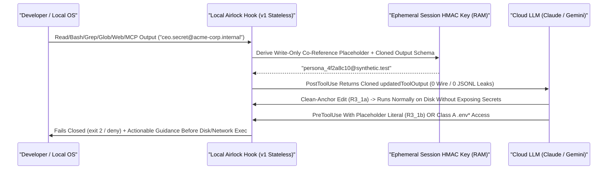

# 360° Product & Engineering Evaluation: *Highbeam Airlock* (`ctxtop Pro` Module)
**Pre-Ingestion AI Context Airlock & Accidental Leakage Prevention for Claude Code (Hook Redaction + Guard) & Google Antigravity (`PreToolUse` / Prompt Guard Only)**

> [!NOTE]
> **Standing Document Scope, Verification Basis & Companion Files**
> * **Reproducible Empirical Harness**: All Claude Code `@anthropic-ai/claude-code@2.1.325` wire, `.jsonl`, `--continue`/`--resume`, and `N = 250` / `N = 30` A/B latency tests cited below are archived with runnable loopback scripts in [`test/fixtures/airlock_spike/README.md`](../test/fixtures/airlock_spike/README.md) and [`spike_empirical_results.json`](../test/fixtures/airlock_spike/spike_empirical_results.json).
> * **Google Antigravity Hook Source Disclosure**: Antigravity lifecycle hook behavior (`PreToolUse`, `PostToolUse`, `PreInvocation`) is derived from inspecting the author's local Antigravity IDE installation specification (`agy-customizations/docs/hooks.md`), which is unredistributed and not publicly URL-verifiable.
> * **Review History & Archived Sister-SKU Scorecard**: The prior 7-domain numeric scorecard (`66.70 / 100` Concept, `78.60 / 100` Spec Quality — which scored the rejected standalone sister-SKU concept) and Rounds 1–3 change history live in [`HIGHBEAM_AIRLOCK_REVIEW_LOG.md`](./HIGHBEAM_AIRLOCK_REVIEW_LOG.md).

---

## 1. Executive Verdict & 7-Gate Readiness Checklist

### Strategic Verdict: **Ship as Stateless One-Way Context Airlock Module Inside `ctxtop Pro` (Branch 2); Standalone Sister SKU Deferred Pending Buyer Pull**

Highbeam Airlock reuses existing repository infrastructure—including [hookIo.mjs](../hooks/handlers/hookIo.mjs), [hookIpcClient.mjs](../hooks/handlers/hookIpcClient.mjs), [pro_license.mjs](../src/core/pro_license.mjs), [pdfReceiptGenerator.mjs](../src/core-isomorphic/ui/pdfReceiptGenerator.mjs), [horizon_panel.html](../src/webview/horizon_panel.html), and [sidecars/horizon-daemon](../sidecars/horizon-daemon)—paired with new pure-JS Mod Law 4 detector/shaper modules (`src/core-isomorphic/airlock/`) and a local audit ledger (`src/core/airlock/`).

Four empirical findings from the Claude Code `v2.1.325` spike and Antigravity primary-source check lock both scope and packaging:
1. **`PostToolUse` `updatedToolOutput` Works When Matching Exact `sdk-tools.d.ts` Shapes**: Across `Read`, `Bash`, `Grep`, `Glob`, and `mcp__*`, returning each tool's exact `Output` interface achieves **`0` leaked canary bytes on outbound HTTP requests AND `0` leaked canary bytes in `.jsonl` `tool_result` records**. Returning plain strings fails `claude.exe`'s Zod validation (`e.outputSchema?.safeParse(Rs)`) and silently falls back to unredacted raw output.
2. **Scrub-on-`Read` Does Not Corrupt Workspace Edits (`R3_1a` / `R3_1b`)**: With `PostToolUse(Read)` scrubbing enabled and stateless `FM-1` (`exit 2` blocking any synthetic placeholder in `Edit`/`Write`/`Bash`), clean-anchor edits succeed byte-for-byte with zero secrets exposed on the wire (`R3_1a`), `old_string` edits matching redacted lines fail cleanly at `Edit.validateInput()` before touching disk (`S1a`/`S1b`), and attempts to write synthetic placeholders in `new_string` are blocked by `FM-1` (`R3_1b`). Consequently, Airlock v1 enables **`SCRUB_ALL_TEXT_READS` by default on Claude Code** (closing the largest workspace leak channel) with per-glob `AUDIT_ONLY` opt-out in `.airlock/policy.json`.
3. **Stateless One-Way Placeholders Replace Reversible Unvaulting in v1**: Dropping `PreToolUse` `updatedInput` unvaulting avoids `Edit.validateInput()` pre-hook rejections, avoids `.jsonl` `attachment.hook_success` secret writes (`F2b`/`F5`, verified local-disk-only across `--continue` and `--resume` in `R3_2`), complies with `CLAUDE_CODE_RESTRICT_PERSONAL_CONFIG`, and eliminates stateful RAM reverse-map loss (`FM-5`), re-vault leaks (`FM-9`), and destination allowlist complexity (`FM-10`).
4. **Honest Standalone vs. Integrated Economics**: Because Anthropic natively documents hook redaction and gateway vendors (such as TrueFoundry) ship free hook integrations, a standalone SKU faces `467` paid-seat breakeven (`$224k ARR` at `$40/mo` blended) from `0` pre-launch installs. Integrating stateless Airlock v1 into `ctxtop Pro` requires **`18.5` engineering days** (`~3.5–4 weeks`) and **`~$24,000/yr`** in ongoing incremental maintenance/CI OpEx (~`134` incremental `$15/mo` Pro solo seats or ~`52` incremental `$39/mo` Team seats to break even on incremental cost), contingent on buyer validation.

#### Table 1.1: 7-Gate Readiness Checklist (`ctxtop Pro` Stateless v1 Module)
*(Replaces the archived sister-SKU numeric composite as the go/no-go instrument for the pivoted product.)*

| Gate | Readiness Criterion | Status | Evidence / Verification Path |
| :---: | :--- | :---: | :--- |
| **G1** | Claude Code wire, `.jsonl`, `Edit` safety (`R3_1`), and `--continue`/`--resume` replay (`R3_2`) verified | **PASSED (`v2.1.325`)** | [`spike_empirical_results.json`](../test/fixtures/airlock_spike/spike_empirical_results.json) (`18` scenarios + `R3_1`–`R3_3`) |
| **G2** | Schema-drift resilience (`cloneAndScrubToolResponse`, `TESTED_CLAUDE_CODE_RANGE` Zone A warning, `latest` CI canary) | **PENDING (Phase 2A)** | Automated canary workflow + unit schema matrix in CI |
| **G3** | `FM-8` `3.5s` internal `exit 2` watchdog + `SessionStart` self-check + `PostToolUse` timeout lapse detector | **PENDING (Phase 2A)** | Simulated hang / `missing node` / crash tests verifying Zone A `INACTIVE` & `Degraded` alerts |
| **G4** | Write-only placeholder UX (`FM-1` guidance + 2-strike retry cap) with `< 5%` task stall rate | **PENDING (Phase 2B)** | Suite 5 across 30 multi-turn coding sessions (`0` >2-strike block loops) |
| **G5** | Detector accuracy (`< 0.1%` per-line FP rate on 500k-line polyglot OSS corpus; Stage 3 held `AUDIT_ONLY` until met) | **PENDING (Phase 2B)** | Suite 1 corpus run (`package-lock.json`, Git SHAs, UUIDs, TS/Py/Go/Terraform) |
| **G6** | Google Antigravity Track B guard check (`PreToolUse` `deny`, `PreInvocation` `terminate`, `overwrite` notice check) | **PENDING (Track B)** | `transcript.jsonl` inspection on dummy tool call |
| **G7** | Commercial pull & conversion lift (`>= 5/15` buyer interviews validate compliance wedge + 30-day Pro trial cohort test) | **PENDING (Discovery)** | Structured interview notes + Pro trial cohort telemetry (`UNVERIFIED ASSUMPTION`) |

---

## 2. Host Hook Capabilities, Context Airlock Architecture & Failure Modes
*Reviewed by: Principal AI Systems & Extension Architect*

### 2.0 Empirical Host Capability Baseline (`Claude Code v2.1.325` Verified / `Antigravity` Track B Pending)

#### A. Primary-Source Findings on Claude Code (`v2.1.325`) & Google Antigravity
1. **`PostToolUse` Output Replacement & Exact `sdk-tools.d.ts` Output Shapes**:
   * Existing repository handler [post-tool-use.mjs](../hooks/handlers/post-tool-use.mjs#L217-L227) (`ISS-034`) emits `updatedMCPToolOutput` only for `mcp__*` and `additionalContext` for built-in tools—a handler limitation, not a host limitation.
   * Inspecting `claude.exe` (`2.1.325`) confirmed `e.outputSchema?.safeParse(Rs)` followed by `e.mapToolResultToToolResultBlockParam(Up, n)`. Returning anything other than each tool's exact `Output` interface logs `"PostToolUse hook returned updatedToolOutput that does not match <tool>'s output shape; using original output."` and silently falls back to the unredacted output (**silent schema-drift fail-open**, tracked as `FM-11`).
   * **Verified `sdk-tools.d.ts` Output Contracts for Scrubbable Tools**:
     * `Read` (`FileReadOutput`):
       - `type: "text"`: `{ type: "text", file: { filePath, content, numLines, startLine, totalLines, truncatedByTokenCap? } }`
       - `type: "notebook"`: `{ type: "notebook", file: { filePath, cells: unknown[] } }`
       - `type: "image"`: `{ type: "image", file: { base64, type, originalSize, dimensions? } }` *(no text leaf to regex-scrub; gate at `PreToolUse`)*
       - `type: "pdf"`: `{ type: "pdf", file: { filePath, base64, originalSize } }` *(binary base64; gate at `PreToolUse`)*
       - `type: "parts"`: per `sdk-tools.d.ts` L339, extracted `pages[]` image blocks are transient in-process and absent from `tool_use_result` *(gate `.pdf` at `PreToolUse`)*
     * `Bash` (`BashOutput`): `{ stdout, stderr, interrupted, isImage, noOutputExpected, ... }`
     * `Grep` (`GrepOutput`): `{ mode, numFiles, filenames, content?, numLines?, totalLines? }`
     * `Glob` (`GlobOutput`): `{ filenames, durationMs, numFiles, truncated, totalMatches?, countIsComplete? }`
     * `WebFetch` (`WebFetchOutput`): `{ bytes, code, codeText, result, durationMs, url, ... }`
     * `WebSearch` (`WebSearchOutput`): `{ query, results: ({ tool_use_id, content: { title, url, snippet? }[] } | string)[], durationSeconds, searchCount? }`
     * `Agent` (`AgentOutput`): `status: "completed"` contains `content: { type: "text", text }[]` and `prompt`; `status: "async_launched"` returns `outputFile` (scrubbed when read).
     * `NotebookEdit` (`NotebookEditOutput`): structured cell replacement result.
     * `MCP` (`McpOutput`): `string | { type: string, [k: string]: unknown }[] | Record<string, unknown>`.
   * **Google Antigravity (`agy-customizations/docs/hooks.md`, local installation doc)**: `PostToolUse` `stdin` receives only `{ toolCall, stepIdx, error }` and expects `{}` on `stdout`. **Antigravity lifecycle hooks cannot inspect or replace `PostToolUse` output.**
2. **`PreToolUse` Argument Rewriting vs. Stateless Blocking**:
   * **Claude Code (`v2.1.325`)**: Three findings block transparent `PreToolUse` unvaulting in v1:
     1. `Edit.validateInput()` runs against the unvaulted disk file **before** `PreToolUse` executes (`S1a`/`S1b`), returning `<tool_use_error>String to replace not found in file.</tool_use_error>` whenever `old_string` contains a placeholder.
     2. Returning `PreToolUse` `updatedInput` persists the entire `stdout` JSON verbatim in `.jsonl` under `type: "attachment"` (`attachment.type: "hook_success"`), even with `"suppressOutput": true` (`F2b`/`F5`). Wait-free resume test `R3_2` proved Claude Code does **not** replay `attachment.hook_success` over the wire on `--continue` or `--resume <sessionId>` (`LOCAL_DISK_ONLY`), so this is strictly a local zero-plaintext-in-telemetry rule rather than a cloud replay leak on resume (re-check `/compact` compaction edge cases before any future v2 opt-in).
     3. `claude.exe` enforces `CLAUDE_CODE_RESTRICT_PERSONAL_CONFIG` by denying `PreToolUse` `updatedInput`.
   * **Google Antigravity**: `PreToolUse` supports `"decision": "deny"` and `"overwrite"` (defer `"overwrite"` pending Track B inspection).
3. **User-Typed Prompt Interception**:
   * **Claude Code (`v2.1.325`)**: `UserPromptSubmit` returning `updatedPrompt`, `updatedInput`, or `suppressOriginalPrompt: true` still sends the raw user prompt on the Turn 0 HTTP request (`S5a`/`S5c`). **Only `exit 2` prevents HTTP transmission (`S5b`: `mainRequestCount = 0`)**; local `.jsonl` still records `queue-operation` and `system` lines locally.
   * **Google Antigravity**: `PreInvocation` reads `lastUserInput` and blocks via `"terminationBehavior": "terminate"` + `"errorMessage"`.
4. **Crash / Timeout Fail-Open Behavior**:
   * `S6c` (`exit 1`) and `S6d` (`3.5s` sleep vs. `1s` host timeout) empirically confirmed Claude Code fails **100% open** on both `PreToolUse` and `PostToolUse` when hooks crash non-`2` or time out.

#### Table 2.0a: Empirical Scenario Matrix (`@anthropic-ai/claude-code@2.1.325`, Loopback Wire + `.jsonl` + Resume Checks)
*(Full JSON records in [`spike_empirical_results.json`](../test/fixtures/airlock_spike/spike_empirical_results.json).)*

| Scenario | Test Focus | `PreToolUse` Result | Wire Clean? | Local `.jsonl` Clean? | Disk Uncorrupted? | Empirical Outcome |
| :--- | :--- | :--- | :---: | :---: | :---: | :--- |
| **`S1a` / `S1b`** | `Read` -> `Edit` (`old_string` contains placeholder) | **Never Fired** | `Read`: **YES** | `Read`: **YES** | **YES** (`prodChanged: false`) | `Edit.validateInput()` checks `old_string` against real disk file **before** `PreToolUse` (`String to replace not found`). |
| **`F2` / `F2b`** | Clean-anchor `Edit` (`new_string` placeholder unvaulted) | Unvaulted (`updatedInput`) | **YES** (`0` canaries) | **NO** (`attachment.hook_success`) | **YES** | `F2b` (`PostToolUse:Edit` active) scrubbed `toolUseResult`, leaving raw canary only in `.jsonl` `attachment.hook_success`. |
| **`F5`** | `Edit` `PreToolUse` `updatedInput` + `suppressOutput: true` | Unvaulted | **YES** | **NO** (`hook_success.stdout`) | **YES** | `"suppressOutput": true` does **not** prevent Claude Code from persisting `PreToolUse` `updatedInput` stdout to `.jsonl`. |
| **`F1`** | `Read` -> `Write` (`updatedInput` unvaulting) | Unvaulted | **YES** | **NO** (`hook_success` + `toolUseResult`) | **YES** | `Write` bypasses `old_string` check, but leaks `PreToolUse` stdout + `FileWriteOutput` unless scrubbed + `.jsonl`-cleaned. |
| **`F3`** | Clean `Bash`, `Grep`, `Glob` -> `PostToolUse` `updatedToolOutput` | Pass-through | **YES (`0` across all 3)** | **YES (`0` canaries)** | N/A | **100% clean** on wire AND `.jsonl` when matching `BashOutput`, `GrepOutput`, `GlobOutput`. |
| **`S4`** | `mcp__spike__get_secret_config` (`Pre` + `Post`) | Unvaulted arg | **YES** | **PARTIAL** (`Post` clean; `Pre` arg in `hook_success`) | N/A | `PostToolUse` scrubbed MCP response on wire & `.jsonl`; `PreToolUse` `updatedInput` logged arg in `hook_success`. |
| **`S5a` / `S5c`** | `UserPromptSubmit` (`updatedPrompt` / `suppressOriginalPrompt: true`) | N/A | **NO (Raw prompt sent Turn 0)** | **NO** | N/A | Prompt rewrite/suppression fields do **not** scrub outbound Turn 0 HTTP prompt. |
| **`S5b`** | `UserPromptSubmit` (`exit 2` block) | N/A | **YES (`0` HTTP requests)** | Local `queue-operation` only | N/A | **Blocks 100% of HTTP network transmission (`mainRequestCount = 0`)**. |
| **`F4`** | `FM-1`: Mutated placeholder in `Edit` `new_string` | **Blocked (`exit 2`)** | **YES (`is_error: true`)** | **YES (`0` canaries)** | **YES** | `PreToolUse` `exit 2` blocked cleanly prior to disk write. |
| **`S6b`** | `FM-10`: Placeholder inside `Bash` `git commit -m` | **Blocked (`exit 2`)** | **YES (`is_error: true`)** | Only placeholder logged | N/A | Blocked prior to `git commit` execution. |
| **`S6c` / `S6d`** | `FM-8`: `exit 1` crash (`S6c`) and `3.5s` > `1s` timeout (`S6d`) | **FAILED OPEN** | **NO (All secrets leaked)** | **NO** | N/A | Non-`2` exits and host hook kills silently fail **OPEN** on both `PreToolUse` and `PostToolUse`. |
| **`R3_1a`** | **Stateless v1**: `SCRUB_ALL_TEXT_READS` + clean-anchor `Edit` (`"pool": 5 -> 20`) | Pass-through | **YES (`0` canaries)** | **YES (`0` canaries)** | **YES** (`"pool": 20` + 6 secrets intact) | **Proves scrub-on-`Read` is safe for clean-anchor edits** with `0` wire/JSONL leaks and `0` file corruption. |
| **`R3_1b`** | **Stateless v1**: `SCRUB_ALL_TEXT_READS` + placeholder in `Edit` `new_string` | **Blocked (`exit 2`, `FM-1`)** | **YES (`0` canaries)** | **YES (`0` canaries)** | **YES** (Unmodified) | **Proves stateless `FM-1` stops synthetic placeholder corruption** even when full `Read` files are scrubbed. |
| **`R3_2`** | `--continue` & `--resume <sessionId>` after `F2b` `hook_success` write | Part 1 unvaulted | **YES (`0` wire replay)** | Part 1 had `line 32` `hook_success` only | **YES** | **`LOCAL_DISK_ONLY`**: neither `--continue` (`7` msgs) nor `--resume` (`9` msgs) replayed `attachment.hook_success` raw secret to API wire. |

#### Post-Spike Decision Tree Outcome: **Branch 2 Executed**
* **Branch 1 (Not Selected)**: Full symmetric `Read -> Vault -> Edit -> Unvault` fails `Edit.validateInput()` (`S1a`/`S1b`), writes `PreToolUse` secrets to `.jsonl` `hook_success` (`F2b`/`F5`), and is blocked under `CLAUDE_CODE_RESTRICT_PERSONAL_CONFIG`.
* **Branch 2 (Selected Default)**: Fold Airlock into **`ctxtop Pro`** as a **stateless one-way context airlock**: schema-exact `PostToolUse` `updatedToolOutput` redaction (including default `SCRUB_ALL_TEXT_READS` per `R3_1a`/`R3_1b`) paired with `PreToolUse` and `UserPromptSubmit` `exit 2` blocking on Claude Code, plus `PreToolUse` `deny` / `PreInvocation` `terminate` guard mode on Google Antigravity.

### 2.1 Stateless One-Way Co-Reference Architecture (v1 Scope vs. Deferred v2)

In **v1**, Airlock generates **Write-Only Co-Reference Placeholders** (`persona_4f2a8c10@synthetic.test`, `host-4f2a8c10.synthetic.internal`, `SYNTH_STRIPE_4f2a8c10_9e`) deterministically via ephemeral RAM `HMAC-SHA256(sessionKey, raw)`.
* **What Write-Only Placeholders Do**: Preserve multi-turn entity co-reference across scrubbed `Read`, `Bash`, `Grep`, `Glob`, `WebFetch`, `WebSearch`, `Agent`, and `mcp__*` outputs (`"did this error and that MCP lookup hit the same host?"`) while preventing raw credentials from entering cloud LLM context (`0` wire and `0` `.jsonl` leaks).
* **What Write-Only Placeholders Explicitly Do NOT Do**: They are **one-way placeholders, not reversible values**. The model cannot execute follow-up `Edit`, `Write`, or `Bash` commands containing those placeholder tokens; `FM-1` blocks any such attempt cleanly with `exit 2` and instructs the model to reference an environment variable name, config key, or ask the developer.
* **Future v2 Optional Unvaulting Path**: Because `R3_2` proved `.jsonl` `attachment.hook_success` is `LOCAL_DISK_ONLY` across `--continue`/`--resume`, a future v2 could reconsider opt-in `PreToolUse` unvaulting strictly for `Write`/`MCP` (never `Edit` `old_string`) *if* customers accept local `.jsonl` cleanup via a `SessionEnd` scrubber, `/compact` replay is verified safe, and strict `FM-9`/`FM-10` destination allowlists are added. Until then, v1 stays stateless.

*Figure 1: Converged v1 Stateless Context Airlock flow on Claude Code `PostToolUse` channels plus cross-host `PreToolUse` / prompt `exit 2` guards. The Airlock component itself makes no network calls; the host IDE and LLM still transmit context over the network, including data from unhooked channels or fail-open `PostToolUse` crashes.*

### 2.2 Core Engineering Principles

1. **Deterministic Ephemeral HMAC for Multi-Turn Co-Reference**:
   Within a session, identical raw strings across `Read`, `Bash`, `Grep`, and `mcp__*` map to the same write-only placeholder (`HMAC-SHA256(sessionKey, raw)` + 8-bit CRC8 check byte) without storing a plaintext reverse lookup map in SQLite or memory. *(Precision note: deterministic tokens do not change prefix KV-cache reuse across prior immutable `PostToolUse` turns—they preserve multi-turn entity co-reference and reduce token confusion relative to per-call `[REDACTED]` strings.)*
2. **Default `SCRUB_ALL_TEXT_READS` Without File Corruption (Supported by `R3_1a`/`R3_1b`)**:
   * **Class A — Pure Secret & Data Files (`.env*`, `*.pem`, `id_rsa`, `*.sql`, `customers.csv`, `~/.ssh`, `~/.aws`, binaries `*.png`/`*.jpg`/`*.pdf`)**: **Hard-Block (`exit 2` / `"deny"`)** at `PreToolUse` on both Claude Code and Google Antigravity, optionally listing safe variable names (`Keys detected in .env: STRIPE_SECRET_KEY`).
   * **Class B & C — Editable Text Code, Configs & Notebooks (`config/*.json`, `src/**`, `*.ipynb`)**:
     - **Default (`SCRUB_ALL_TEXT_READS`) on Claude Code**: Scrubs `PostToolUse(Read)` (`FileReadOutput` `text` and `notebook` variants) so credentials embedded in source or config files never traverse to the cloud LLM. Clean-anchor `Edit`s still pass (`R3_1a`), secret-line `old_string` edits fail safely at `validateInput` (prompting developer handoff or narrow diff), and synthetic `new_string` writes are rejected by `FM-1` (`R3_1b`).
     - **Per-Glob `AUDIT_ONLY` Opt-Out**: Teams needing uninterrupted `Edit` `old_string` matching on non-secret internal terms in `.airlock/policy.json` can configure explicit path globs to `AUDIT_ONLY` (not recommended for credential patterns).
3. **Mod Law 4 Pure-JS Execution & Repository Compatibility**:
   All core detector, HMAC (`hmacSha256HexPure` built atop [sha256HexPure](../src/core-isomorphic/ui/pdfReceiptGenerator.mjs#L30-L100)), shaper, and pre-tool guard logic in `src/core-isomorphic/airlock/` will carry **zero `node:*` imports** (`Mod Law 4` compliant), enabling execution inside `hooks/register.js` (`0 ms` spawn overhead on hot paths) as well as CLI hook handlers while keeping `hooks/hooks.json` default matchers backward-compatible with existing test suites.

### 2.3 Failure Modes & Edge-Case Mitigations

| # | Failure Mode / Technical Risk | Severity | Engineering Mitigation & Fail-Safe Behavior |
| :--- | :--- | :---: | :--- |
| **FM-1** | **Model echoes a write-only placeholder into `Edit`, `Write`, `NotebookEdit`, or `Bash` inputs (`persona_4f2a8c10@synthetic.test`)**. | **Critical** | Reserved placeholder namespaces (`@synthetic.test`, `.synthetic.internal`, `SYNTH_<TYPE>_<12HEX>_<2CRC8>`). `PreToolUse` scans all arguments and **fails closed (`exit 2` / `"deny"`)**, returning explicit non-retry guidance (`stderr`) and enforcing a **2-strike retry cap** via `CircuitBreakerEngine` before escalating to the developer. |
| **FM-2** | **Placeholder collisions & dictionary false matches**. | **High** | 48–64 bit truncated `HMAC-SHA256` + 8-bit CRC8 (collision probability $< 10^{-11}$ at $10^4$ entities); enforce $\ge 5$-char minimum length and `\b` word boundaries on Stage 2 policy terms. |
| **FM-3** | **Coverage gaps across unhooked IDE ingestion paths** (`@file` attachments, Antigravity `PostToolUse`, `CLAUDE.md`). | **Critical** | Disclose exact host boundaries in **Table 2.3a** and Zone A/B UI; add `SessionStart` static scan for `CLAUDE.md`/`AGENTS.md`/`MEMORY.md` credentials. |
| **FM-4** | **Secrets typed or pasted directly into user prompts**. | **High** | `UserPromptSubmit` (`exit 2`, `S5b`: `0` HTTP calls) and Antigravity `PreInvocation` (`"terminationBehavior": "terminate"`) block outbound submission. Note: host CLI still writes the user's blocked raw prompt locally to `.jsonl` `queue-operation`. |
| **FM-5** | **Transient key loss across daemon restart / `/compact` / `--resume`**. | **Low** | Stateless one-way v1 needs no reverse lookup table; any stale placeholder cited from history is cleanly rejected by `FM-1` (`exit 2`). |
| **FM-6** | **Co-reference & task stall trade-off (`UNVERIFIED ASSUMPTION`)**. | **Medium** | Measure multi-turn task completion, **block-loop rate**, and **task stall/handoff rate** across 30 recorded sessions comparing deterministic placeholders vs. `[REDACTED]` (Suite 5). |
| **FM-7** | **Stage 3 Shannon entropy false-positive fatigue (`< 0.1%` target)**. | **High** | Stage 3 remains hard-locked to `AUDIT_ONLY` until Suite 1 proves `< 0.1%` FP/line on the fixed 500k-line polyglot OSS corpus. |
| **FM-8** | **Host fail-open on hook hang (`S6d`), `exit 1` (`S6c`), missing `node` on `PATH`, or `PostToolUse` crash**. | **Critical** | **Honest Contract — Pre-Hook Fail-Closed / Post-Hook & Launch Failure Fail-Open With Detection**: **(1) Internal Watchdog**: `PreToolUse` & `UserPromptSubmit` arm a `3.5s` deadline (`< 5s` host timeout) calling `process.exit(2)` synchronously before the host kills a hung hook. **(2) `SessionStart` Self-Check**: writes `session_hook_verified_at`; if `node` is missing from `PATH` or hooks fail to fire, Zone A renders red **`Airlock INACTIVE · Hooks Did Not Fire`**. **(3) `PostToolUse` Lapse Detection**: `PostToolUse` cannot un-run an already executed tool on OS kill/crash; in-process exceptions emit cloned safe suppression objects, while paired `PreToolUse -> PostToolUse` `tool_use_id` tracking logs `HOOK_TIMEOUT_LAPSE` (`> 0` invalidates clean receipts and flips Zone A amber/red). |
| **FM-9** | **Asymmetric unvaulting (`Pre` unvaults without `Post` re-vault) & `.jsonl` `hook_success` local writes (`F2b`, `F5`, `R3_2`)**. | **Mitigated (v1)** | Neutralized in v1 by omitting `PreToolUse` `updatedInput` unvaulting completely (`R3_2` proved `hook_success` is `LOCAL_DISK_ONLY` on `--continue`/`--resume`, keeping a future v2 opt-in feasible with `SessionEnd` `.jsonl` scrubbing if demanded). |
| **FM-10** | **Unsafe unvault destinations (`git commit -m`, `README.md`, `curl`)**. | **Mitigated (v1)** | With `updatedInput` disabled and `FM-1` blocking synthetic namespaces in `Edit`/`Write`/`Bash` (`S6b`), neither raw secrets nor placeholders can be unvaulted into commits or docs. |
| **FM-11** | **Host Output Schema Drift / Silent Zod Fallback (`claude.exe` `safeParse` mismatch)**. | **Critical** | **(1) In-Place Cloned Scrubbing**: `cloneAndScrubToolResponse` clones `event.tool_response` preserving unknown keys rather than rebuilding minimal objects from scratch, flagging `SCHEMA_DRIFT_LAPSE` if expected string leaves are missing. **(2) Version Allowlist + Banner**: `SessionStart` compares detected Claude Code version against `TESTED_CLAUDE_CODE_RANGE`; unrecognized versions surface amber **`Airlock Warning · Untested Claude Code vX.Y.Z`** in Zone A (configurable `"untestedHostPolicy": "strict_block"`). **(3) Continuous CI Canary**: scheduled GitHub Actions job runs the loopback wire suite against `@anthropic-ai/claude-code@latest` before breaking changes hit users. |

#### Table 2.3a: Complete Per-Host Channel Coverage Matrix

| Ingestion / Read Channel | Claude Code (`v2.1.325+`) v1 Coverage | Google Antigravity Coverage (Local `hooks.md` Inspection) | Residual Gap / Mitigation |
| :--- | :--- | :--- | :--- |
| **`Read` — Text (`type: "text"`) & Notebooks (`type: "notebook"`)** | **Covered**: `PreToolUse` `exit 2` block on Class A (`.env*`, `*.pem`, `*.sql`, `*.csv`); `PostToolUse` `updatedToolOutput` scrubs leaf text & `.ipynb` cells (`SCRUB_ALL_TEXT_READS` default, per `R3_1a`/`R3_1b`). | **`PreToolUse` Block Only** (Class A `.env*`/`*.pem` `deny`); `PostToolUse` returns `{}`. | Antigravity defaults editable config/code `Read`s to path guard (`PostToolUse` scrubbing unsupported via hooks). |
| **`Read` — Images (`type: "image"`) & PDFs (`type: "pdf"`, `type: "parts"`)** | **`PreToolUse` Path/Extension Gate**: `base64` payloads cannot be regex-scrubbed (`type: "parts"` extracts pages outside hook payload per `sdk-tools.d.ts` L339). Block sensitive image/PDF paths at `PreToolUse`. | **`PreToolUse` Path Gate Only** (`deny` sensitive directories/extensions). | OCR scanning of arbitrary images/PDFs is out of scope for v1. |
| **`Bash` / `PowerShell` (`run_command`)** | **Covered**: `PostToolUse` (`BashOutput.stdout`/`.stderr` scrubbed, `F3`); `PreToolUse` `exit 2` blocks Class A reads, obfuscation flags (`base64`, `xxd`, `certutil`), and `FM-1` placeholders. | **`PreToolUse` Command Block Only** (`PostToolUse` unsupported via hooks unless command wraps stdout externally). | Obfuscated custom interpreter scripts bypassing shell path rules remain best-effort (`Table 3.4a`). |
| **`Grep` / `Glob` (`grep_search` / `find_by_name`)** | **Covered**: `PostToolUse` (`GrepOutput`, `GlobOutput` filenames & matches scrubbed, `F3`); `PreToolUse` `exit 2` blocks literal secrets/paths (`S3`). | **`PreToolUse` Path/Pattern Gate Only**. | Block literal secret queries at `PreToolUse` so `assistant.tool_use` intent doesn't echo literals (`S3`). |
| **`Edit` / `Write` / `NotebookEdit`** | **Covered**: `PreToolUse` `exit 2` enforces `FM-1` synthetic block, Class A/self-tamper block; `PostToolUse` scrubs `FileEditOutput`/`FileWriteOutput`/`NotebookEditOutput` cleanly (`F2b`, `R3_1a`). | **`PreToolUse` `deny` Only** (`FM-1` placeholder check + self-tamper protection). | Clean-anchor edits pass; secret-adjacent `old_string` fails safely at `validateInput`. |
| **`mcp__*` (MCP Server Tools)** | **Covered**: `PostToolUse` (`McpOutput` scrubbed, `S4`); `PreToolUse` `exit 2` blocks `FM-1` placeholders / Class A paths. | **`PreToolUse` Guard Only** (requires MCP server command wrapper for output scrubbing). | Local MCP server wrapper remains optional Phase 2 extension for Antigravity. |
| **`WebFetch` / `WebSearch`** | **Covered**: `PreToolUse` blocks outbound URL/query Stage 1 secrets; `PostToolUse` clones & scrubs `WebFetchOutput.result` and `WebSearchOutput.results[].content[].snippet`. | N/A (`PreToolUse` block if search/fetch tools configured). | Outbound network fetch occurs on Anthropic/tool host side if not stopped at `PreToolUse`. |
| **`Task` / `Agent` (Subagents)** | **Partial**: `status: "completed"` `AgentOutput.content[].text` & `async_launched` `outputFile` `Read` scrubbed; **`remote_launched` cloud agents Not Covered**. | **`PreToolUse` Spawn Guard** (`invoke_subagent` / `swarm` matcher); child tool calls inherit local hooks if local. | `remote_launched` cloud agent execution happens off-machine. |
| **Auto-Loaded Instructions & Memory (`CLAUDE.md`, `AGENTS.md`, `MEMORY.md`, `.claude/rules/*`)** | **`SessionStart` Static Hygiene Check**: Loaded directly by host outside tool hooks; Airlock scans these paths once at `SessionStart` and warns/blocks before Turn 0. | **`SessionStart` Static Hygiene Check**: Same pre-session scan at startup. | Mid-session edits to `.claude/rules/*` already trigger self-tamper `PreToolUse` block. |
| **User-Typed / Pasted Prompts** | **`UserPromptSubmit` `exit 2` Block (`0` HTTP calls, `S5b`)**: Rewrites do not scrub Turn 0 (`S5a`/`S5c`); blocked prompts still write locally to `.jsonl` `queue-operation`. | **`PreInvocation` `"terminationBehavior": "terminate"`**. | Educate developers never to paste live secrets into chat box. |
| **IDE `@file` Mentions / Drag-and-Drop Attachments** | **Not Covered** (Injected by IDE UI outside CLI hooks). | **Not Covered**. | Explicit UI warning in Zone A / docs. |

---

## 3. Detection Precision, Empirical Latency A/B Baseline & Honest Threat Model
*Reviewed by: Applied Cryptography & AppSec Lead*

### 3.1 Latency Architecture: JS Math vs. Cold CLI Spawn vs. In-Process Mod API

Latency benchmarks distinguish three separate numbers:
1. **Detector Algorithm Execution Time (`N = 250` Win11 `vault_hook.mjs` Baseline on ~6.3 KB payload: `0.47 ms` p50 / `0.71 ms` p95 / `0.85 ms` p99 / `0.97 ms` max)**: Pure V8 scan/HMAC time is sub-millisecond on `~6.3 KB` payloads. Target `< 6 ms` on `100 KB` with a `10,000`-term Aho-Corasick trie remains **unbenchmarked (`UNVERIFIED ASSUMPTION` `A-4`)**.
2. **Cold Hook Process Spawn Time (`N = 250` Win11 Baseline: `58.02 ms` p50 / `67.54 ms` p95 / `73.76 ms` p99 / `82.58 ms` max)**: Even with minimal hook logic, spawning a fresh Windows `node.exe` CLI subprocess costs `~58 ms` median per hook invocation (`2` spawns per tool call = `PreToolUse` + `PostToolUse`).
3. **End-to-End Added Tool-Call Overhead (`N = 30` Sequential `Read` A/B Inside `claude.exe` `v2.1.325`)**:
   * **Hooks-OFF Baseline (`hooks: {}`)**: **`136.36 ms` p50 / `197.99 ms` max** (`5,120 ms` total for `30` reads; `6` leaked wire canaries).
   * **Hooks-ON (`PreToolUse` + `PostToolUse` CLI command hooks)**: **`420.41 ms` p50 / `481.49 ms` max** (`13,430 ms` total for `30` reads; **`0` leaked wire canaries**).
   * **Net Added Overhead**: **`+284.05 ms` p50 per tool call** (`+8,310 ms` total across 30 calls = `~277 ms/call` average wall delta). *(Because `N = 30`, only `p50` and `max` are reported.)*

> [!NOTE]
> **Latency Implication: UX Hygiene & Justification for In-Process `hooks/register.js`**
> Because real cloud LLM turns typically take `1,500 ms – 15,000 ms`, `+284 ms` on CLI hooks is noticeable in tight multi-read loops (`30` sequential calls = `+8.3s`) rather than a fatal blocker, and latency is a **UX hygiene requirement**, not a competitive wedge. Moving hot paths (`Read`, `Grep`, `Glob`) into in-process `hooks/register.js` (`Mod Law 4`, `0` child spawns) is justified directly by this `+284.05 ms` A/B delta.

### 3.2 Pure-JS 3-Stage Detection Pipeline (`Phase 2B Benchmark Target`)

| Stage | Target Data Classes | Zero-Dependency Algorithm (`Mod Law 4`) | Target Algorithm Time (`100 KB` / `10k` Terms) | False-Positive Mitigation |
| :--- | :--- | :--- | :---: | :--- |
| **Stage 1: Mathematical & Prefix Validators** | Credit cards, SSNs, IBANs, AWS (`AKIA`), Stripe (`sk_live_`), GitHub (`ghp_`), Slack, Private Keys, JWTs, DB URIs | Fixed prefix dispatch + Luhn / Mod-97 checksums + Base64URL header decode | `Target: < 1.2 ms` *(Unbenchmarked at `100 KB`)* | Rejects 40-char Git SHAs, lockfile SHA-512s, and UUIDv4s |
| **Stage 2: Signed Company Policy Trie** | Client names, codenames, internal `.corp` domains, custom regexes | Aho-Corasick multi-pattern automaton compiled from `.airlock/policy.json` | `Target: < 2.0 ms` *(Unbenchmarked at `10k` terms)* | `\b` word boundaries, $\ge 5$-char minimum length, Ed25519 signature check |
| **Stage 3: Contextual Entropy Scanner** | High-entropy tokens & proprietary secrets | Shannon Entropy (`> 4.4 bits/char`) gated by secret/token/Bearer context | `Target: < 2.5 ms` *(Unbenchmarked at `100 KB`)* | **Hard-locked to `AUDIT_ONLY`** until Suite 1 passes `< 0.1%` FP/line |

### 3.3 Remaining Phase 2B Cross-OS Benchmark Plan (`scripts/benchmark_airlock.mjs`)
Before publishing external speed numbers, execute across **(1) Apple M3 Pro (macOS)**, **(2) Windows 11 NTFS + Defender**, and **(3) Ubuntu 24.04 CI runner**, sweeping `1 KB / 10 KB / 100 KB / 1 MB` payloads $\times$ `100 / 1,000 / 10,000` policy terms (`N >= 250` per cell for `p50`/`p95`/`p99`/`max`), plus `hooks/register.js` vs. CLI command hook A/B deltas (`N >= 100`).

### 3.4 Security Boundary & Approved vs. Prohibited Marketing Claims

> [!WARNING]
> **Defense-in-Depth Threat Model**
> A user-space CLI/IDE hook is **not** an OS-kernel firewall. Unhooked IDE `@file` uploads, Antigravity `PostToolUse` results, `remote_launched` cloud subagents, local `.jsonl` copies of blocked prompts, obfuscated scripts, or host-killed `PostToolUse` timeouts (`S6c`/`S6d`) remain residual vectors. Airlock is strictly **"Pre-Ingestion AI Context Airlock & Accidental Leakage Prevention"**—a best-effort defense-in-depth control whose component itself makes zero network calls while the host IDE and LLM still do.

#### Table 3.4a: Approved vs. Prohibited Claims for Marketing, Docs & Sales

| Prohibited Claims (Never Use) | Approved Claims (Accurate & Defensible) |
| :--- | :--- |
| *"Cryptographically guarantees zero company PII/secrets enter cloud LLM context"* | *"Best-effort pre-ingestion airlock designed to reduce accidental secret and PII leakage on supported hook channels"* |
| *"Zero Cloud Exposure"* / *"0 Cloud Leaks"* / *"Zero-Cloud Moat"* | *"Local Hook Processing — the Airlock component itself makes no network calls; the host IDE and LLM still do"* |
| *"Identical full vaulting across Claude Code and Antigravity"* | *"Schema-matched PostToolUse output redaction (`Read`, `Bash`, `Grep`, `Glob`, `Web*`, `Agent`, `mcp__*`) + `exit 2` blocking on Claude Code; `PreToolUse` path/command guard + prompt gate on Google Antigravity"* |
| *"Fail-closed on all errors"* | *"PreToolUse enforces synchronous internal deadline + fail-closed `exit 2`; `SessionStart` & `PostToolUse` track missing completions as visible coverage lapses in Zone A"* |
| *"SOC2 / HIPAA Compliance Certificate"* / *"Zero-Leakage Audit Certificate"* | *"Tamper-Evident Local Policy Enforcement Receipt (PDF 1.4) with explicit coverage-lapse count for internal security review"* |

---

## 4. Developer & CISO UX Design Evaluation
*Reviewed by: Principal Product Designer (Edward Tufte High Data-Ink Standards)*

### 4.1 UX Design for Write-Only Placeholders, `validateInput` Refusals & Anti-Nagging
* **Explicit Placeholder Affordances (Preventing Model Retry Loops)**: When an output placeholder (`persona_4f2a8c10@synthetic.test`) appears in chat history, Claude may try to write it into code or commands. `PreToolUse` `FM-1` blocks (`exit 2`) return concise model-facing instructions:
  `[Airlock FM-1] Blocked write-only placeholder "persona_4f2a8c10@synthetic.test" in Edit/Write/Bash. This token is an anonymized co-reference marker, not a real value. Reference an environment variable name, config key, or ask the developer to edit secret-adjacent lines; DO NOT retry using placeholders.`
  Paired with a **2-strike `CircuitBreakerEngine` cap** per placeholder token, retry loops halt cleanly in `<= 2` turns rather than burning tokens indefinitely.
* **Keyed `HMAC` Fixture Allowlisting (Replacing Plain `SHA-256`)**: Zone B's 1-click fixture allowlist stores **`HMAC-SHA256(orgKeychainSalt, ruleId + ":" + fixtureValue)`** scoped to a test path glob (`test/**`), preventing offline brute-force reversal of short test strings (e.g., 9-digit test SSNs).
* **Active Source Protection (`AGENTS.md` UI Invariant)**: Never expose `.antigravityignore` ignore actions on active source code files (`isIgnorablePath` remains restricted to lockfiles, logs, and scratch outputs).

### 4.2 Adapting Highbeam's 4-Zone Sidepane ([horizon_panel.html](../src/webview/horizon_panel.html))

| UI Zone | Highbeam (`ctxtop`) FinOps Role | Airlock Security Role (`ctxtop Pro` Module) |
| :--- | :--- | :--- |
| **Zone A (Top Status + Watchdog)** | `Optimal Cache · 94% hit · 68.4k / 603k` | **Live Self-Check & Version Gate**: **`Airlock Active (CC Scrub+Guard / AGY Guard)`**, amber **`Airlock Warning · Untested Claude Code vX.Y.Z`** (`FM-11`), amber/red **`Airlock Degraded · Timeout/Schema Lapse (N)`** (`FM-8`), or red **`Airlock INACTIVE · Hooks Did Not Fire`** (`SessionStart` check missing). |
| **Zone B (Policy & Allowlist)** | `DO / AVOID / HOLD` Guidance | **Mode (`Audit` · `Scrub Outputs + Guard` · `Strict Block`)**, Ed25519 signed policy badge, per-glob `AUDIT_ONLY` read overrides, & Salted `HMAC` fixture allowlist (`test/**`). |
| **Zone C (Live Feed)** | Auto-interventions (`+28.4k` FTS5, `+84.2k` KV) | **Live Scrub & Guard Feed** *(e.g., `T3: Scrubbed 4 entities in Read` · `T4: FM-1 halted placeholder retry in Edit`)* — **zero raw secrets rendered**. |
| **Zone D (Bottom Proof)** | `+135.9k tokens saved (~$0.27)` + PDF Receipt | **`19 Unique Policy Matches Handled · 0 Coverage Lapses` + 1-Click PDF 1.4 Enforcement Receipt** (must show `0` `HOOK_TIMEOUT_LAPSE` & `0` `SCHEMA_DRIFT_LAPSE` for clean status). |

---

## 5. Primary KPI Audit: Zero-Plaintext Ledger & Policy Enforcement Receipts
*Reviewed by: Security Telemetry & Compliance Actuary*

1. **Zero-Plaintext Audit Ledger**: Every SQLite row in Airlock's own ledger stores only `entity_hmac = HMAC_SHA256(orgAuditSalt, rawValue)`, `category`, `severity_tier`, `action = "SCRUBBED" | "BLOCKED" | "HOOK_TIMEOUT_LAPSE" | "SCHEMA_DRIFT_LAPSE"`, and `hook = "PostToolUse:Read"`. All Antigravity session SQLite DBs remain opened strictly `{ readOnly: true }`.
2. **Anti-Inflation Unique Metric**: Lead receipts with deduplicated unique entities (`15 Unique Policy-Matched Entities Handled across 412 tool occurrences`).
3. **Explicit Lapse Accounting**: Separate **Tier 1 Credentials**, **Tier 2 Regulated PII/PCI**, **Tier 3 Policy Terms**, and **Coverage Lapses** (`HOOK_TIMEOUT_LAPSE`, `SCHEMA_DRIFT_LAPSE` — must equal `0` for clean receipt verification).
4. **Tamper-Evident Hash Chain**: Chain `prev_row_sha256 -> row_sha256` and print the root digest onto the **PDF 1.4 Policy Enforcement Receipt** via [pdfReceiptGenerator.mjs](../src/core-isomorphic/ui/pdfReceiptGenerator.mjs).

---

## 6. Required QA & Adversarial Proof Suite
*Reviewed by: Staff Security QA & Adversarial Red-Team Lead*

1. **Suite 1 — 500k-Line Polyglot False-Positive Benchmark (`< 0.1%` Per-Line FP Target)**:
   Scan `500,000` lines across 5 OSS repos (`package-lock.json` SHA-512s, Git SHAs, UUIDv4s, JWT examples, CSS/SVG hashes, TS/Python/Go/Terraform); assert zero Stage 1–2 false blocks and keep Stage 3 entropy `AUDIT_ONLY` until `< 0.1%` FP/line passes.
2. **Suite 2 — Wire + `.jsonl` + Schema-Drift & `Edit` Safety Proof**:
   Automate the Track A + `R3_1`/`R3_2` loopback wire and `.jsonl` checks in CI across all scrubbable `sdk-tools.d.ts` output shapes (`FileReadOutput` `text`/`notebook`, `BashOutput`, `GrepOutput`, `GlobOutput`, `WebFetchOutput`, `WebSearchOutput`, `AgentOutput`, `McpOutput`), run a daily/release canary against `@anthropic-ai/claude-code@latest` (`FM-11`), and assert synthetic writes fail closed (`exit 2`).
3. **Suite 3 — Agent Self-Tamper & Obfuscation Proof**:
   Assert `PreToolUse` `exit 2` blocks edits to `.airlock/*`, `.claude/settings*.json`, `hooks.json`, and obfuscated reads (`base64`, `xxd`, `certutil`, inline `python`/`node` `.env` reads), plus confirms `SessionStart` static scan flags plaintext secrets in `CLAUDE.md`/`AGENTS.md`.
4. **Suite 4 — Internal Watchdog, Missing-`PATH` & Lapse Detection Proof**:
   Simulate `5s` hook hang -> verify `3.5s` internal watchdog exits `2` on `PreToolUse`/`UserPromptSubmit`; simulate omitted `SessionStart` (`missing node` on `PATH`) -> verify Zone A shows **`Airlock INACTIVE`**; simulate `PostToolUse` kill -> verify paired `tool_use_id` tracker logs `HOOK_TIMEOUT_LAPSE` and clears `0` lapse status; assert `0` plaintext secret bytes in SQLite/`.jsonl`.
5. **Suite 5 — Write-Only Placeholder Block-Loop & Stall-Rate Benchmark**:
   Benchmark deterministic write-only placeholders vs. generic `[REDACTED]` across 30 realistic multi-turn coding/debugging sessions: measure **(a) task completion accuracy**, **(b) block-loop rate** (`0` instances exceeding the 2-strike cap), and **(c) task stall / human-handoff rate (`< 5%` target)** caused by secret-adjacent `Edit` `validateInput()` failures or `FM-1` blocks.

---

## 7. Commercial Reality & Incremental Module Economics (`ctxtop Pro`)
*Reviewed by: Enterprise Security & DevTools Commercial Advisor*

### 7.1 Competitive Landscape & Narrowed Wedge
* Secondary press estimates cite enterprise AI DLP activity—Prompt Security (`$250M–$300M` acquisition reported — `UNVERIFIED ASSUMPTION`), Harmonic Security (`$50M` — `UNVERIFIED ASSUMPTION`), Nightfall AI (`$60M+` — `UNVERIFIED ASSUMPTION`), and Lasso Security (`$30M` — `UNVERIFIED ASSUMPTION`)—but developer hook tooling is commoditizing fast as Anthropic documents native `PostToolUse` redaction and gateways like TrueFoundry offer free Claude Code hook integrations.
* Standalone regex hooks are trivial to clone (~100 lines). Airlock's defensibility as a **`ctxtop Pro` module** rests on bundling schema-verified cross-tool scrubbing (`sdk-tools.d.ts` canary-tested), write-only co-reference placeholders + `FM-1`/`FM-8` fail-closed guards, `SessionStart` static hygiene checks, signed `.airlock/policy.json`, and hash-chained PDF 1.4 receipts **without routing code through an external vendor proxy** alongside FinOps token governance.

### 7.2 Reconciled Head-to-Head Comparison

| Dimension | **Highbeam Airlock (`ctxtop Pro` Module)** | **AI Gateways & Cloud DLP** *(TrueFoundry, Nightfall)* | **DIY Native Hook Scripts** | **Git Secret Scanners** *(GitGuardian, TruffleHog)* |
| :--- | :---: | :---: | :---: | :---: |
| **Inspection Path** | **Local Hook / Mod Runtime** *(Airlock makes no network calls; host IDE/LLM still do)* | Cloud API / Gateway Proxy | Local Script (fails silently if schema drifts) | Git Pre-Commit / CI |
| **Host Coverage** | **Claude Code (`PostToolUse` Redact + `exit 2` Guard) + Antigravity (`PreToolUse` Guard)** | Claude Code Hooks / API Proxy | Claude Code Only | Git history/diffs only |
| **Measured Win11 Latency** | **`0.47 ms` p50 JS / `58.02 ms` p50 spawn (`N = 250`); `+284.05 ms` p50 `Read` A/B (`N = 30`)** | `80 – 300 ms` Network RTT (`UNVERIFIED ASSUMPTION`) | `50 – 180 ms` Node / `250+ ms` Python (`UNVERIFIED ASSUMPTION`) | Out-of-band |
| **Packaging & Price** | **Integrated in `ctxtop Pro` (`$15/mo` Solo) / `Team` (`$39/seat/mo`); Standalone deferred (`UNVERIFIED ASSUMPTION`)** | Free Tier to `$15k–$75k+/yr` (`UNVERIFIED ASSUMPTION`) | `$0` (DIY maintenance) | `$22–$49 / dev / mo` (`UNVERIFIED ASSUMPTION`) |

### 7.3 Honest Incremental Cost, Build Breakdown & Conversion Hypotheses

Integrating Airlock v1 into `ctxtop Pro` **does not cost `$0`**. Rather, it avoids standalone customer acquisition/legal/billing OpEx while incurring concrete build and ongoing maintenance costs:

1. **One-Time Phase 2 Engineering Build (`18.5` Engineering Days = `~$14,200` Founder Time Allocation at `$150k/yr`)**:
   * **Phase 2A (`v1.0` Core Airlock + Hardening — `9.0 Days`)**:
     - `3.0d`: Pure-JS Mod Law 4 `detector.mjs` (Stages 1–3 + Aho-Corasick) & `hmacTwin.mjs` (`hmacSha256HexPure` + CRC8).
     - `2.5d`: `claudeOutputShaper.mjs` (`cloneAndScrubToolResponse` across `FileReadOutput` `text`/`notebook`, `Bash`, `Grep`, `Glob`, `WebFetch`, `WebSearch`, `Agent`, `McpOutput` + `FM-11` semver check).
     - `3.5d`: `preToolGuard.mjs` (`FM-8` `3.5s` internal `exit 2` watchdog, `SessionStart` self-check & `CLAUDE.md`/`AGENTS.md` scan, 2-strike `FM-1` retry cap, hook wiring including `register.js` + Antigravity handlers, and GitHub Actions `latest` schema canary).
   * **Phase 2B (`v1.1` Compliance Ledger, UI & Benchmarks — `9.5 Days`)**:
     - `2.0d`: Ed25519 `.airlock/policy.json` loader + salted `HMAC` fixture allowlist + hash-chained SQLite `auditLedger.mjs` + PDF 1.4 enforcement receipt.
     - `2.5d`: Daemon heartbeat + 4-zone [horizon_panel.html](../src/webview/horizon_panel.html) updates (`INACTIVE` / `Untested Version` / `Degraded` Zone A banners) + 3-way mirror parity sync.
     - `3.0d`: `scripts/benchmark_airlock.mjs` (500k-line polyglot `< 0.1%` FP gate + 3-OS `N >= 250` latency & `N >= 100` A/B suite).
     - `2.0d`: Automated CI Proof Suites 1–5 (including 30-session block-loop & stall-rate Suite 5) & documentation.
2. **Ongoing Incremental Annual OpEx (`$24,000 / yr`)**:
   * **`~15%` FTE (`$22,500 / yr`)**: Tracking upstream Claude Code/Antigravity schema changes (`FM-11` canary maintenance), false-positive rule tuning, and Team onboarding support.
   * **`$1,500 / yr`**: Cross-OS CI runners, corpus tests, and daily `@anthropic-ai/claude-code@latest` canary checks.
   * **Incremental Cost Breakeven**: With `ctxtop Pro` priced at `$15/mo` (`$180/yr` Solo) and `ctxtop Team` at `$39/seat/mo` (`$468/yr`, per existing [pro_license.mjs](../src/core/pro_license.mjs#L26-L29)), covering `$24,000/yr` incremental OpEx requires **`~134` incremental Solo seats** or **`~52` incremental Team seats** (excluding Stripe/Polar 4% payment fees, ~`54` Team / `139` Pro seats net)—substantially safer than `467` seats / `$224k/yr` for a standalone sister SKU given `0` external users pre-launch.
3. **Conversion & Retention Hypothesis (`UNVERIFIED ASSUMPTION` `A-6` — Measurement Plan)**:
   * *Hypothesis*: Bundling Context Airlock inside `ctxtop Pro` / `Team` increases trial-to-paid conversion and Month-2 logo retention versus FinOps-only telemetry.
   * *Measurement Plan*: (1) Conduct **15 structured buyer interviews** (`$0` cost) during `ctxtop v4.0` rollout to test willingness-to-pay for `$39/seat` Team compliance vs. `$15/mo` Solo Pro; (2) post-GA, compare 30-day cohort activation, paid conversion, and M2 retention between Airlock-enabled Pro trials and control Pro trials (`N >= 200` activations per arm).

---

## 8. Execution Roadmap & Pre-Build Priorities
1. **Immediate (`Gate 0`)**: Tag/maintain clean `ctxtop v4.0` release integrity (`149` verified files), commit spike fixtures + evaluation docs cleanly, and begin **15 Buyer Discovery Interviews**.
2. **Track B (`0.5 Day`)**: Verify Antigravity `PreToolUse` `deny`, `PreInvocation` `terminate`, and `overwrite` notice content in `transcript.jsonl` (`Assumption A-2`).
3. **Phase 2A (`9.0 Days` — Gate 2 & 3 Priority)**: Build pure-JS Mod Law 4 core + `cloneAndScrubToolResponse` + `FM-8` `3.5s` watchdog + `SessionStart` self-check + `FM-11` semver guard + `@anthropic-ai/claude-code@latest` CI canary.
4. **Phase 2B (`9.5 Days` — Gate 4 & 5 Priority)**: Build signed policy/ledger/PDF receipt, Zone A–D UI, run 3-OS `N >= 250` latency + 500k-line `< 0.1%` FP corpus, and measure block-loop/stall rates across 30 sessions (Suite 5) prior to GA.
