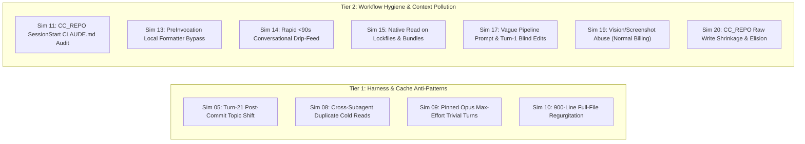

# Implementation Plan: Closing All Bad-Habit Simulation Gaps (20/20 PASS)

## Goal Description

Upgrade both **Google Antigravity Highbeam (`GA_REPO`: `ga-attention-horizon`)** and **Claude Code Highbeam (`CC_REPO`: `claude-code-attention-horizon`)** so that all **20 developer bad-habit scenarios** in [simulate_bad_habits.mjs](./simulate_bad_habits.mjs) achieve **20 / 20 `PASS`** (up from `10 PASS / 9 PARTIAL / 1 FAIL` in [BAD_HABIT_VALIDATION_REPORT.md](./BAD_HABIT_VALIDATION_REPORT.md)).

> [!IMPORTANT]
> **Architectural & UI Invariants (`AGENTS.md`)**
> 1. **3-Way Mirror Parity**: Any change to `src/core/*.mjs` in `GA_REPO` must be synchronized across `.agents/plugins/agy-horizon-flightcheck` and `~/.gemini/config/plugins/agy-horizon*` using `node scripts/sync_mirrors.mjs` (verified via SHA-256).
> 2. **Active Source File Protection**: Only block or suggest `.antigravityignore` on lockfiles, logs, build artifacts, or minified bundles ([`isIgnorablePath`](./src/core/paths.mjs#L15-L21)) — never on active source code files.
> 3. **Plain-Text `/compact` Invariant & Read-Only Telemetry**: Preserve plain-text `/compact` guidance (`Type /compact in the chat box and press Enter`) and zero-trust read-only SQLite access (`SQLITE_OPEN_READONLY`).

---

## Summary of Gaps to Close

| Sim # | Bad Habit | Current Status | Root Cause Summary | Target Detector / Gate |
| :--- | :--- | :---: | :--- | :--- |
| **Sim 05** | Monolithic Thread Rot (Turn 21 Post-Commit Shift) | `PARTIAL` | Turn 21 (`48K` tokens) is below the `60K`/`100K` token watermarks; neither repo triggers an immediate post-`git commit` topic-shift handoff advisory. | `GA`: [`assessCompactionState`](./src/core/compaction_coach.mjs#L207-L242) `CC`: [`evaluateDet11ContextRotGate`](../claude-code-attention-horizon/src/guards/circuitBreakers.mjs#L1363-L1403) |
| **Sim 08** | Unbounded Subagent Swarm (Duplicate Cold Reads) | `PARTIAL` | `DET-20` blocks concurrent *writes*, and `DET-16` caps total subagent tokens/turns, but parallel cold *reads* of identical files by multiple subagents do not emit a shared-digest advisory. | `GA`: [`runStrictPreToolUse`](./src/hooks/portfolio_runtime.mjs#L339-L360) `CC`: [`evaluateDet20ScopeLockAndQuotaBrake`](../claude-code-attention-horizon/src/guards/circuitBreakers.mjs#L2110-L2160) |
| **Sim 09** | Pinned Frontier Model / Max Effort on Trivial Turns | `PARTIAL` | `CC_REPO` only evaluates `DET-08` during `PreModelSwitch`, missing sessions that stay pinned to `claude-opus-4-6` (`effort: max`) across 5 trivial edits in `PreToolUse`. | `GA`: [`handlePreInvocation`](./src/hooks/pre_invocation.mjs#L495-L509) `CC`: [`evaluatePreToolUse`](../claude-code-attention-horizon/src/guards/circuitBreakers.mjs#L2230-L2245) |
| **Sim 10** | Full-File Regurgitation (`Write` 900 lines for 3-line diff) | `PARTIAL` | `DET-05` checks shrinkage (`<60%` lines) and lazy placeholders, but misses full-file `Write` calls where line count stays `900 -> 900` with `99.7%` identical lines. | `GA`: [`evaluateDet05PreWriteIntegrity`](./src/core/shared/detectors.mjs#L153-L185) `CC`: [`evaluateDet05DiffThrashing`](../claude-code-attention-horizon/src/guards/circuitBreakers.mjs#L1169-L1250) |
| **Sim 11** | Bloated `CLAUDE.md` / Rules File (`11K` tokens) | `PARTIAL` | `GA_REPO` catches `11K`-token rule bloat + polar contradictions (`RSI-01` / `DET-27`), but `CC_REPO` `SessionStart` only hydrates `StateBaton` without auditing `CLAUDE.md`. | `CC`: [`compact-lifecycle.mjs`](../claude-code-attention-horizon/hooks/handlers/compact-lifecycle.mjs#L81-L97) |
| **Sim 13** | LLM as Linter / Formatter (`300`-line pasted block) | `PARTIAL` | `GA_REPO` downshifts effort and `CC_REPO` runs Prettier on `Stop`, but neither intercepts a prompt pasting $\ge 50$ lines asking purely to fix indentation / sort imports before LLM generation. | `GA`: [`handlePreInvocation`](./src/hooks/pre_invocation.mjs#L500-L535) & [`runStrictPreInvocation`](./src/hooks/portfolio_runtime.mjs#L155-L185) `CC`: [`evaluateDet15BatchedStopFormatter`](../claude-code-attention-horizon/src/guards/circuitBreakers.mjs#L1486-L1525) |
| **Sim 14** | Conversational Drip-Feeding (`5` prompts in `<90s`) | **`FAIL`** | `GA_REPO` exempts short follow-up prompts when `activeSetPaths` matches the file; `CC_REPO` lacks a rolling inter-arrival timestamp window (`<90s`) for rapid incremental single-file micro-edits. | `GA`: [`handlePreInvocation`](./src/hooks/pre_invocation.mjs#L560-L595) & [`runStrictPreInvocation`](./src/hooks/portfolio_runtime.mjs#L155-L195) `CC`: [`evaluatePreToolUse`](../claude-code-attention-horizon/src/guards/circuitBreakers.mjs#L2220-L2240) |
| **Sim 15** | Reading Lockfiles & Build Artifacts (`Read` tool) | `PARTIAL` | `CC_REPO` `DET-07` only inspects `Bash` commands (`cat package-lock.json`), and `GA_REPO` `PreToolUse` only blocks `.env`/`.pem` secrets, allowing unbounded native `Read`/`read_file` on `package-lock.json`, `pnpm-lock.yaml`, and `dist/bundle.min.js`. | `GA`: [`evaluateDet07IgnorableFileReadGuard`](./src/core/shared/detectors.mjs#L265-L293) & [`runStrictPreToolUse`](./src/hooks/portfolio_runtime.mjs#L339-L360) `CC`: [`evaluateDet07OutputBombGuard`](../claude-code-attention-horizon/src/guards/circuitBreakers.mjs#L1309-L1352) |
| **Sim 17** | Skipping the Plan/TDD Gate (`"Refactor the billing pipeline"`) | `PARTIAL` | `GA_REPO` `isVagueMultiFile` regex misses `"Refactor the <domain> pipeline"`, and `DET-06` only triggers on `write_file` to new files (missing Turn-1 `Edit` calls across 4 files with `0` prior reads). `CC_REPO` catches unverified edits at `Stop`, not during Turn-1 blind multi-file `PreToolUse`. | `GA`: [`handlePreInvocation`](./src/hooks/pre_invocation.mjs#L570-L595) & [`evaluateDet06BlindNewModule`](./src/core/shared/detectors.mjs#L294-L315) `CC`: [`evaluatePreToolUse`](../claude-code-attention-horizon/src/guards/circuitBreakers.mjs#L2220-L2245) |
| **Sim 19** | Vision / Screenshot Abuse (`aiCreditOveragesActive: false`) | `PARTIAL` | `GA_REPO` `DET-20` vision guard only fires when `aiCreditOveragesActive === true`, ignoring consecutive screenshot turns for text/CSS errors under normal billing. `CC_REPO` has no vision/image attachment guard. | `GA`: [`evaluateDet20VisionOverageGuard`](./src/core/shared/detectors.mjs#L862-L895) `CC`: [`evaluatePreToolUse`](../claude-code-attention-horizon/src/guards/circuitBreakers.mjs#L2280-L2315) |
| **Sim 20** | Destructive Code-Stripping (Raw `Write` in `CC_REPO`) | `PASS` (Hardening) | `GA_REPO` blocks both `Write` and `Edit`, and `CC_REPO` blocks `Edit` (`500 -> 12` lines), but `CC_REPO` `Write` without `old_string` needs disk-backed `oldText` hydration + lazy-elision regex matching inside `DET-05`. | `CC`: [`evaluateDet05DiffThrashing`](../claude-code-attention-horizon/src/guards/circuitBreakers.mjs#L1169-L1250) & [`evaluatePreToolUse`](../claude-code-attention-horizon/src/guards/circuitBreakers.mjs#L2200-L2218) |

---

## Deep-Dive Coverage: The 6 Core Token-Wasting Scenarios

In addition to closing all 10 `PARTIAL`/`FAIL` simulation verdicts, this plan explicitly hardens every sub-vector of the **6 high-priority token-wasting scenarios** across both `GA_REPO` and `CC_REPO`:

| # | Token-Wasting Scenario | Sub-Vectors Explicitly Handled & Verified in `simulate_bad_habits.mjs` |
| :-: | :--- | :--- |
| **1** | **Cold-Cache Resume & Post-Expiry `/compact`** (`Sim 06`) | • **Synthetic `T+390s` Gap**: Warns *before* prompt submission when a `95K`-token cache has expired past the `300s` (5m) TTL. • **Subscription Overage TTL Drop (`1h` $\rightarrow$ `5m`)**: Models the automatic drop from `3600s` (1-hour subscription TTL) to `300s` (5-minute TTL) when `aiCreditOveragesActive` / usage limits are exceeded or on subagent spawns. • **Cold `/compact` Block**: Blocks `/compact` on an expired cache (`cacheExpired: true`), redirecting to a `<300`-token `StateBaton` handoff instead of paying full uncached input rates to summarize `95K` cold tokens. |
| **2** | **Silent Prefix Mutation via MCP, `MEMORY.md` & IDE State** (`Sim 01` & `Sim 16`) | • **Mid-Session MCP Toggles & Late Connections**: Flags enabling, disabling, or late-connecting an MCP server after Turn 1 (`LATE_MCP_CONNECT` in `DET-25`). • **`MEMORY.md` Mid-Thread Auto-Update (`25KB`)**: Tracks `memoryMdHash` / byte size across turns; flags mid-session `MEMORY.md` writes that mutate the system prefix. • **Dynamic IDE Context Prefix Injection**: Detects active file names, highlighted line ranges, or IDE `"Problems"` tab diagnostics injected into the *system prefix* (instead of the user-turn tail) between turns (`IDE_STATE_PREFIX_MUTATION`). • **20-Block Lookback Deletion (`Sim 16`)**: Detects dropping messages `3–5` from a 15-message array (`DET-26`) and quantifies the exact shifted suffix tokens (`62.5K`). |
| **3** | **Turn-0 Static Overhead: Idle MCP Hoarding & Skill Bloat** (`Sim 02` & `Sim 11`) | • **Turn-0 Prefill Breakdown Audit**: Audits bundled skills (`~2,134` tok), synced account skills (`~3,150` tok), connected MCP schemas (`45,000` tok across 12 servers), and root `CLAUDE.md` / `AGENTS.md` (`11,000` tok) before Turn 1. • **5-Turn Zero-Invocation Flag**: Verifies that after **5 consecutive turns with `0` MCP tool calls**, both the `GA_REPO` HUD (`evaluateDet09McpSchemaTax`) and `CC_REPO` statusline/breaker explicitly flag the idle MCP servers and recommend `ENABLE_TOOL_SEARCH=auto:5`. |
| **4** | **Multimodal / Headless-Browser Screenshot Accumulation** (`Sim 19`) | • **Base64 & Retina Image Block Inspection**: Scans message history for `type: "image"` / `source.type: "base64"` payloads, `.png`/`.webp` reads, and headless-browser QA screenshot loops. • **Cumulative Multi-Turn Vision Tax**: Computes the compounding token cost of historical screenshots re-sent on every turn and triggers `DET-20` (`VISION_SCREENSHOT_ABUSE`) when $\ge 2$ screenshots accumulate for text/DOM/CSS debugging (even when `aiCreditOveragesActive === false`). |
| **5** | **First-Read Artifact Poisoning: Lockfiles & Raw HTML** (`Sim 15` & `Sim 18`) | • **Turn-1 Lockfile & Minified Bundle Pre-Read Block (`Sim 15`)**: `PreToolUse` (`DET-07`) intercepts the *very first* native `Read`/`read_file` on `package-lock.json`, `pnpm-lock.yaml`, `yarn.lock`, `Cargo.lock`, or `dist/*.min.js` before a single token enters context. • **Turn-1 `35,000`-Token Raw HTML DOM Scrape (`Sim 18`)**: `PostToolUse` (`DET-03`) strips `<script>`, `<style>`, `<svg>`, `<nav>`, and DOM boilerplate on Turn 1, compressing `35K` tokens down by `>95%`. |
| **6** | **Conversational Drip-Feeding & LLM-as-Linter Prompts** (`Sim 13` & `Sim 14`) | • **Successful Micro-Turn Velocity (`Sim 14`)**: Tracks `5` consecutive $\le 15$-word prompts arriving within `90` seconds on the same module **even when every turn succeeds (`0` errors)**, triggering `DET-02B` (`"drip-feed"`) to coach requirement batching. • **300-Line Pasted Code Formatter Bypass (`Sim 13`)**: Intercepts prompts pasting $\ge 40$ lines of code asking to fix indentation or sort imports (`"formatter-bypass"`), recommending local `ruff`, `prettier`, or `eslint --fix` at \$0 token cost. |

---

## Proposed Changes — Repository 1: `GA_REPO` (`ga-attention-horizon`)

### 1. Shared Detector Engine (`src/core/shared/detectors.mjs`)

#### [MODIFY] [detectors.mjs](./src/core/shared/detectors.mjs)
- **`Sim 01` & `Sim 16` — Silent Prefix Mutation via Late MCP Connect, `MEMORY.md` (`25KB`), and Dynamic IDE State**:
  - Extend `DET-09` / `DET-25` prefix-integrity evaluation to detect and classify:
    1. `LATE_MCP_CONNECT`: MCP server count or schema hash changing after Turn 1 (`turnCount > 1`).
    2. `MEMORY_MD_MID_THREAD_MUTATION`: Between-turn changes to `MEMORY.md` hash/byte size (`up to 25KB` injected into the system prefix).
    3. `IDE_STATE_PREFIX_MUTATION`: Dynamic IDE state (active tab filename, highlighted line numbers, or IDE `"Problems"` diagnostics) mutating the static system prefix instead of being appended at the tail of the latest user turn.
- **`Sim 02` & `Sim 11` — Turn-0 Static Prefill Breakdown & 5-Turn Idle MCP Audit in [`evaluateDet09McpSchemaTax`](./src/core/shared/detectors.mjs#L597-L625)**:
  - Accept Turn-0 prefill components (`bundledSkillsTokens = 0`, `syncedSkillsTokens = 0`, `mcpSchemaTokens = 0`, `claudeMdTokens = 0`, `turnsElapsed = 0`, `mcpInvocations = 0`).
  - Flag `IDLE_MCP_HOARDING_5_TURNS` when `mcpSchemaTokens >= 15000`, `turnsElapsed >= 5`, and `mcpInvocations === 0`, reporting the full Turn-0 static prefill breakdown (`bundledSkillsTokens + syncedSkillsTokens + mcpSchemaTokens + claudeMdTokens`).
- **`Sim 06` — Adaptive `1h` $\rightarrow$ `5m` Subscription Overage TTL Drop in [`evaluateDet10IdleCacheWatchdog`](./src/core/shared/detectors.mjs#L1022-L1041)**:
  - Support `planDefaultTtlSeconds = 3600`, `aiCreditOveragesActive = false`, and `isSubagent = false`. Automatically drop effective `ttlWindowSeconds` from `3600s` (1h) to `300s` (5m) when `aiCreditOveragesActive || isSubagent || billingMode === 'api'`, and flag `CACHE_TTL_EXPIRED` when `elapsedSeconds > effectiveTtlSeconds` (e.g., `T+390s` > `300s`).
- **`Sim 10` — Full-File Regurgitation in [`evaluateDet05PreWriteIntegrity`](./src/core/shared/detectors.mjs#L153-L185)**:
  - When `toolName` matches `/^(write_to_file|write_file|write)$/i` and `beforeLines >= 300`, compare trimmed line multisets between `beforeContent` and `afterContent`.
  - If the file is not shrinking (`afterLines >= beforeLines * 0.9`) and $\ge 90\%$ of lines are unchanged (`changedLines <= Math.max(25, Math.floor(beforeLines * 0.10))`), append violation:
    `FULL_FILE_REGURGITATION (${unchangedCount}/${beforeLines} lines unchanged — use surgical edit_file/replace_file_content instead of rewriting the full file)`.
- **`Sim 15` — Native `Read` Guard on Lockfiles & Bundles (`evaluateDet07IgnorableFileReadGuard`)**:
  - Add exported function `evaluateDet07IgnorableFileReadGuard({ toolName = '', targetPath = '', startLine = null, endLine = null, limit = null, flightMode = 'COACH' })` after [`evaluateDet04CredentialGuard`](./src/core/shared/detectors.mjs#L276-L292).
  - Match native read tools (`/^(read_file|view_file|read)$/i`) targeting lockfiles (`package-lock.json`, `pnpm-lock.yaml`, `yarn.lock`, `Cargo.lock`, `poetry.lock`, `composer.lock`) or minified build artifacts (`dist/*.min.js`, `build/*.min.js`, `*.bundle.min.js`, `*.min.css`, `*.map`).
  - Unless a bounded line window ($\le 100$ lines via `StartLine`/`EndLine` or `limit <= 100`) is specified, return `triggered: true`, `detectorId: 'DET-07'`, `decision: flightMode === 'AUTO_PILOT' ? 'deny' : 'allow'`, with coaching to query `package.json` or bounded line ranges.
- **`Sim 17` — Blind Turn-1 Multi-File Edits in [`evaluateDet06BlindNewModule`](./src/core/shared/detectors.mjs#L294-L315)**:
  - Extend `evaluateDet06BlindNewModule` parameters with `editedFilesCount = 0, turnCount = 1`.
  - When `discoveryCallsCount === 0` and either:
    1. A new non-test file is created via `write_file` (`!targetFileExists`), OR
    2. `turnCount <= 1` and `editedFilesCount >= 2` (`Edit`/`write_file` across multiple files on Turn 1 without any prior `read_file`/`grep_search` or plan artifact),
    trigger `DET-06` (`BLIND_UNPLANNED_MULTI_EDIT`).
- **`Sim 19` — Vision/Screenshot Abuse Under Normal Billing in [`evaluateDet20VisionOverageGuard`](./src/core/shared/detectors.mjs#L862-L895)**:
  - Extend parameters with `consecutiveImageTurns = 0, promptText = ''`.
  - In addition to `aiCreditOveragesActive && hasImageAttachment`, trigger `DET-20` (`subType: 'VISION_SCREENSHOT_ABUSE'`) when `hasImageAttachment && (consecutiveImageTurns >= 2 || imageCount >= 2)` and `promptText` matches text-debuggable CSS/console patterns (`/\b(TypeError|ReferenceError|SyntaxError|console\.error|stack\s*trace|padding|margin|z-index|flex|grid|css|align|overflow)\b/i`).

---

### 2. Compaction Coach (`src/core/compaction_coach.mjs`)

#### [MODIFY] [compaction_coach.mjs](./src/core/compaction_coach.mjs)
- **`Sim 05` — Post-Commit Topic Shift at Turn 21 in [`assessCompactionState`](./src/core/compaction_coach.mjs#L207-L242)**:
  - Add optional parameters `lastTurnGitCommitted = false, topicShiftDetected = false` to `assessCompactionState`.
  - Define `const postCommitShiftTrigger = Boolean(lastTurnGitCommitted && topicShiftDetected && turnCount >= 15 && totalTokens >= 25_000);`.
  - Include `postCommitTopicShift: postCommitShiftTrigger` in `triggers` and trigger `action = 'EXECUTE_BATON_PASS'` with reason:
    `"Post-commit topic shift detected at Turn ${turnCount} (${Math.round(totalTokens / 1000)}K tokens). Previous milestone is committed to git — run /handoff or /compact before starting a new feature on stale context."`

---

### 3. Pre-Invocation, Horizon Config & Portfolio Runtime (`src/core/horizon_config.mjs`, `src/hooks/pre_invocation.mjs` & `src/hooks/portfolio_runtime.mjs`)

#### [MODIFY] [horizon_config.mjs](./src/core/horizon_config.mjs)
- **Independent Developer-Habit Toggles (`off | warn | block | default`)**:
  - Register human-readable semantic slugs in `DEFAULT_HORIZON_CONFIG.semanticDetectors` and `SLUG_TO_ANTIGRAVITY_DETECTOR`:
    - `'formatter-bypass'` (`Sim 13` — Local CLI Formatter Bypass)
    - `'drip-feed'` (`Sim 14` — `<90s` Conversational Drip-Feeding)
    - `'vague-prompt-rubric'` (`Sim 17` — Cold-Session Vague Architectural Prompt Gate, aliased with `'prompt-decomposer'`)
    - `'effort-overkill'` (`Sim 09` — Pinned Frontier Model / Max Effort on Trivial Turns)
    - `'post-commit-handoff'` (`Sim 05` — Post-Commit Topic Shift Baton Pass)
    - `'vision-screenshot-coach'` (`Sim 19` — Consecutive Screenshots on Text/CSS Errors)
  - Honor `resolveDetectorOverride(horizonConfig, slug)` across both `pre_invocation.mjs` and `portfolio_runtime.mjs`:
    - `'off'`: Completely bypasses the habit detector.
    - `'warn'`: Emits a non-blocking `systemMessage` / HUD coaching banner (`decision: 'allow'`, never terminates).
    - `'block'`: Forces a hard halt (`terminationBehavior: 'terminate'` / `decision: 'deny'`).
    - `'default'`: Follows the active `flightMode` (`COACH` = `warn`, `AUTO_PILOT` = `block`/cooldown-gated).

#### [MODIFY] [pre_invocation.mjs](./src/hooks/pre_invocation.mjs)
- **Wire `resolveDetectorOverride(horizonConfig, slug)` into All Prompt-Habit Checks**:
  - Wrap `EFFORT_OVERKILL` (`'effort-overkill'`), `LOCAL_FORMATTER_BYPASS` (`'formatter-bypass'`), `CONVERSATIONAL_DRIP_FEED` (`'drip-feed'`), and `REWRITE_SCORECARD` (`'vague-prompt-rubric'`) in a helper `applyHabitOverride(slug, cardOrMessage)` that checks `resolveDetectorOverride(horizonConfig, slug)` before deciding whether to skip (`off`), advise (`warn`), or halt (`block`).
- **`Sim 13` — Local CLI Formatter Bypass (`DET-15` / `'formatter-bypass'`)**:
  - Around line 505, detect when `rawPrompt` contains a pasted code block ($\ge 40$ lines) and formatting-only intent (`/\b(fix\s+(?:the\s+)?indentation|sort\s+(?:the\s+)?imports|format\s+this\s+(?:code|file|block)|convert\s+tabs\s+to\s+spaces|run\s+prettier)\b/i`) without functional logic requests.
  - Emit a `[DET-15 Local Formatter Bypass]` advisory/halt recommending `npx prettier --write <file>` or `npx eslint --fix <file>` (0 LLM tokens).
- **`Sim 14` — Conversational Drip-Feeding (`DET-02B` / `'drip-feed'`)**:
  - Track `sidecar.sessionMeta.recentPromptTimestamps` (rolling array of `{ ts, wordCount, targetScope }` within `90,000` ms).
  - When $\ge 4$ consecutive short prompts ($\le 18$ words) arrive within `90` seconds targeting the same active file/module, bypass the single-turn `hasActiveSetMatch` exemption at [line 563](./src/hooks/pre_invocation.mjs#L563) and emit a `[DET-02B Conversational Drip-Feed Advisory]` coaching the developer to batch requirements into a single numbered checklist prompt.
- **`Sim 17` — Broadened Vague Architectural Prompt Detection (`'vague-prompt-rubric'`)**:
  - At [line 572](./src/hooks/pre_invocation.mjs#L572), expand `isVagueMultiFile` from `/(refactor everything|fix all|update the whole project|caching)/i` to also match architectural/pipeline refactoring prompts lacking `@file` anchors (`/\b(refactor|rewrite|rearchitect|migrate|overhaul|redesign)\s+(?:the\s+)?[a-z0-9_-]+\s+(?:pipeline|system|architecture|service|subsystem|layer|workflow|engine)\b/i`) when `promptSufficiency.score <= 4` and `!hasSpecificAnchor`.

#### [MODIFY] [portfolio_runtime.mjs](./src/hooks/portfolio_runtime.mjs)
- **Wire `Sim 13`, `Sim 14`, and `Sim 19` into [`runStrictPreInvocation`](./src/hooks/portfolio_runtime.mjs#L148-L212)**:
  - Track `portfolio.recentPromptEvents` (for `<90s` conversational drip-feed `DET-02B`) and `portfolio.consecutiveImageTurns` (for `DET-20` vision screenshot abuse under normal billing), plus `DET-15` local formatter bypass on $\ge 40$-line pasted formatting prompts.
- **Wire `Sim 08`, `Sim 15`, and `Sim 17` into [`runStrictPreToolUse`](./src/hooks/portfolio_runtime.mjs#L223-L410)**:
  - **Sim 15**: Call `evaluateDet07IgnorableFileReadGuard` when `toolName` is `read_file`/`Read` and `isIgnorablePath(rawTarget)` is true; deny in `AUTO_PILOT` and record `DET-07` in `portfolio.detectorHits`.
  - **Sim 08**: Track `portfolio.subagentReadScopes[normTarget]` across active subagents (`agentId`); when $\ge 2$ distinct subagents cold-read the same file without a parent `StateBaton` digest, record `DET-20` (`CROSS_SUBAGENT_DUPLICATE_READ`) and return a shared-digest coaching notice.
  - **Sim 17**: Track `portfolio.turn1EditedFiles` when `portfolio.discoveryCallsCount === 0` and `portfolio.readLedger.length === 0`; pass `editedFilesCount` into `evaluateDet06BlindNewModule` so Turn-1 blind edits across $\ge 2$ files trigger `DET-06`.

---

## Proposed Changes — Repository 2: `CC_REPO` (`claude-code-attention-horizon`)

### 1. Circuit Breaker Engine (`src/guards/circuitBreakers.mjs`)

#### [MODIFY] [circuitBreakers.mjs](../claude-code-attention-horizon/src/guards/circuitBreakers.mjs)
- **`Sim 10` & `Sim 20` — Full-File Regurgitation, Disk-Backed `Write` Diffing, and Lazy Elision in [`evaluateDet05DiffThrashing`](../claude-code-attention-horizon/src/guards/circuitBreakers.mjs#L1169-L1250) & [`evaluatePreToolUse`](../claude-code-attention-horizon/src/guards/circuitBreakers.mjs#L2200-L2218)**:
  - In `evaluatePreToolUse` (line 2201): When `/^Write$/i.test(toolName)` and `!oldText && filePath && fs.existsSync(filePath)`, read existing file contents (`fs.readFileSync(filePath, 'utf8')`) as `oldText` before calling `evaluateDet05DiffThrashing`.
  - In `evaluateDet05DiffThrashing`:
    1. Add `LAZY_ELISION_PLACEHOLDER` regex detection (`/(?:\/\/|#|--|\/\*)\s*(?:\.\.\.|…)?\s*(?:existing|rest of|remaining|unchanged)\s+(?:code|implementation|file|methods|lines)\b/i`) returning `decision: 'deny'`, `subType: 'LAZY_ELISION_PLACEHOLDER'`.
    2. Add `FULL_FILE_REGURGITATION` detection when `/^Write$/i.test(toolName)` targets an existing file with `oldLineCount >= 300`, `newLineCount >= oldLineCount * 0.9`, and $\ge 90\%$ of lines are identical (`changedLineCount <= Math.max(25, Math.floor(oldLineCount * 0.10))`), returning `triggered: true`, `subType: 'FULL_FILE_REGURGITATION'`, `decision: this.flightMode === 'AUTO_PILOT' ? 'ask' : 'allow'`, coaching `Edit` / `MultiEdit`.
- **`Sim 15` — Native `Read` on Lockfiles & Minified Bundles in [`evaluateDet07OutputBombGuard`](../claude-code-attention-horizon/src/guards/circuitBreakers.mjs#L1309-L1352)**:
  - Accept `filePath = '', limit = null` in `evaluateDet07OutputBombGuard` and call it for both `Bash` and `Read`/`read_file` in `evaluatePreToolUse` (line 2280).
  - When `toolName` is `Read`/`read_file` and `filePath` matches lockfiles (`/(?:^|[\\/])(package-lock\.json|pnpm-lock\.yaml|yarn\.lock|Cargo\.lock|poetry\.lock|composer\.lock)$/i`) or minified build artifacts (`/(?:^|[\\/])(dist|build|\.next|out)[\\/].+\.js$|\.(?:min\.js|bundle\.js|min\.css|js\.map)$/i`) without `Number(limit) > 0 && Number(limit) <= 100`, return `triggered: true`, `detectorId: 'DET-07'`, `decision: 'deny'`, `subType: 'LOCKFILE_OR_BUNDLE_READ_BLOCKED'`.
- **`Sim 05` — Post-Commit Topic Shift in [`evaluateDet11ContextRotGate`](../claude-code-attention-horizon/src/guards/circuitBreakers.mjs#L1363-L1403)**:
  - Track `this.lastTurnGitCommitted` (set when a `Bash` tool executes `git commit`) and `this.committedTopDirs` in `CircuitBreakerEngine` state snapshot.
  - When `turnId >= 15`, `totalInputTokens >= 25000`, and `lastTurnGitCommitted` is followed by a tool call targeting a new directory/module outside `committedTopDirs` (or `toolEvent.topic_shift === true`), trigger `DET-11` (`subType: 'POST_COMMIT_TOPIC_SHIFT'`, `decision: 'advise_compact'`).
- **`Sim 08` — Cross-Subagent Duplicate Read Digest in [`evaluateDet20ScopeLockAndQuotaBrake`](../claude-code-attention-horizon/src/guards/circuitBreakers.mjs#L2110-L2160) & [`scopeLockRegistry.mjs`](../claude-code-attention-horizon/src/telemetry/scopeLockRegistry.mjs#L305-L345)**:
  - Record subagent file reads in `scopeLockRegistry` (`readOwnersByPath`). When a second subagent (`agentId`) calls `Read` on a file already read by another active subagent in the same wave, return a `DET-20` advisory (`subType: 'SUBAGENT_DUPLICATE_READ_DIGEST'`, `decision: 'allow'`) with `additionalContext` instructing the orchestrator to pass a shared parent `StateBaton` file digest.
- **`Sim 09` — Pinned Opus Max-Effort Trivial Turn Detection in [`evaluatePreToolUse`](../claude-code-attention-horizon/src/guards/circuitBreakers.mjs#L2230-L2245)**:
  - Track `this.consecutiveTrivialMaxEffortTurns` in `CircuitBreakerEngine`.
  - When `model` is Opus (`opus-4-6` / `opus-4-5`) with `effort === 'max'` and the turn performs a trivial single-line edit ($\le 3$ changed lines) or trivial formatting for $\ge 3$ consecutive turns, trigger `DET-08` (`subType: 'PINNED_MAX_EFFORT_TRIVIAL_STREAK'`) coaching `/effort low` (while preserving the warm Opus prefix cache).
- **`Sim 13` — Local CLI Formatter Bypass in [`evaluateDet15BatchedStopFormatter`](../claude-code-attention-horizon/src/guards/circuitBreakers.mjs#L1486-L1525) & `evaluatePreToolUse`**:
  - Add `evaluateDet15PreFormatBypass({ prompt = '', newText = '', oldText = '' })` so that when a prompt or edit requests pure indentation/import sorting across $\ge 40$ lines, `DET-15` emits an immediate `LOCAL_FORMATTER_BYPASS` advisory (`npx prettier --write`) before burning output tokens.
- **`Sim 14` — Conversational Drip-Feeding (`<90s` Rapid Micro-Edits) in [`evaluatePreToolUse`](../claude-code-attention-horizon/src/guards/circuitBreakers.mjs#L2220-L2240)**:
  - Track `this.recentEditTimestampsByFile[filePath]` (array of timestamps in ms, persisted via `exportStateSnapshot`/`hydrateStateSnapshot`).
  - When $\ge 4$ incremental edits touch the same `filePath` within a `90,000` ms window across consecutive turns, trigger `DET-05` (`subType: 'CONVERSATIONAL_DRIP_FEED'`, `decision: this.flightMode === 'AUTO_PILOT' ? 'ask' : 'allow'`) coaching requirement batching.
- **`Sim 17` — Turn-1 Blind Multi-File Mutation Gate in [`evaluatePreToolUse`](../claude-code-attention-horizon/src/guards/circuitBreakers.mjs#L2220-L2245)**:
  - Track `this.totalDiscoveryCalls` (`Read`, `Grep`, `Glob`). When `this.modifiedFilesInTurn.size >= 2` on Turn 1 (`turnId <= 1`) and `this.totalDiscoveryCalls === 0`, trigger `DET-14` (`subType: 'BLIND_UNPLANNED_MULTI_EDIT'`, `decision: this.flightMode === 'AUTO_PILOT' ? 'ask' : 'allow'`) requiring codebase inspection or a plan before mutating multiple files.
- **`Sim 19` — Vision / Screenshot Abuse Guard in [`evaluatePreToolUse`](../claude-code-attention-horizon/src/guards/circuitBreakers.mjs#L2280-L2315)**:
  - Track `this.consecutiveVisionTurns`. When `Read` targets an image file (`.png`, `.jpg`, `.jpeg`, `.webp`, `.gif`) or `toolEvent.has_image_attachment === true` for $\ge 2$ consecutive turns alongside CSS/console/text error context, trigger `DET-07` / `DET-20` (`subType: 'VISION_SCREENSHOT_ABUSE'`) coaching text/DOM inspection.

---

### 2. `SessionStart` Static `CLAUDE.md` Hygiene Audit (`hooks/handlers/compact-lifecycle.mjs`)

#### [MODIFY] [compact-lifecycle.mjs](../claude-code-attention-horizon/hooks/handlers/compact-lifecycle.mjs)
- **`Sim 11` — Bloated `CLAUDE.md` & Contradiction Detection at `SessionStart`**:
  - Add `auditWorkspaceClaudeMd(cwd)` inside [compact-lifecycle.mjs](../claude-code-attention-horizon/hooks/handlers/compact-lifecycle.mjs#L81-L97) (or exported from [stateBatonHydrator.mjs](../claude-code-attention-horizon/src/coach/stateBatonHydrator.mjs)).
  - Scan `CLAUDE.md`, `.claude/CLAUDE.md`, and `AGENTS.md` in `cwd`.
  - If total lines $> 200$ or estimated tokens $> 4,000$ (or opposing `Always ...` vs `NEVER ...` rules are present), append a `[DET-09 / RSI-01 Static Rule Bloat Advisory]` to `hookSpecificOutput.additionalContext` reporting exact token weight, contradiction pairs, and `.claude/skills/` modularization instructions.

---

## Proposed Enhancement — Microsoft `TokenEconomizer` Synergy (Zero-LLM-Cost Edition)

### Deterministic Command-Pair Micro-Skills (`RSI-04` / `"micro-skills"`)
- **How It Works**:
  1. **Capture (`PostToolUse` / Shell Tracker)**: Whenever a shell command fails (`exitCode !== 0`, e.g., `pytest`, `npm test`, `cargo build`) and a subsequent shell command in the same command family succeeds within the next 3 turns (`exitCode === 0`, e.g., `poetry run pytest`, `npx vitest run`, `cargo build --workspace`), record the candidate pair `{ failedCmd, workingCmd, commandFamily, confirmedSessions, lastVerifiedAt }` in `.agents/state/micro_skills.json`.
  2. **Promotion & Contradiction Eviction**: Once confirmed in $\ge 2$ sessions (configurable via `thresholds.microSkillConfirmSessions`, default `2`), promote the pair to an active repo Micro-Skill. If a later session sees `workingCmd` fail while an alternative succeeds, automatically evict or update the contradicted Micro-Skill.
  3. **Injection (`SessionStart` `StateBaton` & `PreToolUse` Intercept)**:
     - Inject compact verified Micro-Skills (`<80` tokens total) into the existing `SessionStart` `StateBaton` ([stateBatonHydrator.mjs](../claude-code-attention-horizon/src/coach/stateBatonHydrator.mjs)).
     - If an agent attempts the known-broken `failedCmd` in `PreToolUse`, intercept it immediately with `[RSI-04 Repo Micro-Skill] "${failedCmd}" previously failed in this repo; use verified command "${workingCmd}" instead.`
  4. **Config Toggle**: Controlled via `"micro-skills": "default" | "warn" | "block" | "off"` in `.attention-horizon.json`.

---

## Proposed Changes — Simulation Harness & Validation Report

### [MODIFY] [simulate_bad_habits.mjs](./simulate_bad_habits.mjs)
- Update scenario assertions in `Sim 05`, `Sim 08`, `Sim 09`, `Sim 10`, `Sim 11`, `Sim 13`, `Sim 14`, `Sim 15`, `Sim 17`, `Sim 19`, and `Sim 20` to exercise the newly wired entrypoints using realistic inputs (and read `gaPreTrivial.terminationBehavior === 'terminate'` in `Sim 09`) and verify runtime outputs without hardcoded results.

### [MODIFY] [BAD_HABIT_VALIDATION_REPORT.md](./BAD_HABIT_VALIDATION_REPORT.md)
- Re-generate [BAD_HABIT_VALIDATION_REPORT.md](./BAD_HABIT_VALIDATION_REPORT.md) from the live execution output of `node simulate_bad_habits.mjs`, updating the Validation Summary Scorecard, 20-Row Master Validation Matrix, and Per-Scenario Execution Logs.

---

## Verification Plan

1. **Mirror Synchronization (`GA_REPO`)**:
   - Run `node scripts/sync_mirrors.mjs` in `ga-attention-horizon` and verify SHA-256 parity across `src/core/*.mjs` and plugin mirrors.
2. **Existing Test Suites**:
   - Execute `npm test` in `ga-attention-horizon` and `claude-code-attention-horizon` to verify zero regressions in existing unit/integration tests.
3. **20-Scenario Bad-Habit Simulation Suite**:
   - Execute `node simulate_bad_habits.mjs` in `ga-attention-horizon`.
   - Confirm **`20 PASS / 0 PARTIAL / 0 FAIL`** across all 20 scenarios and update [BAD_HABIT_VALIDATION_REPORT.md](./BAD_HABIT_VALIDATION_REPORT.md).
